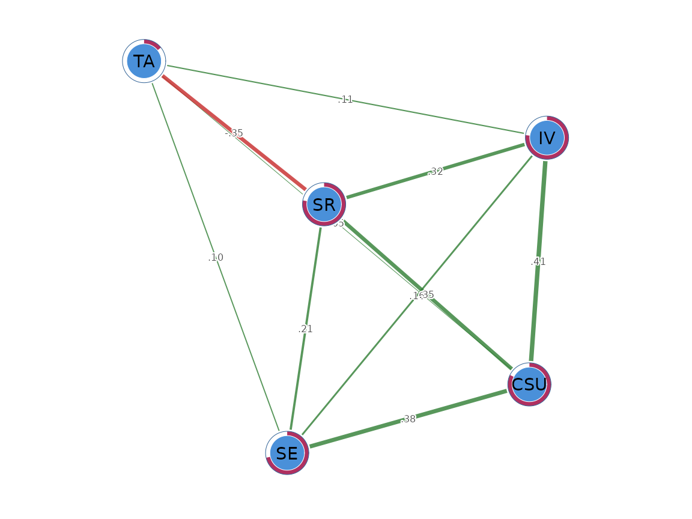

# Gaussian graphical models: estimation and interpretation

Constructs measured by self-report questionnaires, such as motivation,
self-efficacy, strategy use and anxiety, are correlated with one
another, and a correlation matrix cannot separate the associations that
are direct from those that run through other constructs. Motivation and
achievement may correlate because both depend on effort and prior
achievement rather than because of any relation of their own. A Gaussian
graphical model (GGM) addresses this by estimating, for every pair of
variables, the partial correlation that remains after all other
variables in the model are held constant. Pairs whose partial
correlation is indistinguishable from zero are left unconnected, so the
resulting network shows which associations each variable has after the
others have been accounted for (Epskamp & Fried, 2018).

This article estimates a regularized GGM for five self-regulated
learning constructs. It reads the edges, contrasts them with the
ordinary correlations, describes the position of each construct through
centrality and predictability, and examines whether the conclusions
depend on the correlation estimator, on a post-hoc edge threshold, and
on the assumption of normality.

``` r

library(psychnets)
```

## Data

`SRL_GPT` holds 300 sets of responses to the Motivated Strategies for
Learning Questionnaire. Each value is a construct score, the mean of
that construct’s items on a scale from 1 to 7. The responses were
generated by a large language model (GPT) in a study of how such models
answer psychological surveys (Saqr, 2025); they serve here as a
well-structured example and are not evidence about students.

- **Nodes:** five construct scores, each treated as continuous:
  - `CSU`, cognitive strategy use;
  - `IV`, intrinsic value;
  - `SE`, self-efficacy;
  - `SR`, self-regulation;
  - `TA`, test anxiety.
- **Observations:** one row per respondent; the data are complete.

``` r

head(SRL_GPT)
#>        CSU       IV       SE       SR   TA
#> 1 5.307692 5.666667 5.777778 5.333333 4.00
#> 2 5.846154 6.444444 6.000000 5.777778 4.00
#> 3 6.615385 6.666667 6.222222 6.333333 3.25
#> 4 5.692308 6.555556 6.333333 5.555556 4.50
#> 5 4.384615 5.555556 4.888889 4.777778 4.00
#> 6 4.846154 5.444444 5.666667 5.111111 3.50
```

Each score averages several items and takes many distinct values, which
makes the continuous treatment defensible. Item-level ordinal responses
would call for polychoric correlations (`cor_method = "auto"`).

## The model

For variables $`X_1, \ldots, X_p`$ with covariance matrix
$`\boldsymbol\Sigma`$, the precision matrix
$`\mathbf{K} = \boldsymbol\Sigma^{-1}`$ holds the conditional structure.
The partial correlation between $`X_i`$ and $`X_j`$ given all other
variables is

``` math
\rho_{ij \cdot \mathrm{rest}} = -\frac{K_{ij}}{\sqrt{K_{ii}K_{jj}}},
```

and under multivariate normality $`K_{ij} = 0`$ means that $`X_i`$ and
$`X_j`$ are independent once the remaining variables are known. An edge
in the network is a non-zero partial correlation.

In a sample, every partial correlation differs from zero by chance. The
graphical lasso (Friedman et al., 2008) estimates the precision matrix
with a penalty on the absolute size of its off-diagonal entries,

``` math
\widehat{\mathbf{K}} = \underset{\mathbf{K} \succ 0}{\operatorname{argmin}}
\left\{ \operatorname{tr}(\mathbf{S}\mathbf{K}) - \log\det(\mathbf{K})
+ \lambda \sum_{i \ne j}|K_{ij}| \right\},
```

where $`\mathbf{S}`$ is the sample correlation matrix and $`\lambda`$
sets how strongly small entries are pulled to exactly zero. The penalty
$`\lambda`$ is chosen from a path of candidate values by the extended
Bayesian information criterion (EBIC; Foygel & Drton, 2010),

``` math
\operatorname{EBIC}_{\gamma} = -2\ell(\widehat{\mathbf{K}}) + E\log n
+ 4E\gamma\log p,
```

where $`\ell`$ is the Gaussian log-likelihood, $`E`$ the number of
edges, $`n`$ the sample size and $`p`$ the number of nodes. The
hyperparameter $`\gamma`$ (0.5 by default) adds a penalty for model
complexity beyond BIC; larger values favour sparser networks.

## Which constructs are directly associated?

[`psychnet()`](https://pak.dynasite.org/psychnets/reference/psychnet.md)
with `method = "glasso"` estimates the EBIC graphical lasso. The
defaults are Pearson correlations, pairwise-complete handling of missing
values and $`\gamma = 0.5`$.

``` r

net <- psychnet(data = SRL_GPT, method = "glasso")
summary(net)
#> <psychnet> glasso network
#>   nodes: 5   edges: 10   (undirected)
#>   lambda: 0.00861   gamma: 0.5
#>   optimality (KKT residual): 2.21e-10
#>   edge weight: range [-0.350, 0.412], mean 0.174
```

The selected penalty is $`\lambda = 0.00861`$, and at this penalty all
10 possible pairs keep an edge. The edge weights range from -0.350 to
0.412. The edge table lists every pair with its partial correlation:

``` r

as.data.frame(net)
#>    from to      weight
#> 1   CSU IV  0.41166866
#> 2   CSU SE  0.38290223
#> 3    IV SE  0.15992605
#> 4   CSU SR  0.35481359
#> 5    IV SR  0.31909443
#> 6    SE SR  0.20767208
#> 7   CSU TA  0.04906668
#> 8    IV TA  0.11058735
#> 9    SE TA  0.09871818
#> 10   SR TA -0.34985157
```

The four learning constructs form a positively connected cluster. The
strongest edge joins cognitive strategy use and intrinsic value (0.412),
followed by cognitive strategy use with self-efficacy (0.383) and with
self-regulation (0.355): respondents with higher strategy use report
higher values on these constructs even when the other three variables
are equal. Self-regulation and test anxiety are joined by the only
negative edge (-0.350): at equal levels of the other constructs, higher
self-regulation goes with lower test anxiety. The remaining edges of
test anxiety are small and positive, with `CSU` (0.049), `SE` (0.099)
and `IV` (0.111), too small to carry a substantive interpretation on
their own.

## How do partial correlations differ from correlations?

The marginal correlation network, `method = "cor"`, contains the same
pairs without any adjustment and shows what the GGM has removed.

``` r

as.data.frame(psychnet(data = SRL_GPT, method = "cor"))
#>    from to      weight
#> 1   CSU IV  0.86099753
#> 2   CSU SE  0.83458495
#> 3    IV SE  0.78460033
#> 4   CSU SR  0.84743518
#> 5    IV SR  0.82163456
#> 6    SE SR  0.77913881
#> 7   CSU TA -0.13851086
#> 8    IV TA -0.11372136
#> 9    SE TA -0.09672104
#> 10   SR TA -0.30196344
```

The learning constructs correlate between 0.779 and 0.861, two to five
times the size of their partial correlations: much of each pairwise
association is shared with the other constructs. Test anxiety correlates
negatively with all four learning constructs (-0.097 to -0.302), yet
three of its partial correlations are positive. Once self-regulation is
held constant, the negative association of test anxiety with the
learning constructs is carried by self-regulation alone. A correlation
network would have attributed it to every construct.

## Is the fitted network the optimum of its objective?

The graphical lasso is solved iteratively, so a fitted network is an
approximation to the minimum of the objective above. Any solution must
satisfy the problem’s optimality (Karush–Kuhn–Tucker) conditions; the
amount by which a fitted network violates them is its certificate, and a
value near zero shows that the network is the optimum of its objective.
[`certificate()`](https://pak.dynasite.org/psychnets/reference/certificate.md)
reports it, with `certified = TRUE` when it is below $`10^{-6}`$.

``` r

certificate(net)
#>   method  certificate kind certified
#> 1 glasso 2.213389e-10  kkt      TRUE
```

The violation is $`2.21 \times 10^{-10}`$, so the reported edges are the
graphical-lasso solution for this penalty and not an artefact of an
unfinished optimization. The certificate concerns the computation only;
it says nothing about sampling uncertainty or about whether the model’s
assumptions hold.

## Which constructs are most connected?

[`net_centralities()`](https://pak.dynasite.org/psychnets/reference/net_centralities.md)
summarizes each node’s edges. Strength is the sum of absolute edge
weights; expected influence is the signed sum, in which negative edges
offset positive ones (Robinaugh et al., 2016).

``` r

net_centralities(net)
#>   node  strength expected_influence
#> 1  CSU 1.1984512         1.19845117
#> 2   IV 1.0012765         1.00127649
#> 3   SE 0.8492185         0.84921854
#> 4   SR 1.2314317         0.53172852
#> 5   TA 0.6082238        -0.09147935
```

Self-regulation has the largest strength (1.231), followed by cognitive
strategy use (1.198). Their expected influences differ: cognitive
strategy use has only positive edges, so its expected influence equals
its strength, while the negative edge of self-regulation with test
anxiety lowers its expected influence to 0.532. Test anxiety has the
smallest strength (0.608) and a slightly negative expected influence
(-0.091). Self-regulation is therefore the construct most strongly tied
to the others, and also the one through which test anxiety connects to
the network. Centrality describes the estimated graph; it does not
identify causes or intervention targets.

## How well is each construct predicted by the others?

Predictability is the proportion of a node’s variance explained by its
neighbours, $`R^2`$ (Haslbeck & Waldorp, 2018). For a GGM it follows
from the precision matrix, $`R_j^2 = 1 - 1/(K_{jj}S_{jj})`$, so
[`net_predict()`](https://pak.dynasite.org/psychnets/reference/net_predict.md)
needs no further data.

``` r

net_predict(net)
#>   node     type metric predictability accuracy
#> 1  CSU gaussian     R2      0.8217840       NA
#> 2   IV gaussian     R2      0.7690346       NA
#> 3   SE gaussian     R2      0.7142811       NA
#> 4   SR gaussian     R2      0.7786477       NA
#> 5   TA gaussian     R2      0.1421163       NA
```

The other four constructs explain 82% of the variance in cognitive
strategy use ($`R^2 = 0.822`$), 78% in self-regulation, 77% in intrinsic
value and 71% in self-efficacy, but only 14% in test anxiety
($`R^2 = 0.142`$). Test anxiety is largely independent of the learning
constructs, which matches its weak edges. These are in-sample values;
prediction of new respondents would need a separate validation sample.

## What does the network look like?

[`cograph::splot()`](https://sonsoles.me/cograph/reference/splot.html)
draws the fitted network. With `psych_styling = TRUE`, positive edges
are green, negative edges red, edge width follows the absolute weight,
and the ring around each node shows its predictability.

``` r

cograph::splot(net, psych_styling = TRUE)
```



The figure shows the dense positive cluster of the learning constructs
and the single negative edge to test anxiety. Node positions come from a
layout algorithm, and the distance between two nodes carries no
statistical meaning.

## Do the conclusions depend on the correlation estimator?

Spearman correlations use ranks and are less affected by skewed
distributions and extreme values. Refitting with
`cor_method = "spearman"` tests whether the structure depends on the
Pearson estimator.

``` r

spearman_net <- psychnet(data = SRL_GPT, method = "glasso",
                         cor_method = "spearman")
summary(spearman_net)
#> <psychnet> glasso network
#>   nodes: 5   edges: 9   (undirected)
#>   lambda: 0.01882   gamma: 0.5
#>   optimality (KKT residual): 2.67e-10
#>   edge weight: range [-0.237, 0.424], mean 0.192
as.data.frame(spearman_net)
#>   from to      weight
#> 1  CSU IV  0.41037571
#> 2  CSU SE  0.42434529
#> 3   IV SE  0.12821527
#> 4  CSU SR  0.32164519
#> 5   IV SR  0.34602908
#> 6   SE SR  0.18400655
#> 7   IV TA  0.07280225
#> 8   SE TA  0.07509761
#> 9   SR TA -0.23654039
```

The rank-based model selects a larger penalty ($`\lambda = 0.01882`$)
and keeps 9 edges. The positive cluster of learning constructs and the
negative self-regulation–test anxiety edge remain; the latter weakens
from -0.350 to -0.237. The weakest Pearson edge, `CSU`–`TA` (0.049), is
absent. The main structure does not depend on the correlation estimator,
whereas the weak edges of test anxiety do.

## What does a post-hoc threshold change?

A threshold removes every edge whose absolute weight falls below a
chosen value after estimation. It is a reporting decision, to be fixed
before the results are seen, and not part of model selection.

``` r

threshold_net <- psychnet(data = SRL_GPT, method = "glasso", threshold = 0.1)
threshold_net
#> <psychnet> glasso network
#>   nodes: 5   edges: 8   (undirected)
#>   lambda: 0.00861   gamma: 0.5
#>   optimality: unavailable for post-threshold graph  (pre-threshold residual 2.21e-10)
as.data.frame(threshold_net)
#>   from to     weight
#> 1  CSU IV  0.4116687
#> 2  CSU SE  0.3829022
#> 3   IV SE  0.1599260
#> 4  CSU SR  0.3548136
#> 5   IV SR  0.3190944
#> 6   SE SR  0.2076721
#> 7   IV TA  0.1105874
#> 8   SR TA -0.3498516
```

With a threshold of 0.1 the network keeps 8 edges; the `CSU`–`TA`
(0.049) and `SE`–`TA` (0.099) edges are removed, and the penalty is
unchanged. The thresholded network is no longer the solution of the
graphical-lasso objective, so the printout reports optimality as
unavailable and quotes the residual before thresholding
($`2.21 \times 10^{-10}`$), and `certificate(threshold_net)` returns
`NA`. A thresholded network must be reported as such, not as the EBIC
selection.

## Do the conclusions depend on normality?

The GGM’s conditional-independence interpretation rests on multivariate
normality. The nonparanormal model (Liu et al., 2009) relaxes it: each
variable is mapped to normal scores through its ranks, and the same EBIC
graphical lasso is fitted to the transformed data. `method = "huge"`
fits this model.

``` r

npn_net <- psychnet(data = SRL_GPT, method = "huge")
summary(npn_net)
#> <psychnet> huge network
#>   nodes: 5   edges: 10   (undirected)
#>   lambda: 0.008559   gamma: 0.5
#>   optimality (KKT residual): 2.47e-10
#>   edge weight: range [-0.343, 0.426], mean 0.172
as.data.frame(npn_net)
#>    from to      weight
#> 1   CSU IV  0.42556520
#> 2   CSU SE  0.40615961
#> 3    IV SE  0.12908167
#> 4   CSU SR  0.34672549
#> 5    IV SR  0.31792725
#> 6    SE SR  0.19589994
#> 7   CSU TA  0.02390372
#> 8    IV TA  0.12511890
#> 9    SE TA  0.09634264
#> 10   SR TA -0.34267471
certificate(npn_net)
#>   method  certificate kind certified
#> 1   huge 2.471392e-10  kkt      TRUE
```

The nonparanormal network keeps all 10 edges with weights from -0.343 to
0.426, and its certificate ($`2.47 \times 10^{-10}`$) shows that it is
the optimum of its objective. The positive learning cluster and the
negative self-regulation–test anxiety edge are unchanged in sign and
close in size. The `CSU`–`TA` edge halves from 0.049 to 0.024, which
again marks it as the least stable edge in the network. Departures from
normality do not drive the main conclusions.

## Reporting the analysis

A report states the variables and their measurement scale, the sample
size, the correlation estimator, the treatment of missing data, the
estimator and the value of $`\gamma`$, and any threshold. The edges are
reported as partial correlations, with centrality and predictability
defined before they are interpreted.

In this analysis, an EBIC graphical lasso ($`\gamma = 0.5`$) on Pearson
correlations of 300 complete responses selected $`\lambda = 0.00861`$
and kept all 10 edges. The largest positive partial correlation joined
cognitive strategy use and intrinsic value (0.412) and the only negative
one joined self-regulation and test anxiety (-0.350). Rank-based and
nonparanormal fits preserved this structure and changed only the weak
edges of test anxiety.

## Assumptions and when to use the GGM

- The variables are continuous, or ordinal with enough categories to be
  treated as continuous; otherwise use polychoric correlations
  (`cor_method = "auto"`), the Ising model for binary data, or a mixed
  graphical model when continuous and binary variables are combined.
- The joint distribution is approximately multivariate normal; the
  nonparanormal model is the sensitivity check when it is not.
- Observations are independent. Repeated measures of the same persons
  call for a model that separates within- and between-person variation,
  such as the panel graphical VAR.
- The regularized GGM suits analyses where a sparse, readable network is
  the goal. When the sample is large relative to the number of variables
  and unshrunk partial correlations are wanted, the stepwise model
  selection of `method = "ggm"` is the alternative.
- An edge is a conditional association, not a causal effect, and a
  missing edge shows that the data do not support a unique association,
  not that the two variables are unrelated.

## Mathematical details

### Optimality conditions

Write $`\mathbf{W} = \widehat{\mathbf{K}}^{-1}`$. At the minimum of the
graphical-lasso objective the diagonal satisfies $`W_{ii} = S_{ii}`$,
and for the off-diagonal entries

``` math
W_{ij} - S_{ij} = \lambda\,\operatorname{sign}(\widehat{K}_{ij})
\quad \text{if } \widehat{K}_{ij} \ne 0, \qquad
|W_{ij} - S_{ij}| \leq \lambda \quad \text{if } \widehat{K}_{ij} = 0.
```

[`certificate()`](https://pak.dynasite.org/psychnets/reference/certificate.md)
returns the largest violation of these conditions. Because the objective
is strictly convex, its minimum is unique, and a violation near zero
identifies it without reference to any other software.

### Selection of the penalty

The path holds candidate values of $`\lambda`$ on a logarithmic grid.
Each is fitted, the EBIC is computed, and the value with the smallest
EBIC is refitted at a tighter numerical tolerance before it is returned.

### Predictability

The residual variance of node $`j`$ given all other nodes is
$`1/K_{jj}`$. With marginal variance $`S_{jj}`$, the explained
proportion is

``` math
R_j^2 = 1 - \frac{1}{K_{jj}S_{jj}}.
```

## References

Epskamp, S., & Fried, E. I. (2018). A tutorial on regularized partial
correlation networks. *Psychological Methods*, 23(4), 617-634.
[doi:10.1037/met0000167](https://doi.org/10.1037/met0000167)

Foygel, R., & Drton, M. (2010). Extended Bayesian information criteria
for Gaussian graphical models. *Advances in Neural Information
Processing Systems*, 23, 604-612.

Friedman, J., Hastie, T., & Tibshirani, R. (2008). Sparse inverse
covariance estimation with the graphical lasso. *Biostatistics*, 9(3),
432-441.
[doi:10.1093/biostatistics/kxm045](https://doi.org/10.1093/biostatistics/kxm045)

Haslbeck, J. M. B., & Waldorp, L. J. (2018). How well do network models
predict observations? On the importance of predictability in network
models. *Behavior Research Methods*, 50(2), 853-861.
[doi:10.3758/s13428-017-0910-x](https://doi.org/10.3758/s13428-017-0910-x)

Liu, H., Lafferty, J., & Wasserman, L. (2009). The nonparanormal:
Semiparametric estimation of high dimensional undirected graphs.
*Journal of Machine Learning Research*, 10, 2295-2328.

Robinaugh, D. J., Millner, A. J., & McNally, R. J. (2016). Identifying
highly influential nodes in the complicated grief network. *Journal of
Abnormal Psychology*, 125(6), 747-757.
[doi:10.1037/abn0000181](https://doi.org/10.1037/abn0000181)

Saqr, M. (2025). Delving into the psychology of machines: Exploring the
structure of self-regulated learning via LLM-generated survey responses.
*Computers in Human Behavior*, 173, 108769.
[doi:10.1016/j.chb.2025.108769](https://doi.org/10.1016/j.chb.2025.108769)
