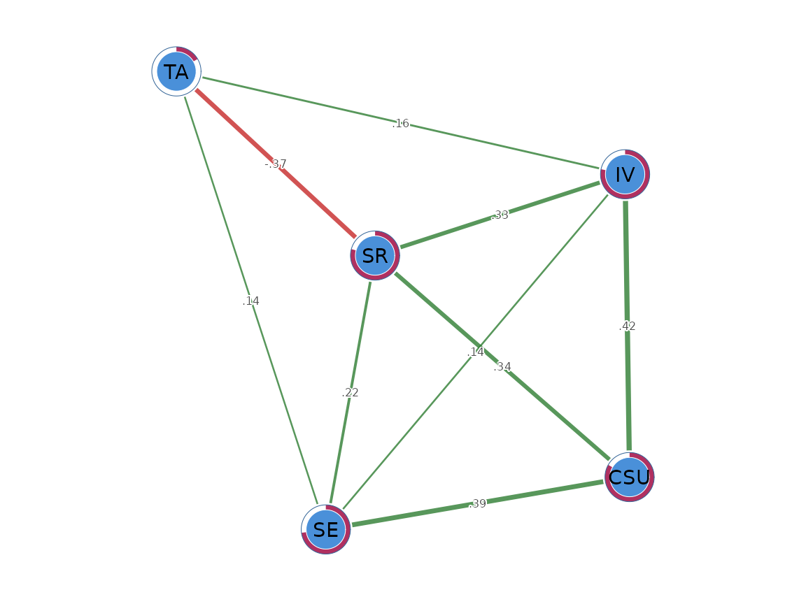

# Stepwise Gaussian graphical model selection with the psychnets R package

Which links between psychological constructs should remain in a model
after the other measured variables have been considered? Stepwise
Gaussian graphical model selection addresses the task of identifying a
set of conditional associations rather than displaying every pairwise
correlation. In a Gaussian graphical model (GGM), constructs appear as
nodes and edges indicate partial correlations between two variables
after adjustment for the rest of the network. The resulting pattern can
describe how related psychological characteristics are organised,
although selecting an edge does not establish a causal relationship
(Epskamp et al., 2018; Saqr et al., 2024).

Selecting the edges is an important part of estimating a GGM. A widely
used approach, the graphical lasso, applies a penalty to estimate a
sparse network, but it also shrinks retained partial correlations
towards zero (Epskamp & Fried, 2018). This can complicate the
interpretation of edge magnitudes. Stepwise model selection offers an
alternative: it compares candidate graphs using an information criterion
and then estimates the edges of the selected graph by unpenalised
maximum likelihood (Williams et al., 2019). The extended Bayesian
information criterion provides a way to balance model fit and complexity
(Foygel & Drton, 2010). Neither approach is preferable in every setting;
sample size, network dimension and the purpose of the analysis should
inform the choice of estimator (Isvoranu & Epskamp, 2023; Williams &
Rast, 2020).

In education, psychological networks have been used to investigate
relationships among learning strategies, motivation and the regulation
of learning. Network approaches can represent the interdependence of
learning-related processes without treating every association as a
direct effect. For example, Saqr et al. (2021) examined the relational
and temporal dynamics of self-regulation in academic writing, while
Malmberg et al. (2022) analysed how students’ monitoring events were
associated with phases of regulation. These applications illustrate the
value of considering several interconnected processes, alongside the
need to distinguish descriptive associations from explanations of how
learning occurs.

This article demonstrates stepwise GGM selection with `psychnets` using
five self-regulated learning constructs from a dataset of
language-model-generated questionnaire responses (Vogelsmeier et al.,
2025). It explains the selection criterion, fits and interprets the
resulting network, verifies the numerical solution, and compares the
selected edges with those from the graphical lasso. It also examines
node centrality and predictability and repeats the analysis using
rank-based correlations. The example is intended to guide applied
researchers through estimation and interpretation, not to draw
conclusions about actual students.

``` r

library(psychnets)
```

## The model

A GGM describes conditional associations among continuous variables.
Under multivariate normality, the precision matrix
$`\mathbf{K} = \boldsymbol\Sigma^{-1}`$ is the inverse of the covariance
matrix. An edge between $`X_i`$ and $`X_j`$ corresponds to a non-zero
partial correlation

``` math
\rho_{ij \cdot \mathrm{rest}} = -\frac{K_{ij}}{\sqrt{K_{ii}K_{jj}}}.
```

The procedure compares candidate graphs using the extended Bayesian
information criterion (EBIC),

``` math
\operatorname{EBIC}_{\gamma} = -2\ell(\widehat{\mathbf{K}}) + E\log n
+ 4E\gamma\log p,
```

Here, $`\ell`$ is the log-likelihood after refitting the graph without a
penalty, $`E`$ is its number of edges, $`n`$ is the sample size and
$`p`$ is the number of nodes. The parameter $`\gamma`$ controls the
additional penalty for model complexity; the default $`\gamma = 0`$
gives the ordinary Bayesian information criterion (BIC). Lower scores
indicate a better balance of fit and complexity.

The search has two stages. First, a graphical-lasso path provides
candidate graphs, from which the lowest-scoring graph is selected after
each candidate has been refitted by maximum likelihood. Next, the
algorithm considers adding or removing a single edge and accepts changes
that reduce the criterion. It stops when neither type of single-edge
change improves the score. The selected network is therefore a local
optimum, not necessarily the best graph among all possible graphs.

## Data

`SRL_GPT` contains 300 sets of questionnaire responses summarised as
construct scores on a scale from 1 to 7. The scores relate to the
Motivated Strategies for Learning Questionnaire. They were generated by
a large language model (GPT) as part of a study of how these models
respond to psychological surveys (Vogelsmeier et al., 2025). They
provide an example for demonstrating the method, but they are not
observations of students and should not be interpreted as evidence about
student learning.

- **Nodes:** five construct scores, treated as continuous: `CSU`
  (cognitive strategy use), `IV` (intrinsic value), `SE`
  (self-efficacy), `SR` (self-regulation) and `TA` (test anxiety).
- **Observations:** one row per generated response set; the data are
  complete.

``` r

head(SRL_GPT)
#>        CSU       IV       SE       SR   TA
#> 1 5.307692 5.666667 5.777778 5.333333 4.00
#> 2 5.846154 6.444444 6.000000 5.777778 4.00
#> 3 6.615385 6.666667 6.222222 6.333333 3.25
#> 4 5.692308 6.555556 6.333333 5.555556 4.50
#> 5 4.384615 5.555556 4.888889 4.777778 4.00
#> 6 4.846154 5.444444 5.666667 5.111111 3.50
```

There are 300 observations for five variables. This relatively
favourable ratio of observations to variables makes the example suitable
for illustrating unpenalised estimation, although adequate sample size
alone does not establish that a selected network is stable.

## Which constructs are directly associated?

The call to
[`psychnet()`](https://pak.dynasite.org/psychnets/reference/psychnet.md)
with `method = "ggm"` selects a GGM by the stepwise procedure. The
summary reports the number of nodes and retained edges, together with a
numerical optimality check and the range of estimated edge weights.

``` r

stepwise_net <- psychnet(data = SRL_GPT, method = "ggm")
summary(stepwise_net)
#> <psychnet> ggm network
#>   nodes: 5   edges: 9   (undirected)
#>   optimality (KKT residual): 7.77e-16
#>   edge weight: range [-0.370, 0.422], mean 0.196
```

The selected graph retains 9 of the 10 possible edges. Its estimated
partial correlations range from -0.370 to 0.422. The following table
identifies the connected pairs and their unpenalised edge weights:

``` r

as.data.frame(stepwise_net)
#>   from to     weight
#> 1  CSU IV  0.4215770
#> 2  CSU SE  0.3921754
#> 3   IV SE  0.1416604
#> 4  CSU SR  0.3385710
#> 5   IV SR  0.3333520
#> 6   SE SR  0.2173406
#> 7   IV TA  0.1565223
#> 8   SE TA  0.1368928
#> 9   SR TA -0.3699703
```

The four learning-related constructs are connected by positive edges.
The largest positive partial correlation is between cognitive strategy
use and intrinsic value (0.422), followed by cognitive strategy use and
self-efficacy (0.392). These are conditional associations after
accounting for the other constructs, rather than estimates of the
effects of one construct on another. The only negative edge connects
self-regulation and test anxiety (-0.370). Test anxiety also has smaller
positive edges with intrinsic value (0.157) and self-efficacy (0.137).
The `CSU`–`TA` edge is absent. Under the selected graph, its partial
correlation is constrained to zero, although this does not establish
that the constructs are unrelated in the population.

## Is the refitted network the maximum-likelihood solution?

Once the graph has been selected, its retained edges are estimated by
maximum likelihood, with the absent edges constrained to zero. The
Karush–Kuhn–Tucker optimality conditions provide a numerical check of
this fit. In particular, the fitted covariance must match the observed
covariance in the positions corresponding to the diagonal and retained
edges, while the precision matrix must have zeros for absent edges. The
certificate summarises the extent to which these conditions are
violated; a value close to zero indicates that the fitted parameters
satisfy the optimisation conditions for the selected graph.

``` r

certificate(stepwise_net)
#>   method  certificate kind certified
#> 1    ggm 7.771561e-16  kkt      TRUE
```

The certificate is approximately $`4.44 \times 10^{-16}`$, below
$`10^{-14}`$, and the fit is marked as certified. This provides strong
numerical evidence that the reported parameters solve the
maximum-likelihood problem for the selected graph. It does not show that
the graph itself is the correct model or that its estimated edges would
be stable in another sample.

## How does the selection differ from the graphical lasso?

For comparison, `method = "glasso"` fits a penalised GGM to the same
data. This makes it possible to inspect differences in the selected
edges and their estimated magnitudes.

``` r

glasso_net <- psychnet(data = SRL_GPT, method = "glasso")
summary(glasso_net)
#> <psychnet> glasso network
#>   nodes: 5   edges: 10   (undirected)
#>   lambda: 0.00861   gamma: 0.5
#>   optimality (KKT residual): 2.21e-10
#>   edge weight: range [-0.350, 0.412], mean 0.174
as.data.frame(glasso_net)
#>    from to      weight
#> 1   CSU IV  0.41166866
#> 2   CSU SE  0.38290223
#> 3    IV SE  0.15992605
#> 4   CSU SR  0.35481359
#> 5    IV SR  0.31909443
#> 6    SE SR  0.20767208
#> 7   CSU TA  0.04906668
#> 8    IV TA  0.11058735
#> 9    SE TA  0.09871818
#> 10   SR TA -0.34985157
```

The graphical lasso retains all 10 possible edges, including a small
`CSU`–`TA` partial correlation (0.049) that is absent from the stepwise
graph. Of the nine edges shared by the methods, seven have larger
absolute weights under stepwise selection. For example, `CSU`–`IV` is
0.422 in the stepwise network and 0.412 in the graphical-lasso network,
while `SR`–`TA` is -0.370 and -0.350, respectively. Two shared edges are
instead larger in absolute value under the graphical lasso, so the
comparison should not be read as a uniform difference in every estimate.
Both methods identify broadly similar patterns in these data, but they
differ in edge inclusion and magnitude. Unpenalised refitting can be
useful when edge sizes are of primary interest, provided the sample
supports it; penalisation may be preferable when estimation would
otherwise be unstable.

## Which constructs are most connected?

[`net_centralities()`](https://pak.dynasite.org/psychnets/reference/net_centralities.md)
summarises how each node is connected to the remaining network. Strength
is the sum of the absolute weights of its incident edges, whereas
expected influence retains the signs when summing those weights.

``` r

net_centralities(stepwise_net)
#>   node  strength expected_influence
#> 1  CSU 1.1523235         1.15232352
#> 2   IV 1.0531117         1.05311170
#> 3   SE 0.8880693         0.88806926
#> 4   SR 1.2592340         0.51929333
#> 5   TA 0.6633854        -0.07655525
```

Self-regulation has the greatest strength (1.259), followed by cognitive
strategy use (1.152). Because self-regulation has a negative edge with
test anxiety, its expected influence is lower (0.519). By contrast, all
edges incident to cognitive strategy use are positive, so its strength
and expected influence are both 1.152. Test anxiety has the lowest
strength (0.663) and a slightly negative expected influence (-0.077).
These measures describe connections in the fitted network. They should
not be interpreted as evidence that a highly connected construct causes
changes elsewhere or is necessarily the best target for intervention.

## How well is each construct predicted by the others?

[`net_predict()`](https://pak.dynasite.org/psychnets/reference/net_predict.md)
reports the predictability of each node as $`R^2`$, the proportion of
its variance accounted for by the other nodes in the fitted model. For a
GGM, it is calculated from the precision matrix as
$`R_j^2 = 1 - 1/(K_{jj}S_{jj})`$.

``` r

net_predict(stepwise_net)
#>   node     type metric predictability accuracy
#> 1  CSU gaussian     R2      0.8327378       NA
#> 2   IV gaussian     R2      0.7831430       NA
#> 3   SE gaussian     R2      0.7279821       NA
#> 4   SR gaussian     R2      0.7920188       NA
#> 5   TA gaussian     R2      0.1656566       NA
```

Predictability is highest for cognitive strategy use ($`R^2 = 0.833`$),
followed by self-regulation ($`R^2 = 0.792`$), intrinsic value
($`R^2 = 0.783`$) and self-efficacy ($`R^2 = 0.728`$). Test anxiety is
much less predictable from the other four constructs ($`R^2 = 0.166`$).
Expressed as percentages, these values correspond to approximately 83%,
79%, 78%, 73% and 17% of the variance, respectively. They describe fit
within the analysed dataset, not predictive accuracy for new
observations. External or cross-validated assessment would be needed to
evaluate out-of-sample prediction.

## What does the network look like?

[`cograph::splot()`](https://sonsoles.me/cograph/reference/splot.html)
provides a visual summary of the fitted network. With these plotting
options, positive and negative edges are distinguished by green and red,
and a ring around each node represents its estimated predictability.

``` r

cograph::splot(stepwise_net, psych_styling = TRUE, predictability = TRUE)
```



The plot highlights the positive connections among the learning
constructs and the negative connection between self-regulation and test
anxiety. The comparatively small predictability ring around test anxiety
is consistent with its lower $`R^2`$. Node positions are determined by
the plotting layout and should not be interpreted as measured distances
between constructs.

## Does the selection depend on the correlation estimator?

As a sensitivity check, `cor_method = "spearman"` repeats the selection
using rank correlations rather than Pearson correlations. Rank
correlations are generally less sensitive to extreme values and
non-normal marginal distributions, although they do not remove all
modelling assumptions.

``` r

spearman_net <- psychnet(data = SRL_GPT, method = "ggm",
                         cor_method = "spearman")
summary(spearman_net)
#> <psychnet> ggm network
#>   nodes: 5   edges: 7   (undirected)
#>   optimality (KKT residual): 8.88e-16
#>   edge weight: range [-0.266, 0.483], mean 0.245
as.data.frame(spearman_net)
#>   from to     weight
#> 1  CSU IV  0.4626441
#> 2  CSU SE  0.4832486
#> 3  CSU SR  0.2856316
#> 4   IV SR  0.3865529
#> 5   SE SR  0.1948044
#> 6   IV TA  0.1652304
#> 7   SR TA -0.2664620
certificate(spearman_net)
#>   method  certificate kind certified
#> 1    ggm 8.881784e-16  kkt      TRUE
```

The rank-based model retains 7 edges, compared with 9 in the
Pearson-based model. It keeps five positive edges among the learning
constructs, the positive `IV`–`TA` edge and the negative `SR`–`TA` edge
(-0.266). The `IV`–`SE` and `SE`–`TA` edges selected using Pearson
correlations are no longer retained. Its certificate is approximately
$`1.11 \times 10^{-15}`$, again indicating a numerically satisfactory
fit. The main pattern of positive connections among learning constructs
and a negative association between self-regulation and test anxiety is
present in both networks, but inclusion of the weaker edges depends on
the correlation estimator.

## Reporting the analysis

A report of stepwise GGM selection should identify the variables and
sample size, explain how missing data were handled, and specify the
correlation estimator and selection criterion, including $`\gamma`$. It
should also make clear that retained edges are unpenalised
maximum-likelihood partial correlations conditional on the selected
graph. Information about sensitivity and uncertainty is important when
interpreting the model.

In this example, stepwise GGM selection using Pearson correlations and
BIC ($`\gamma = 0`$) retained 9 of 10 possible edges from 300 complete,
model-generated response sets. The largest positive partial correlation
was between cognitive strategy use and intrinsic value (0.422), and the
sole negative edge was between self-regulation and test anxiety
(-0.370). Repeating the selection with Spearman correlations retained 7
edges, preserving these broad patterns but excluding two weaker
connections.

## Assumptions and when to use stepwise selection

- A standard GGM assumes continuous variables, approximate multivariate
  normality and independent observations. Researchers should consider
  whether these assumptions are reasonable for their measures and
  sampling design.
- Unpenalised estimates require sufficient information relative to the
  number of variables and possible edges. When observations are scarce
  relative to model complexity, penalised methods may provide more
  stable estimates.
- Stepwise selection separates graph selection from estimation of edge
  magnitudes. The retained edges are not penalised, but they remain
  subject to sampling uncertainty and possible selection error. This is
  not a guarantee of unbiased estimates after model selection.
- The stepwise search reaches a local optimum. Different correlation
  estimators, values of $`\gamma`$ or samples may lead to different
  graphs. Resampling and sensitivity analyses can help assess robustness
  (see the network reliability article).

## How to cite this article

Saqr, M., & López-Pernas, S. (2026). *Stepwise Gaussian graphical model
selection with the psychnets R package*. psychnets.
<https://doi.org/10.5281/zenodo.24569495> ·
[HTML](https://pak.dynasite.org/psychnets/articles/ggm-model-selection.html)
· [PDF](https://pak.dynasite.org/psychnets/pdf/ggm-model-selection.pdf)

## References

Epskamp, S., Borsboom, D., & Fried, E. I. (2018). Estimating
psychological networks and their accuracy: A tutorial paper. *Behavior
Research Methods*, 50(1), 195-212.
[doi:10.3758/s13428-017-0862-1](https://doi.org/10.3758/s13428-017-0862-1)

Epskamp, S., & Fried, E. I. (2018). A tutorial on regularized partial
correlation networks. *Psychological Methods*, 23(4), 617-634.
[doi:10.1037/met0000167](https://doi.org/10.1037/met0000167)

Foygel, R., & Drton, M. (2010). Extended Bayesian information criteria
for Gaussian graphical models. *Advances in Neural Information
Processing Systems*, 23, 604-612.

Isvoranu, A.-M., & Epskamp, S. (2023). Which estimation method to choose
in network psychometrics? Deriving guidelines for applied researchers.
*Psychological Methods*, 28(4), 925-946.
[doi:10.1037/met0000439](https://doi.org/10.1037/met0000439)

Malmberg, J., Saqr, M., Järvenoja, H., & Järvelä, S. (2022). How the
monitoring events of individual students are associated with phases of
regulation: A network analysis approach. *Journal of Learning
Analytics*, 9(1), 77-92.
[doi:10.18608/jla.2022.7429](https://doi.org/10.18608/jla.2022.7429)

Saqr, M., Beck, E., & López-Pernas, S. (2024). Psychological networks: A
modern approach to analysis of learning and complex learning processes.
In M. Saqr & S. López-Pernas (Eds.), *Learning analytics methods and
tutorials: A practical guide using R* (pp. 639-671). Springer.
[doi:10.1007/978-3-031-54464-4_19](https://doi.org/10.1007/978-3-031-54464-4_19)

Saqr, M., Peeters, W., & Viberg, O. (2021). The relational, co-temporal,
contemporaneous, and longitudinal dynamics of self-regulation for
academic writing. *Research and Practice in Technology Enhanced
Learning*, 16, 29.
[doi:10.1186/s41039-021-00175-7](https://doi.org/10.1186/s41039-021-00175-7)

Vogelsmeier, L. V. D. E., Oliveira, E., Misiejuk, K., López-Pernas, S.,
& Saqr, M. (2025). Delving into the psychology of machines: Exploring
the structure of self-regulated learning via LLM-generated survey
responses. *Computers in Human Behavior*, 173, 108769.
[doi:10.1016/j.chb.2025.108769](https://doi.org/10.1016/j.chb.2025.108769)

Williams, D. R., & Rast, P. (2020). Back to the basics: Rethinking
partial correlation network methodology. *British Journal of
Mathematical and Statistical Psychology*, 73(2), 187-212.
[doi:10.1111/bmsp.12173](https://doi.org/10.1111/bmsp.12173)

Williams, D. R., Rhemtulla, M., Wysocki, A. C., & Rast, P. (2019). On
nonregularized estimation of psychological networks. *Multivariate
Behavioral Research*, 54(5), 719-750.
[doi:10.1080/00273171.2019.1575716](https://doi.org/10.1080/00273171.2019.1575716)
