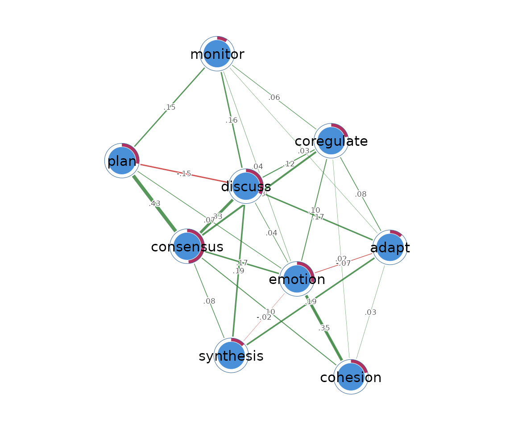
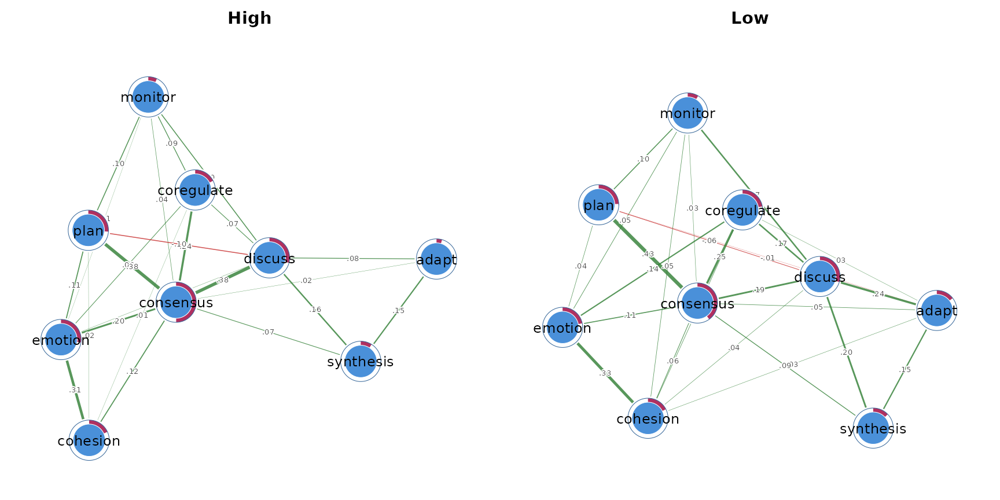

# Networks of regulation actions from event logs

Digital learning environments record what learners do as event logs: who
performed which action and when. In collaborative learning, the actions
include planning, monitoring, discussing and regulating emotions, and a
recurring question is which of these behaviours go together. Students
who plan more may also build more consensus, while those who discuss
more may plan less. Network models answer such questions for variables
measured on the same observations, so an event log is first summarized
into the number of times each actor performed each action. A partial
correlation network of these frequencies shows which actions co-occur
after the frequencies of all other actions are held constant.

What an edge means depends on the unit of observation. When each actor’s
whole history is one observation, the network describes differences
between actors: those who do more of one action also do more of another.
When the history is divided into sessions and each session is compared
with the actor’s own average, the network describes variation within
actors: in sessions where an actor does more of one action than usual,
the actor also does more of another. This article estimates both kinds
of network from a log of group regulation actions, compares the networks
of high and low achievers, and separates the within- and between-actor
parts of the same data.

``` r

library(psychnets)
```

## Data

`group_regulation_long`, from the optional `tna` package, is a synthetic
log of students’ regulation actions during collaborative learning, with
27,533 events from 2,000 students.

- **Actor:** `Actor`, the student identifier.
- **Action:** `Action`, one of nine regulation actions: `adapt`,
  `cohesion`, `consensus`, `coregulate`, `discuss`, `emotion`,
  `monitor`, `plan` and `synthesis`. These are the network nodes.
- **Time:** `Time`, the timestamp of the event, used to divide each
  history into sessions.
- **Grouping:** `Achiever`, high or low achievement, with 1,000 students
  in each.
- **Other columns:** `Group` (collaboration group) and `Course`, not
  used here.

``` r

data("group_regulation_long", package = "tna")
event_log <- data.frame(group_regulation_long)
head(event_log)
#>   Actor Achiever Group Course                Time    Action
#> 1     1     High     1      A 2025-01-01 08:27:07  cohesion
#> 2     1     High     1      A 2025-01-01 08:35:20 consensus
#> 3     1     High     1      A 2025-01-01 08:42:18   discuss
#> 4     1     High     1      A 2025-01-01 08:50:00 synthesis
#> 5     1     High     1      A 2025-01-01 08:52:25     adapt
#> 6     1     High     1      A 2025-01-01 08:57:31 consensus
```

Each row is one event, and the rows of one actor form that actor’s
history.
[`psychnet()`](https://pak.dynasite.org/psychnets/reference/psychnet.md)
recognizes an event log when the `actor` argument names the actor
column; the action column is `Action` by default.

## The model

For actor $`a`$, occasion $`s`$ and action $`j`$, the frequency is the
number of matching events,

``` math
V_{asj} = \sum_e I(A_e = a,\ S_e = s,\ J_e = j).
```

Without sessions, each actor contributes one frequency vector, and the
network is estimated from these between-actor frequencies. With
sessions, each actor contributes several vectors. Subtracting the
actor’s mean, $`V^{W}_{asj} = V_{asj} - \bar V_{a \cdot j}`$, gives the
within-actor deviations, and the actor means $`\bar V_{a \cdot j}`$
carry the between-actor part. Each network is a Gaussian graphical model
estimated by the EBIC graphical lasso, so an edge is a partial
correlation between two action frequencies with the other seven held
constant.

## Which actions co-occur across students?

With `actor = "Actor"`,
[`psychnet()`](https://pak.dynasite.org/psychnets/reference/psychnet.md)
counts each student’s actions and estimates a graphical lasso network of
the counts.

``` r

actor_net <- psychnet(data = event_log, actor = "Actor")
summary(actor_net)
#> <psychnet> glasso network
#>   nodes: 9   edges: 28   (undirected)
#>   lambda: 0.008001   gamma: 0.5
#>   optimality (KKT residual): 3.19e-11
#>   edge weight: range [-0.154, 0.434], mean 0.104
as.data.frame(actor_net)
#>          from         to       weight
#> 1       adapt   cohesion  0.028340228
#> 2    cohesion  consensus  0.104456298
#> 3       adapt coregulate  0.083642924
#> 4    cohesion coregulate  0.024349135
#> 5   consensus coregulate  0.225910826
#> 6       adapt    discuss  0.171392767
#> 7    cohesion    discuss  0.027060667
#> 8   consensus    discuss  0.329359608
#> 9  coregulate    discuss  0.115303519
#> 10      adapt    emotion -0.071536621
#> 11   cohesion    emotion  0.348144853
#> 12  consensus    emotion  0.173584152
#> 13 coregulate    emotion  0.102035538
#> 14    discuss    emotion  0.044301431
#> 15      adapt    monitor  0.027444520
#> 16 coregulate    monitor  0.063156831
#> 17    discuss    monitor  0.157029937
#> 18    emotion    monitor  0.037567027
#> 19  consensus       plan  0.434452415
#> 20 coregulate       plan -0.007036661
#> 21    discuss       plan -0.154478241
#> 22    emotion       plan  0.072573204
#> 23    monitor       plan  0.146170265
#> 24      adapt  synthesis  0.188381634
#> 25  consensus  synthesis  0.079776529
#> 26 coregulate  synthesis  0.007569019
#> 27    discuss  synthesis  0.186580959
#> 28    emotion  synthesis -0.020637713
```

The network has 28 of the 36 possible edges, with partial correlations
from -0.154 to 0.434. The strongest joins `consensus` and `plan`
(0.434): students who plan more also reach consensus more often, at
equal frequencies of the other actions. Consensus is also strongly tied
to `discuss` (0.329) and `coregulate` (0.226), and `cohesion` to
`emotion` (0.348). The strongest negative edge joins `discuss` and
`plan` (-0.154): students who discuss more plan less. Several edges are
close to zero, for example `coregulate`–`plan` (-0.007) and
`coregulate`–`synthesis` (0.008), and carry no substantive weight.
Consensus building is thus the hub of the regulation network, linked to
both planning and discussion.

## Is the fitted network the optimum of its objective?

Any solution of the graphical lasso must satisfy the problem’s
optimality (Karush–Kuhn–Tucker) conditions; the amount by which a fitted
network violates them is its certificate, and a value near zero shows
that the network is the optimum of its objective.

``` r

certificate(actor_net)
#>   method  certificate kind certified
#> 1 glasso 3.188705e-11  kkt      TRUE
```

The violation is $`3.19 \times 10^{-11}`$, so the network is the
graphical-lasso solution at the selected penalty.

## What does the network look like?

[`cograph::splot()`](https://sonsoles.me/cograph/reference/splot.html)
draws the network, with green positive and red negative edges and a ring
showing each action’s predictability.

``` r

cograph::splot(actor_net, psych_styling = TRUE)
```



The figure shows `consensus` at the centre, with its thick edges to
`plan` and `discuss`, and the `cohesion`–`emotion` pair. Node positions
come from a layout algorithm and carry no statistical meaning.

## Do high and low achievers differ?

With `group = "Achiever"`,
[`psychnet()`](https://pak.dynasite.org/psychnets/reference/psychnet.md)
estimates one network per achievement level and returns them together.

``` r

achievement_nets <- psychnet(data = event_log, actor = "Actor",
                             group = "Achiever")
achievement_nets
#> <psychnet_group> 2 networks by Achiever (method: glasso)
#>  group nodes edges    n
#>   High     9    25 1000
#>    Low     9    27 1000
summary(achievement_nets)
#>   group nodes edges mean_abs_weight
#> 1  High     9    25       0.1141111
#> 2   Low     9    27       0.1139959
```

The network of high achievers has 25 edges and that of low achievers 27,
each from 1,000 students. The mean absolute edge weight is 0.114 in
both, so the retained associations are of the same typical size.
Centrality shows where the two networks differ:

``` r

net_centralities(achievement_nets)
#> <psychnet_centrality_group> 2 groups: High, Low
#> 
#> --- High ---
#>         node  strength expected_influence
#> 1      adapt 0.2557087          0.2557087
#> 2   cohesion 0.4572828          0.4572828
#> 3  consensus 1.4481964          1.4481964
#> 4 coregulate 0.4826224          0.4826224
#> 5    discuss 0.9148080          0.7172144
#> 6    emotion 0.7213529          0.7213529
#> 7    monitor 0.3386263          0.3386263
#> 8       plan 0.7092177          0.5116240
#> 9  synthesis 0.3777409          0.3777409
#> 
#> --- Low ---
#>         node  strength expected_influence
#> 1      adapt 0.5044549          0.4798929
#> 2   cohesion 0.5561617          0.5561617
#> 3  consensus 1.2000886          1.2000886
#> 4 coregulate 0.6383543          0.6383543
#> 5    discuss 1.0808622          0.9531748
#> 6    emotion 0.6868285          0.6868285
#> 7    monitor 0.4027815          0.4027815
#> 8       plan 0.6447291          0.4924798
#> 9  synthesis 0.4415186          0.4415186
```

`consensus` has the largest strength in both groups, 1.448 among high
and 1.200 among low achievers. Among low achievers, `discuss` follows
closely (1.081), and `adapt` (0.504 against 0.256) and `coregulate`
(0.638 against 0.483) are more connected than among high achievers. The
networks of high achievers are thus more concentrated on consensus
building. These are descriptive differences between two estimated
networks; a formal test of a difference requires a network comparison
test
([`net_compare()`](https://pak.dynasite.org/psychnets/reference/net_compare.md)).

``` r

cograph::splot(achievement_nets, psych_styling = TRUE)
```



The two panels share one layout, so each action has the same position in
both.

## Which actions co-occur within students?

With `time = "Time"`,
[`psychnet()`](https://pak.dynasite.org/psychnets/reference/psychnet.md)
divides each student’s history into sessions, starting a new session
after a pause longer than `time_threshold` seconds, here five minutes.
The timestamps define the sessions only; no lagged or temporal effect is
estimated. With `standardize = TRUE`, the default, each session’s counts
are centred on the student’s mean, and one network is estimated from the
pooled deviations.

``` r

within_net <- psychnet(data = event_log, actor = "Actor", time = "Time",
                       time_threshold = 300)
summary(within_net)
#> <psychnet> glasso network
#>   nodes: 9   edges: 14   (undirected)
#>   lambda: 0.0288   gamma: 0.5
#>   optimality (KKT residual): 1.30e-12
#>   edge weight: range [-0.074, 0.148], mean 0.042
as.data.frame(within_net)
#>          from         to       weight
#> 1       adapt   cohesion  0.020792318
#> 2    cohesion coregulate  0.004241206
#> 3   consensus coregulate  0.057999059
#> 4       adapt    discuss  0.033506053
#> 5   consensus    discuss  0.058347732
#> 6  coregulate    discuss  0.038807994
#> 7    cohesion    emotion  0.147896226
#> 8  coregulate    monitor  0.004845725
#> 9       adapt       plan -0.015897821
#> 10   cohesion       plan -0.005337637
#> 11  consensus       plan  0.116101114
#> 12    discuss       plan -0.073852486
#> 13      adapt  synthesis  0.089102215
#> 14    discuss  synthesis  0.116874946
certificate(within_net)
#>   method  certificate kind certified
#> 1 glasso 1.296872e-12  kkt      TRUE
```

The within-student network has 14 edges, half as many as the
between-student network, and a larger penalty ($`\lambda = 0.0288`$).
Its strongest edge joins `cohesion` and `emotion` (0.148): in sessions
where a student expresses more cohesion than usual, the student also
expresses more emotion than usual. `discuss`–`synthesis` (0.117) and
`consensus`–`plan` (0.116) follow, and `discuss`–`plan` is again
negative (-0.074). The certificate, $`1.30 \times 10^{-12}`$, shows that
the network is the optimum of its objective. The within-student
associations are weaker than the between-student ones, and only part of
the between-student structure is repeated from session to session.

``` r

cograph::splot(within_net, psych_styling = TRUE)
```


## How do the within- and between-student networks compare?

With `standardize = FALSE`,
[`psychnet()`](https://pak.dynasite.org/psychnets/reference/psychnet.md)
keeps both parts of the session data: the within-student network of the
deviations and the between-student network of the students’ mean session
counts.

``` r

multilevel_nets <- psychnet(data = event_log, actor = "Actor", time = "Time",
                            time_threshold = 300, standardize = FALSE)
multilevel_nets
#> <psychnet_multilevel> glasso networks (within + between)
#>   actors: 2000   occasions: 12305
#>   within : 9 nodes, 14 edges
#>   between: 9 nodes, 24 edges
```

The five-minute rule divides the 2,000 histories into 12,305 sessions.
The within-student network has 14 edges and the between-student network
24. More associations hold between students’ average profiles than
between their session-to-session fluctuations. A plot shows the two
networks side by side.

``` r

cograph::splot(multilevel_nets, psych_styling = TRUE)
```


The decomposition separates the two sources of covariance; it is not a
random-effects model.

## Reporting the analysis

A report names the actor, action and time columns, defines the occasion
and the session rule, states whether the network describes differences
between actors or variation within them, and gives the estimator and its
settings. It also states that sessions defined by timestamps do not make
the network temporal.

In this analysis, 27,533 events from 2,000 students gave a
between-student network of 28 edges, with consensus building as its hub.
High and low achievers had networks of 25 and 27 edges with the same
mean absolute weight. A five-minute session rule gave 12,305 sessions, a
within-student network of 14 edges and a between-student network of 24
edges.

## Assumptions and when to use which network

- The between-actor network (`actor` only) answers how students who
  differ in one action differ in others. It needs one observation per
  student and many students.
- The within-actor network (`time` or `session`, `standardize = TRUE`)
  answers how an actor’s actions vary together from session to session.
  It needs several sessions per actor, and the session rule should be
  fixed in advance and checked for sensitivity.
- `standardize = FALSE` keeps both, which shows whether an association
  is a difference between actors, a variation within them, or both.
- Counts are skewed and the graphical lasso assumes approximate
  normality; the nonparanormal model (`method = "huge"`) is a
  sensitivity check.
- Edges are associations between action frequencies, not between
  individual events, and not causal effects. For the order in which
  actions follow one another, transition network analysis is the
  appropriate model.
