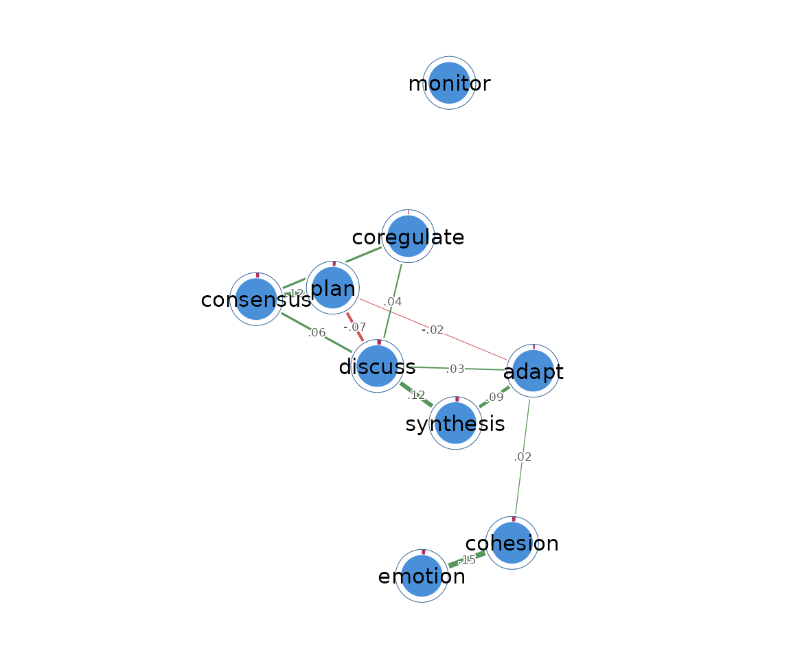
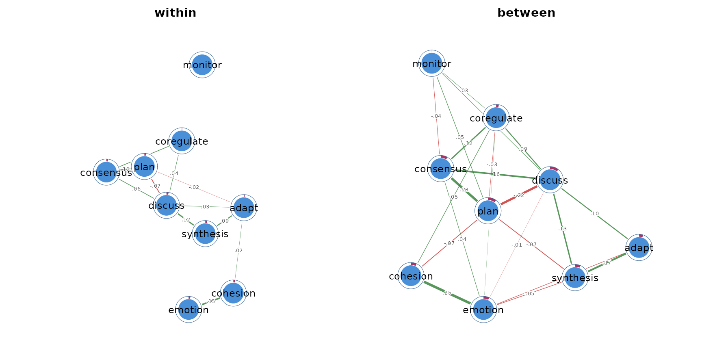

# Networks of regulation actions from event logs with the psychnets R package

Digital learning environments produce event logs that identify the
learner, the action performed and the time of the event. In
collaborative tasks, these records may capture planning, monitoring,
discussion, consensus building and emotional regulation. Researchers
often want to know whether such actions tend to occur together, rather
than merely how frequently each action occurs. Psychological network
analysis offers a way to examine these patterns by representing actions
as nodes and their conditional associations as edges. This approach
treats relationships among observed variables as the object of analysis,
while avoiding the assumption that an association represents a causal
influence (Borsboom et al., 2021).

To construct a psychological network from an event log, events must
first be aggregated into comparable observations. For example, counting
each student’s actions produces a table with one row per student and one
column per action. A Gaussian graphical model then estimates partial
correlations between action frequencies, accounting for the other
actions in the model (Epskamp et al., 2018). This can reveal
associations that are not apparent from separate frequency summaries.
However, aggregation changes the question being answered. A network
comparing students’ total counts describes differences between students,
whereas a network based on deviations from each student’s usual session
counts describes variation within students. These levels should not be
interpreted interchangeably, a distinction also relevant to the
interpretation of longitudinal models (Hamaker et al., 2015).

Psychological and related network approaches have been used in education
to investigate the interconnections among learning activities and
regulatory processes (Saqr et al., 2024). For example, network analysis
has been applied to individual monitoring events and phases of
regulation in collaborative learning (Malmberg et al., 2022). Work on
self-regulation has also framed learners’ behaviour as a complex,
evolving system (Saqr & López-Pernas, 2024). These applications make the
level of analysis especially important: group-level patterns of
engagement need not reflect the processes of individual learners (Saqr,
2024). Networks based on event frequencies are therefore useful
descriptive tools, but they do not by themselves establish the order of
actions or the mechanisms that produce them.

This article demonstrates how to use
[`psychnet()`](https://pak.dynasite.org/psychnets/reference/psychnet.md)
in `psychnets` to estimate networks of regulation actions from an event
log. We first construct a network from each student’s complete action
history and examine its edges and numerical convergence. We then compare
networks estimated separately for high and low achievers. Finally, we
divide the histories into sessions, estimate a network of within-student
deviations and separate within-student from between-student
associations. The example uses synthetic data, so the results illustrate
interpretation and reporting rather than provide evidence about actual
learners.

``` r

library(psychnets)
```

## The model

For actor $`a`$, occasion $`s`$ and action $`j`$, the frequency is the
number of matching events,

``` math
V_{asj} = \sum_e I(A_e = a,\ S_e = s,\ J_e = j).
```

Without sessions, each actor contributes one frequency vector based on
the full observation period. Associations in this network therefore
describe differences between actors. With sessions, each actor
contributes several frequency vectors, allowing variation across
occasions to be examined. Subtracting the actor’s mean,
$`V^{W}_{asj} = V_{asj} - \bar V_{a \cdot j}`$, gives the within-actor
deviations, and the actor means $`\bar V_{a \cdot j}`$ carry the
between-actor part. Each network is a Gaussian graphical model estimated
by the EBIC graphical lasso. An edge represents a partial correlation
between two action frequencies conditional on the other seven actions.
Its sign indicates the direction of the association, and its magnitude
indicates its estimated strength. Neither a positive nor a negative edge
establishes causation.

## Data

`group_regulation_long`, from the optional `tna` package, is a synthetic
log of students’ regulation actions during collaborative learning, with
27,533 events from 2,000 students.

- **Actor:** `Actor`, the student identifier.
- **Action:** `Action`, one of nine regulation actions: `adapt`,
  `cohesion`, `consensus`, `coregulate`, `discuss`, `emotion`,
  `monitor`, `plan` and `synthesis`. These are the network nodes.
- **Time:** `Time`, the timestamp of the event, used to divide each
  history into sessions.
- **Grouping:** `Achiever`, high or low achievement, with 1,000 students
  in each.
- **Other columns:** `Group` (collaboration group) and `Course`, not
  used here.

``` r

data("group_regulation_long", package = "tna")
event_log <- data.frame(group_regulation_long)
head(event_log)
#>   Actor Achiever Group Course                Time    Action
#> 1     1     High     1      A 2025-01-01 08:27:07  cohesion
#> 2     1     High     1      A 2025-01-01 08:35:20 consensus
#> 3     1     High     1      A 2025-01-01 08:42:18   discuss
#> 4     1     High     1      A 2025-01-01 08:50:00 synthesis
#> 5     1     High     1      A 2025-01-01 08:52:25     adapt
#> 6     1     High     1      A 2025-01-01 08:57:31 consensus
```

Each row records one action by one student at a particular time.
Multiple rows for the same student make up that student’s event history.
[`psychnet()`](https://pak.dynasite.org/psychnets/reference/psychnet.md)
recognises the data as an event log when the `actor` argument identifies
the student column; the action column is `Action` by default. As the
example is synthetic, its frequencies and associations should not be
generalised to a population of students.

## Which actions co-occur across students?

With `actor = "Actor"`,
[`psychnet()`](https://pak.dynasite.org/psychnets/reference/psychnet.md)
counts each student’s actions and estimates a graphical lasso network of
the counts.

``` r

actor_net <- psychnet(data = event_log, actor = "Actor")
summary(actor_net)
#> <psychnet> glasso network
#>   nodes: 9   edges: 28   (undirected)
#>   lambda: 0.008001   gamma: 0.5
#>   optimality (KKT residual): 3.19e-11
#>   edge weight: range [-0.154, 0.434], mean 0.104
as.data.frame(actor_net)
#>          from         to       weight
#> 1       adapt   cohesion  0.028340228
#> 2    cohesion  consensus  0.104456298
#> 3       adapt coregulate  0.083642924
#> 4    cohesion coregulate  0.024349135
#> 5   consensus coregulate  0.225910826
#> 6       adapt    discuss  0.171392767
#> 7    cohesion    discuss  0.027060667
#> 8   consensus    discuss  0.329359608
#> 9  coregulate    discuss  0.115303519
#> 10      adapt    emotion -0.071536621
#> 11   cohesion    emotion  0.348144853
#> 12  consensus    emotion  0.173584152
#> 13 coregulate    emotion  0.102035538
#> 14    discuss    emotion  0.044301431
#> 15      adapt    monitor  0.027444520
#> 16 coregulate    monitor  0.063156831
#> 17    discuss    monitor  0.157029937
#> 18    emotion    monitor  0.037567027
#> 19  consensus       plan  0.434452415
#> 20 coregulate       plan -0.007036661
#> 21    discuss       plan -0.154478241
#> 22    emotion       plan  0.072573204
#> 23    monitor       plan  0.146170265
#> 24      adapt  synthesis  0.188381634
#> 25  consensus  synthesis  0.079776529
#> 26 coregulate  synthesis  0.007569019
#> 27    discuss  synthesis  0.186580959
#> 28    emotion  synthesis -0.020637713
```

Of the 36 possible connections between nine actions, 28 have non-zero
estimated weights. These range from -0.154 to 0.434. The largest
positive edge connects `consensus` and `plan` (0.434). Students with
higher planning counts also tend to have higher consensus counts after
accounting for their frequencies of the other seven actions. Other
relatively strong positive edges connect `cohesion` and `emotion`
(0.348), `consensus` and `discuss` (0.329), and `consensus` and
`coregulate` (0.226).

The most negative edge connects `discuss` and `plan` (-0.154),
indicating an inverse conditional association across students. This does
not imply that discussion prevents planning. Some retained edges have
negligible magnitudes, including `coregulate`–`plan` (-0.007) and
`coregulate`–`synthesis` (0.008), and should not be given substantive
interpretations simply because they are non-zero. Taken together, the
comparatively strong connections involving `consensus` suggest that
consensus building occupies a prominent position in this estimated
network.

## Is the fitted network the optimum of its objective?

The graphical lasso solves a penalised optimisation problem. Its
solution should satisfy the Karush–Kuhn–Tucker optimality conditions.
The certificate measures the remaining violation of these conditions,
with a value close to zero indicating that the numerical solution meets
them to high precision. This is a check on optimisation, not on whether
the model is substantively correct.

``` r

certificate(actor_net)
#>   method  certificate kind certified
#> 1 glasso 3.188688e-11  kkt      TRUE
```

The certificate is $`3.19 \times 10^{-11}`$ and is marked as certified
in the output. This indicates that the fitted network satisfies the
graphical-lasso optimality conditions to high numerical precision at the
selected penalty. It does not establish that the estimated edges would
replicate in another sample.

## What does the network look like?

[`cograph::splot()`](https://sonsoles.me/cograph/reference/splot.html)
draws the network, with green positive and red negative edges and a ring
showing each action’s predictability.

``` r

cograph::splot(actor_net, psych_styling = TRUE)
```


The figure shows `consensus` at the centre, with its thick edges to
`plan` and `discuss`, and the `cohesion`–`emotion` pair. Node positions
come from a layout algorithm and carry no statistical meaning.

## Do high and low achievers differ?

With `group = "Achiever"`,
[`psychnet()`](https://pak.dynasite.org/psychnets/reference/psychnet.md)
estimates one network per achievement level and returns them together.

``` r

achievement_nets <- psychnet(data = event_log, actor = "Actor",
                             group = "Achiever")
achievement_nets
#> <psychnet_group> 2 networks by Achiever (method: glasso)
#>  group nodes edges    n
#>   High     9    25 1000
#>    Low     9    27 1000
summary(achievement_nets)
#>   group nodes edges mean_abs_weight
#> 1  High     9    25       0.1141111
#> 2   Low     9    27       0.1139959
```

The network for high achievers contains 25 edges and the network for low
achievers contains 27, each estimated from 1,000 students. Their mean
absolute weights are almost identical (0.114 in both). Thus, the average
magnitude of the retained edges is very similar, although the number and
arrangement of edges differ. Node strength, the sum of the absolute
weights of edges connected to a node, provides a further descriptive
comparison:

``` r

net_centralities(achievement_nets)
#> <psychnet_centrality_group> 2 groups: High, Low
#> 
#> --- High ---
#>         node  strength expected_influence
#> 1      adapt 0.2557087          0.2557087
#> 2   cohesion 0.4572828          0.4572828
#> 3  consensus 1.4481964          1.4481964
#> 4 coregulate 0.4826224          0.4826224
#> 5    discuss 0.9148080          0.7172144
#> 6    emotion 0.7213529          0.7213529
#> 7    monitor 0.3386263          0.3386263
#> 8       plan 0.7092177          0.5116240
#> 9  synthesis 0.3777409          0.3777409
#> 
#> --- Low ---
#>         node  strength expected_influence
#> 1      adapt 0.5044549          0.4798929
#> 2   cohesion 0.5561617          0.5561617
#> 3  consensus 1.2000886          1.2000886
#> 4 coregulate 0.6383543          0.6383543
#> 5    discuss 1.0808622          0.9531748
#> 6    emotion 0.6868285          0.6868285
#> 7    monitor 0.4027815          0.4027815
#> 8       plan 0.6447291          0.4924798
#> 9  synthesis 0.4415186          0.4415186
```

`consensus` has the highest strength in both groups, at 1.448 for high
achievers and 1.200 for low achievers. For low achievers, `discuss` has
a strength of 1.081. Both `adapt` (0.504 versus 0.256) and `coregulate`
(0.638 versus 0.483) have greater strength in the low-achiever network
than in the high-achiever network. The high-achiever network appears
more concentrated around `consensus`, whereas several other actions are
relatively more connected in the low-achiever network. These
observations describe estimated networks and do not establish
statistically significant group differences. A formal assessment
requires a network comparison test
([`net_compare()`](https://pak.dynasite.org/psychnets/reference/net_compare.md)).

``` r

cograph::splot(achievement_nets, psych_styling = TRUE)
```


The two panels share one layout, so each action has the same position in
both.

## Which actions co-occur within students?

With `time = "Time"`,
[`psychnet()`](https://pak.dynasite.org/psychnets/reference/psychnet.md)
divides each student’s history into sessions, starting a new session
after a pause longer than `time_threshold` seconds, here five minutes.
The timestamps define the sessions only; no lagged or temporal effect is
estimated. With `standardize = TRUE`, the default, each session’s counts
are centred on the student’s mean, and one network is estimated from the
pooled deviations.

``` r

within_net <- psychnet(data = event_log, actor = "Actor", time = "Time",
                       time_threshold = 300)
summary(within_net)
#> <psychnet> glasso network
#>   nodes: 9   edges: 14   (undirected)
#>   lambda: 0.0288   gamma: 0.5
#>   optimality (KKT residual): 1.30e-12
#>   edge weight: range [-0.074, 0.148], mean 0.042
as.data.frame(within_net)
#>          from         to       weight
#> 1       adapt   cohesion  0.020792318
#> 2    cohesion coregulate  0.004241206
#> 3   consensus coregulate  0.057999059
#> 4       adapt    discuss  0.033506053
#> 5   consensus    discuss  0.058347732
#> 6  coregulate    discuss  0.038807994
#> 7    cohesion    emotion  0.147896226
#> 8  coregulate    monitor  0.004845725
#> 9       adapt       plan -0.015897821
#> 10   cohesion       plan -0.005337637
#> 11  consensus       plan  0.116101114
#> 12    discuss       plan -0.073852486
#> 13      adapt  synthesis  0.089102215
#> 14    discuss  synthesis  0.116874946
certificate(within_net)
#>   method  certificate kind certified
#> 1 glasso 1.296872e-12  kkt      TRUE
```

The within-student network contains 14 edges, compared with 28 in the
network based on students’ complete histories. The selected penalty is
$`\lambda = 0.0288`$, compared with 0.0080 for the full-history network.
The largest within-student edge connects `cohesion` and `emotion`
(0.148). In sessions where a student has more cohesion events than their
own average, they also tend to have more emotion events than their own
average, conditional on the other actions. Further positive edges
connect `discuss`–`synthesis` (0.117) and `consensus`–`plan` (0.116),
while `discuss`–`plan` is negative (-0.074).

The certificate is $`1.30 \times 10^{-12}`$, indicating a numerically
satisfactory graphical-lasso solution. The smaller number of edges and
lower maximum weight describe a sparser, generally weaker set of
conditional associations than in the full-history network. These
differences must be interpreted cautiously because the networks use
different observational units and have different selected penalties. In
particular, an association between students need not also characterise
how a given student varies across sessions.

``` r

cograph::splot(within_net, psych_styling = TRUE)
```



## How do the within- and between-student networks compare?

With `standardize = FALSE`,
[`psychnet()`](https://pak.dynasite.org/psychnets/reference/psychnet.md)
keeps both parts of the session data: the within-student network of the
deviations and the between-student network of the students’ mean session
counts.

``` r

multilevel_nets <- psychnet(data = event_log, actor = "Actor", time = "Time",
                            time_threshold = 300, standardize = FALSE)
multilevel_nets
#> <psychnet_multilevel> glasso networks (within + between)
#>   actors: 2000   occasions: 12305
#>   within : 9 nodes, 14 edges
#>   between: 9 nodes, 24 edges
```

Applying the five-minute session rule to the histories of 2,000 students
produces 12,305 sessions. The decomposition yields 14 edges in the
within-student network and 24 in the between-student network of average
session counts. These are two distinct sources of association:
deviations within students and differences between students’ average
session profiles. The between-student component has more retained edges
in this fitted model, but edge counts alone do not demonstrate stronger
underlying processes. The plot presents the two networks side by side.

``` r

cograph::splot(multilevel_nets, psych_styling = TRUE)
```



This decomposition separates within-student from between-student
covariance in the session-level counts. It is not a random-effects
model, and neither component describes the temporal ordering of
regulatory actions. Also, the between-student network here is based on
mean session counts, so it is not the same estimand as the earlier
network based on complete-history counts.

## Reporting the analysis

To make an event-log network analysis reproducible, a report should
specify the actor and action columns and, when applicable, the time
column. It should explain how events were counted, what constitutes an
observation, and how sessions were defined. The report should
distinguish whole-history, within-student and between-student estimands,
identify the estimator and its settings, and present the main edge
patterns with appropriate caution. Dividing a log by timestamps does not
make a contemporaneous association network a temporal or causal model.

For example, the synthetic log contains 27,533 events from 2,000
students. The network of complete-history counts contains 28 edges, with
`consensus` having several of the strongest connections. The networks of
high and low achievers contain 25 and 27 edges, respectively, and both
have a mean absolute edge weight of approximately 0.114. A five-minute
session rule identifies 12,305 sessions. The session-based analysis
produces a within-student network with 14 edges and a between-student
network of average session counts with 24 edges. These figures describe
the fitted example, not population-level effects.

## Assumptions and when to use which network

- The between-actor network (`actor` only) answers how students who
  differ in one action differ in others. It needs one observation per
  student and many students.
- The within-actor network (`time` or `session`, `standardize = TRUE`)
  answers how an actor’s actions vary together from session to session.
  It needs several sessions per actor, and the session rule should be
  fixed in advance and checked for sensitivity.
- `standardize = FALSE` keeps both, which shows whether an association
  is a difference between actors, a variation within them, or both.
- Counts are skewed and the graphical lasso assumes approximate
  normality; the nonparanormal model (`method = "huge"`) is a
  sensitivity check.
- Edges are associations between action frequencies, not between
  individual events, and not causal effects. For the order in which
  actions follow one another, transition network analysis is the
  appropriate model.

## How to cite this article

Saqr, M., & López-Pernas, S. (2026). *Networks of regulation actions
from event logs with the psychnets R package*. psychnets.
<https://doi.org/10.5281/zenodo.24569496> ·
[HTML](https://pak.dynasite.org/psychnets/articles/group-networks-from-event-data.html)
·
[PDF](https://pak.dynasite.org/psychnets/pdf/group-networks-from-event-data.pdf)

## References

Borsboom, D., Deserno, M. K., Rhemtulla, M., Epskamp, S., Fried, E. I.,
McNally, R. J., Robinaugh, D. J., Perugini, M., Dalege, J., Costantini,
G., Isvoranu, A.-M., Wysocki, A. C., van Borkulo, C. D., van Bork, R., &
Waldorp, L. J. (2021). Network analysis of multivariate data in
psychological science. *Nature Reviews Methods Primers*, 1, 58.
[doi:10.1038/s43586-021-00055-w](https://doi.org/10.1038/s43586-021-00055-w)

Epskamp, S., Waldorp, L. J., Mõttus, R., & Borsboom, D. (2018). The
Gaussian graphical model in cross-sectional and time-series data.
*Multivariate Behavioral Research*, 53(4), 453-480.
[doi:10.1080/00273171.2018.1454823](https://doi.org/10.1080/00273171.2018.1454823)

Hamaker, E. L., Kuiper, R. M., & Grasman, R. P. P. P. (2015). A critique
of the cross-lagged panel model. *Psychological Methods*, 20(1),
102-116. [doi:10.1037/a0038889](https://doi.org/10.1037/a0038889)

Malmberg, J., Saqr, M., Järvenoja, H., & Järvelä, S. (2022). How the
monitoring events of individual students are associated with phases of
regulation: A network analysis approach. *Journal of Learning
Analytics*, 9(1), 77-92.
[doi:10.18608/jla.2022.7429](https://doi.org/10.18608/jla.2022.7429)

Saqr, M. (2024). Group-level analysis of engagement poorly reflects
individual students’ processes: Why we need idiographic learning
analytics. *Computers in Human Behavior*, 150, 107991.
[doi:10.1016/j.chb.2023.107991](https://doi.org/10.1016/j.chb.2023.107991)

Saqr, M., Beck, E., & López-Pernas, S. (2024). Psychological networks: A
modern approach to analysis of learning and complex learning processes.
In M. Saqr & S. López-Pernas (Eds.), *Learning analytics methods and
tutorials: A practical guide using R* (pp. 639-671). Springer.
[doi:10.1007/978-3-031-54464-4_19](https://doi.org/10.1007/978-3-031-54464-4_19)

Saqr, M., & López-Pernas, S. (2024). Mapping the self in self-regulation
using complex dynamic systems approach. *British Journal of Educational
Technology*, 55(4), 1376-1397.
[doi:10.1111/bjet.13452](https://doi.org/10.1111/bjet.13452)
