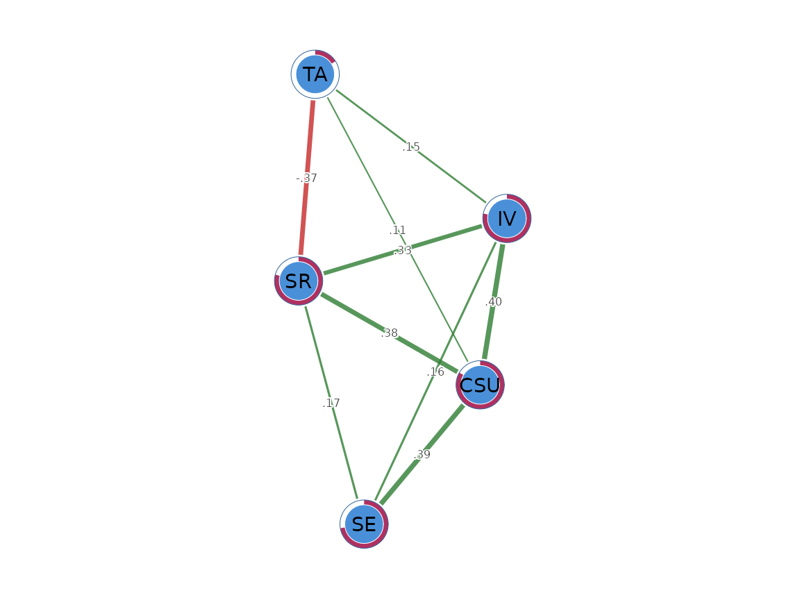

# Information-filtering networks with TMFG and LoGo

A questionnaire with many items yields a correlation matrix with
hundreds of entries, most of them small, and a network that draws every
correlation cannot be read. Information-filtering networks reduce such a
matrix to a sparse backbone by a structural rule instead of a
significance test or a penalty. The Triangulated Maximally Filtered
Graph (TMFG; Massara et al., 2016) keeps the strongest correlations that
can be arranged into a connected, planar network of triangles, so a
network of $`p`$ variables always retains $`3(p - 2)`$ edges. The
Local-Global method (LoGo; Barfuss et al., 2016) then estimates partial
correlations on that backbone, turning the filtered correlation
structure into a conditional-dependence network without a tuning
parameter.

The two stages answer different questions. A TMFG edge is an ordinary
correlation: how strongly two variables go together. A LoGo edge is a
partial correlation: how strongly they go together once the other
variables are held constant. This article builds both networks for five
self-regulated learning constructs, compares their edges, checks that
each network has the properties its definition requires, describes the
nodes of the LoGo network, and repeats the analysis on rank
correlations.

``` r

library(psychnets)
```

## Data

`SRL_GPT` holds 300 sets of responses to the Motivated Strategies for
Learning Questionnaire, each a construct score on a scale from 1 to 7.
The responses were generated by a large language model (GPT) in a study
of how such models answer psychological surveys (Saqr, 2025); they serve
as a well-structured example and are not evidence about students.

- **Nodes:** five construct scores, treated as continuous: `CSU`
  (cognitive strategy use), `IV` (intrinsic value), `SE`
  (self-efficacy), `SR` (self-regulation) and `TA` (test anxiety).
- **Observations:** one row per respondent; the data are complete.

``` r

head(SRL_GPT)
#>        CSU       IV       SE       SR   TA
#> 1 5.307692 5.666667 5.777778 5.333333 4.00
#> 2 5.846154 6.444444 6.000000 5.777778 4.00
#> 3 6.615385 6.666667 6.222222 6.333333 3.25
#> 4 5.692308 6.555556 6.333333 5.555556 4.50
#> 5 4.384615 5.555556 4.888889 4.777778 4.00
#> 6 4.846154 5.444444 5.666667 5.111111 3.50
```

With five nodes, a TMFG keeps $`3(5 - 2) = 9`$ of the 10 possible pairs,
so the example shows how the method works rather than how much it
filters. Filtering grows with the number of variables: with 30 items a
TMFG keeps 84 of 435 pairs.

## The model

TMFG starts from the four variables with the strongest correlations,
which form a tetrahedron of six edges. Each remaining variable is
inserted into the triangular face to which it is most strongly
correlated and joined to the face’s three corners, adding three edges.
The construction therefore has

``` math
6 + 3(p - 4) = 3(p - 2)
```

edges, and the graph is connected, planar and chordal: it decomposes
into four-node cliques that overlap in three-node separators.

LoGo uses this decomposition to estimate the precision matrix. With
$`\mathbf{S}`$ the correlation matrix, $`\mathcal{C}`$ the four-node
cliques and $`\mathcal{T}`$ the three-node separators,

``` math
\widehat{\mathbf{K}} = \sum_{c \in \mathcal{C}} \left[\mathbf{S}_{cc}^{-1}\right]^{0}
- \sum_{t \in \mathcal{T}} \left[\mathbf{S}_{tt}^{-1}\right]^{0},
```

where $`[\cdot]^0`$ places a small inverse into the full $`p \times p`$
matrix with zeros elsewhere. The result is the maximum-likelihood
precision matrix of a Gaussian model whose missing edges are exactly
those absent from the TMFG, and the partial correlations are
$`\rho_{ij \cdot \mathrm{rest}} = -K_{ij}/\sqrt{K_{ii}K_{jj}}`$.

## Which correlations form the backbone?

[`psychnet()`](https://pak.dynasite.org/psychnets/reference/psychnet.md)
with `method = "tmfg"` builds the filtered graph from the Pearson
correlation matrix.

``` r

tmfg_net <- psychnet(data = SRL_GPT, method = "tmfg")
summary(tmfg_net)
#> <psychnet> tmfg network
#>   nodes: 5   edges: 9   (undirected)
#>   structural certificate (violated TMFG invariants): 0
#>   edge weight: range [-0.302, 0.861], mean 0.486
as.data.frame(tmfg_net)
#>   from to     weight
#> 1  CSU IV  0.8609975
#> 2  CSU SE  0.8345850
#> 3   IV SE  0.7846003
#> 4  CSU SR  0.8474352
#> 5   IV SR  0.8216346
#> 6   SE SR  0.7791388
#> 7  CSU TA -0.1385109
#> 8   IV TA -0.1137214
#> 9   SR TA -0.3019634
```

The backbone has 9 edges, with correlations from -0.302 to 0.861. The
four learning constructs are fully connected by strong positive
correlations, from 0.779 (`SE`–`SR`) to 0.861 (`CSU`–`IV`). Test anxiety
is attached through three negative correlations, the strongest with
self-regulation (-0.302). The excluded pair is `SE`–`TA`, the weakest
correlation of test anxiety. TMFG chooses edges as part of a connected
structure rather than by a cut-off, so the missing pair says that it was
not needed for the backbone, not that the correlation is zero.

## Does the backbone have the required structure?

A TMFG is defined by its structure: exactly $`3(p - 2)`$ edges,
connected, planar and chordal.
[`certificate()`](https://pak.dynasite.org/psychnets/reference/certificate.md)
counts how many of these properties the fitted graph violates.

``` r

certificate(tmfg_net)
#>   method certificate       kind certified
#> 1   tmfg           0 structural      TRUE
```

The count is 0 and `certified` is `TRUE`: the graph has all the
properties of a TMFG. This checks the construction, not the stability of
the selected edges across samples.

## Which associations remain after adjustment?

[`psychnet()`](https://pak.dynasite.org/psychnets/reference/psychnet.md)
with `method = "logo"` builds the same backbone and estimates partial
correlations on it.

``` r

logo_net <- psychnet(data = SRL_GPT, method = "logo")
summary(logo_net)
#> <psychnet> logo network
#>   nodes: 5   edges: 9   (undirected)
#>   optimality (KKT residual): 6.66e-16
#>   edge weight: range [-0.372, 0.404], mean 0.191
as.data.frame(logo_net)
#>   from to     weight
#> 1  CSU IV  0.4035714
#> 2  CSU SE  0.3934966
#> 3   IV SE  0.1648976
#> 4  CSU SR  0.3771675
#> 5   IV SR  0.3300708
#> 6   SE SR  0.1681288
#> 7  CSU TA  0.1100782
#> 8   IV TA  0.1463203
#> 9   SR TA -0.3720398
```

The LoGo network has the same 9 edges, now carrying partial
correlations. The strongest positive edges join cognitive strategy use
with intrinsic value (0.404), self-efficacy (0.393) and self-regulation
(0.377). Self-regulation and test anxiety share the only negative edge
(-0.372), slightly stronger than their correlation of -0.302.

Comparing the two tables shows what adjustment does. The `IV`–`SE`
correlation is 0.785 but its partial correlation is 0.165: most of the
association between intrinsic value and self-efficacy is shared with
cognitive strategy use and self-regulation. Test anxiety correlates
negatively with cognitive strategy use (-0.139) and intrinsic value
(-0.114), yet its partial correlations with them are positive (0.110 and
0.146); once self-regulation is held constant, the negative association
of test anxiety with the learning constructs runs through
self-regulation alone. TMFG and LoGo weights must therefore never be
reported interchangeably.

## Is the LoGo network the maximum-likelihood solution?

LoGo is a closed-form construction, and its result should be the
maximum-likelihood estimate for the TMFG graph. Any such solution must
satisfy the problem’s optimality (Karush–Kuhn–Tucker) conditions: the
implied covariance reproduces the observed correlation on every retained
edge and on the diagonal, and the precision is zero on every missing
edge. The amount by which a fitted network violates them is its
certificate; a value near zero shows that the network is the optimum of
its objective.

``` r

certificate(logo_net)
#>   method  certificate kind certified
#> 1   logo 6.661338e-16  kkt      TRUE
```

The violation is at the level of machine precision (below $`10^{-14}`$),
so the LoGo partial correlations are the maximum-likelihood estimates
for the backbone.

## Which constructs are most connected?

[`net_centralities()`](https://pak.dynasite.org/psychnets/reference/net_centralities.md)
returns strength, the sum of absolute edge weights, and expected
influence, the signed sum, for the LoGo network.

``` r

net_centralities(logo_net)
#>   node  strength expected_influence
#> 1  CSU 1.2843138          1.2843138
#> 2   IV 1.0448601          1.0448601
#> 3   SE 0.7265229          0.7265229
#> 4   SR 1.2474068          0.5033273
#> 5   TA 0.6284383         -0.1156412
```

Cognitive strategy use has the largest strength (1.284), equal to its
expected influence because all its edges are positive. Self-regulation
follows in strength (1.247), but its negative edge with test anxiety
lowers its expected influence to 0.503. Test anxiety has the smallest
strength (0.628) and a negative expected influence (-0.116). Cognitive
strategy use is the most connected construct, and self-regulation is the
link between the learning constructs and test anxiety. Centrality
describes the graph and does not identify causes or intervention
targets.

## How well is each construct predicted by the others?

[`net_predict()`](https://pak.dynasite.org/psychnets/reference/net_predict.md)
reports each node’s $`R^2`$, computed from the LoGo precision matrix as
$`R_j^2 = 1 - 1/(K_{jj}S_{jj})`$.

``` r

net_predict(logo_net)
#>   node     type metric predictability accuracy
#> 1  CSU gaussian     R2      0.8347645       NA
#> 2   IV gaussian     R2      0.7824561       NA
#> 3   SE gaussian     R2      0.7227872       NA
#> 4   SR gaussian     R2      0.7923888       NA
#> 5   TA gaussian     R2      0.1589941       NA
```

The other constructs explain 83% of the variance in cognitive strategy
use ($`R^2 = 0.835`$), 79% in self-regulation, 78% in intrinsic value
and 72% in self-efficacy, but only 16% in test anxiety
($`R^2 = 0.159`$). The learning constructs are largely predictable from
one another, while test anxiety is not. These are in-sample values.

## What does the network look like?

[`cograph::splot()`](https://sonsoles.me/cograph/reference/splot.html)
draws the LoGo network, with green positive and red negative edges and a
ring showing each node’s predictability.

``` r

cograph::splot(logo_net, psych_styling = TRUE, predictability = TRUE)
```



The figure shows the triangulated structure: four learning constructs
fully connected, and test anxiety attached to three of them. Node
positions come from a layout algorithm and carry no statistical meaning.

## Do the conclusions depend on the correlation estimator?

Refitting LoGo with `cor_method = "spearman"` bases both the backbone
and the partial correlations on rank correlations.

``` r

logo_spearman <- psychnet(data = SRL_GPT, method = "logo",
                          cor_method = "spearman")
summary(logo_spearman)
#> <psychnet> logo network
#>   nodes: 5   edges: 9   (undirected)
#>   optimality (KKT residual): 1.67e-15
#>   edge weight: range [-0.301, 0.440], mean 0.191
as.data.frame(logo_spearman)
#>   from to      weight
#> 1  CSU IV  0.41199792
#> 2  CSU SE  0.44035144
#> 3   IV SE  0.11746132
#> 4  CSU SR  0.34053654
#> 5   IV SR  0.36023514
#> 6   SE SR  0.15431277
#> 7  CSU TA  0.07122993
#> 8   IV TA  0.12358306
#> 9   SR TA -0.30091058
certificate(logo_spearman)
#>   method  certificate kind certified
#> 1   logo 1.665335e-15  kkt      TRUE
```

The rank-based backbone contains the same nine pairs. The positive edges
of cognitive strategy use remain the strongest, with `CSU`–`SE` (0.440)
now slightly above `CSU`–`IV` (0.412), and the `SR`–`TA` edge remains
negative (-0.301). The weak `CSU`–`TA` edge falls from 0.110 to 0.071.
The certificate is again at machine precision. The backbone and its main
edges do not depend on the correlation estimator.

## Reporting the analysis

A report states the variables, the sample size, the correlation
estimator and the treatment of missing data, and keeps the two stages
apart: TMFG edges are correlations, LoGo edges are partial correlations.

In this analysis, TMFG on Pearson correlations of 300 complete responses
kept 9 of 10 pairs, leaving out `SE`–`TA`. LoGo partial correlations on
that backbone were largest for cognitive strategy use with intrinsic
value (0.404) and negative only for self-regulation with test anxiety
(-0.372). A rank-based analysis kept the same backbone and the same main
edges.

## Assumptions and when to use information filtering

- TMFG fixes the number of edges at $`3(p - 2)`$ whatever the sample
  size. It suits large item sets where a readable backbone is wanted and
  where a penalty-based method would keep too many or too few edges; it
  does not test whether an edge is different from zero.
- LoGo assumes a Gaussian model restricted to the TMFG graph. It needs
  no tuning parameter, but every four-node block of the correlation
  matrix must be invertible, so duplicated or perfectly collinear
  variables must be removed first.
- For a network whose edges are selected from the data by a criterion,
  use the graphical lasso or stepwise selection; for a network of
  marginal associations, the TMFG backbone alone is sufficient.
- Neither network identifies causal direction.

## References

Barfuss, W., Massara, G. P., Di Matteo, T., & Aste, T. (2016).
Parsimonious modeling with information filtering networks. *Physical
Review E*, 94(6), 062306.
[doi:10.1103/PhysRevE.94.062306](https://doi.org/10.1103/PhysRevE.94.062306)

Massara, G. P., Di Matteo, T., & Aste, T. (2016). Network filtering for
big data: Triangulated maximally filtered graph. *Journal of Complex
Networks*, 5(2), 161-178.
[doi:10.1093/comnet/cnw015](https://doi.org/10.1093/comnet/cnw015)

Saqr, M. (2025). Delving into the psychology of machines: Exploring the
structure of self-regulated learning via LLM-generated survey responses.
*Computers in Human Behavior*, 173, 108769.
[doi:10.1016/j.chb.2025.108769](https://doi.org/10.1016/j.chb.2025.108769)
