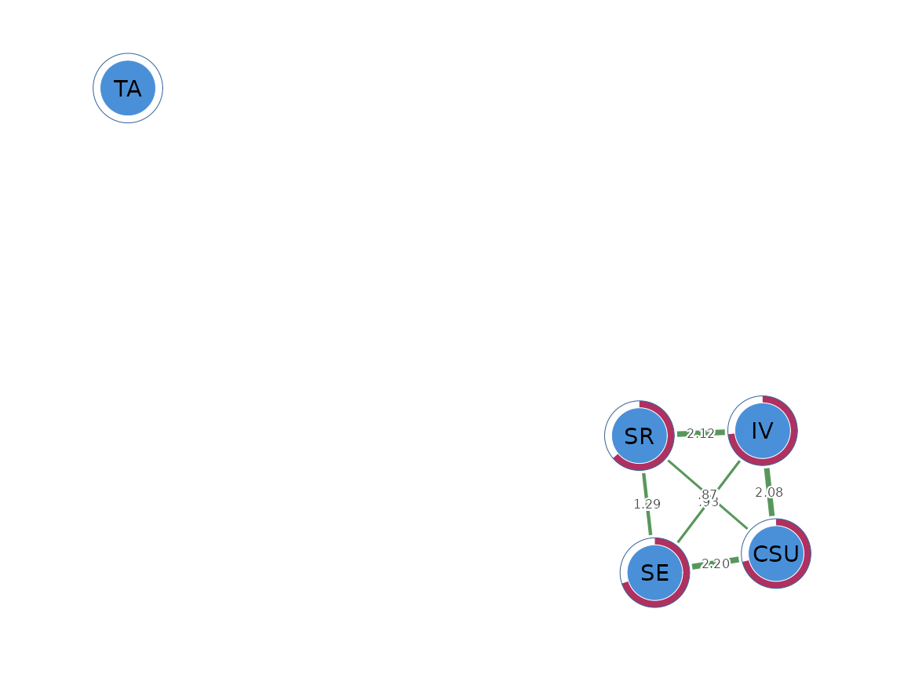

# Ising networks for binary data

Many psychological and educational variables are binary. A symptom may
be present or absent, a diagnostic criterion may be met or not met, an
assessment item may be passed or failed, and a behaviour may be reported
or not reported. These variables represent distinct states rather than
measurements along a continuous scale. Methods based on correlations and
partial correlations among continuous variables are therefore not always
appropriate. The Ising model provides a framework for estimating
networks of binary variables (van Borkulo et al., 2014), and it is
closely related to item response theory models, a link that connects the
network and latent-variable views of the same data (Marsman et al.,
2018). In an Ising network, each edge represents a conditional
association on the log-odds scale. A positive edge indicates that, when
one variable is present, the odds of another variable being present are
higher, conditional on the remaining variables. A negative edge
indicates lower conditional odds. An absent edge indicates that the
association between two variables is not estimated as a direct
association after accounting for the other variables in the network.

Psychological networks describe the conditional associations among
variables within a psychological system. They are now a standard method
in psychological science, with established procedures for estimation,
accuracy assessment and reporting (Borsboom et al., 2021; Epskamp et
al., 2018), and recent work has extended Ising estimation to Bayesian
structure selection (Marsman et al., 2022). In education, psychological
networks show how the components of learning and regulation relate to
one another, rather than treating each component as a separate outcome
(Saqr et al., 2024). Applications include self-regulation in academic
writing (Saqr et al., 2021) and the relation between students’
monitoring events and the phases of regulation (Malmberg et al., 2022).
Networks can also be estimated for a single learner, which shows how a
process is organised within that person rather than assuming that the
group-level network describes every student (Saqr & López-Pernas, 2024).

This article demonstrates how to estimate and interpret an Ising network
using `psychnets`. The example uses five binary indicators of
self-regulated learning. It explains how the estimated interactions can
be interpreted, how node centrality and predictability can be examined,
and how the regularized network can be compared with an unregularized
estimator. The data are generated by a large language model and are used
to illustrate the analysis rather than to draw conclusions about
students.

``` r

library(psychnets)
```

## The model

For a binary vector $`\mathbf{x} \in \{0, 1\}^p`$, the Ising model gives

``` math
P(\mathbf{x}) = \frac{1}{Z}\exp\left(\sum_i \tau_i x_i
+ \sum_{i<j}\omega_{ij}x_i x_j\right),
```

where $`\tau_i`$ is the threshold of node $`i`$ (its tendency to be 1
when all other nodes are 0), $`\omega_{ij}`$ the interaction between
nodes $`i`$ and $`j`$, and $`Z`$ the normalizing constant. The
conditional distribution of one node is a logistic regression on the
others,

``` math
\operatorname{logit} P(X_i = 1 \mid \mathbf{X}_{-i})
= \tau_i + \sum_{j \ne i}\omega_{ij}X_j ,
```

so $`\exp(\omega_{ij})`$ is the conditional odds ratio of $`X_i = 1`$
when $`X_j`$ changes from 0 to 1.

The network is estimated by fitting a separate logistic regression for
each node, using all remaining nodes as predictors. Each regression uses
an $`\ell_1`$ penalty, which shrinks coefficients and can set some of
them to zero. The penalty is selected using the extended BIC with
$`\gamma = 0.25`$. Because each pair of nodes appears in two
regressions, the procedure produces two estimates for each possible
interaction. The AND rule retains an edge only when both regressions
select it, whereas the OR rule retains an edge when either regression
selects it. For a retained edge, the two estimates are averaged to
obtain its weight.

## Data

`SRL_GPT` contains 300 sets of responses to the Motivated Strategies for
Learning Questionnaire. The responses were generated by a large language
model (GPT) in a study examining how such models answer psychological
surveys (Vogelsmeier et al., 2025). They provide a structured example
for demonstrating the analysis, but they do not represent observations
from students. The construct scores are continuous. In this example,
[`dichotomize()`](https://pak.dynasite.org/psychnets/reference/dichotomize.md)
with `method = "rank"` converts each score into a binary indicator,
coding a score as 1 when it falls in the upper half of its distribution
and as 0 otherwise.

- **Nodes:** five binary indicators, 1 for the upper half of `CSU`
  (cognitive strategy use), `IV` (intrinsic value), `SE`
  (self-efficacy), `SR` (self-regulation) and `TA` (test anxiety).
- **Observations:** one row per respondent; the data are complete.

``` r

binary_data <- dichotomize(data = SRL_GPT, method = "rank")
head(binary_data)
#>      CSU IV SE SR TA
#> [1,]   0  0  0  0  1
#> [2,]   1  1  1  1  1
#> [3,]   1  1  1  1  0
#> [4,]   0  1  1  0  1
#> [5,]   0  0  0  0  1
#> [6,]   0  0  0  0  0
colMeans(binary_data)
#>       CSU        IV        SE        SR        TA 
#> 0.4966667 0.5366667 0.4766667 0.4600000 0.5000000
```

The proportion coded as 1 ranges from 46% to 54% across the five
indicators. The proportions do not equal exactly 50% because tied scores
remain on the same side of the split. Dichotomization reduces the
information available in the original scores and should therefore be
used only when the research question concerns the distinction between
the two states. Variables that are naturally binary can be analysed
without this additional step.

## Which indicators are directly associated?

The function
[`psychnet()`](https://pak.dynasite.org/psychnets/reference/psychnet.md)
estimates the network when `method = "ising"` is specified. The AND rule
(`rule = "AND"`) is the default and is stated explicitly here to make
the estimation procedure clear.

``` r

ising_net <- psychnet(data = binary_data, method = "ising", rule = "AND")
summary(ising_net)
#> <psychnet> ising network
#>   nodes: 5   edges: 6   (undirected)
#>   optimality (KKT residual): 2.53e-09
#>   edge weight: range [0.868, 2.201], mean 1.582
as.data.frame(ising_net)
#>   from to    weight
#> 1  CSU IV 2.0823827
#> 2  CSU SE 2.2005411
#> 3   IV SE 0.9297109
#> 4  CSU SR 0.8683591
#> 5   IV SR 2.1232839
#> 6   SE SR 1.2884921
```

The estimated network contains 6 edges, all positive and connecting the
four learning constructs. Their weights range from 0.868 to 2.201. The
strongest interaction is between `CSU` and `SE` (2.201). Conditional on
the other indicators, being in the upper half of cognitive strategy use
is associated with approximately nine times the odds of being in the
upper half of self-efficacy ($`e^{2.201}`$). The weakest interaction is
between `CSU` and `SR` (0.868), corresponding to an odds ratio of
approximately 2.4.

Test anxiety has no estimated edge in this network. After accounting for
the learning constructs, the model does not estimate a direct
association between test anxiety and any of them. The Gaussian network
estimated from the continuous scores contains a negative edge between
self-regulation and test anxiety (-0.350; see the Gaussian graphical
models article). The absence of this edge in the binary network
illustrates how dichotomization can change the associations represented
in a network by discarding information from the original scores.

## Is the fitted network the optimum of its objective?

The penalized logistic regressions are solved iteratively. A solution to
each regression must satisfy the Karush–Kuhn–Tucker (KKT) optimality
conditions. The certificate returned for the network is the largest
violation of these conditions across the five regressions. A value close
to zero indicates that the fitted solution satisfies the numerical
optimality conditions of the objective.

``` r

certificate(ising_net)
#>   method  certificate kind certified
#> 1  ising 2.531323e-09  kkt      TRUE
```

The largest violation is $`2.53 \times 10^{-9}`$, indicating that the
fitted interactions satisfy the optimality conditions of the penalized
regressions. This certificate assesses the numerical solution of the
estimation procedure. It does not establish the sampling stability of
the edges or the validity of the binary coding.

## Which indicators are most connected?

The function
[`net_centralities()`](https://pak.dynasite.org/psychnets/reference/net_centralities.md)
returns two measures of node connectedness. Strength is the sum of the
absolute interaction weights connected to a node, whereas expected
influence is the sum of its signed interaction weights.

``` r

net_centralities(ising_net)
#>   node strength expected_influence
#> 1  CSU 5.151283           5.151283
#> 2   IV 5.135377           5.135377
#> 3   SE 4.418744           4.418744
#> 4   SR 4.280135           4.280135
#> 5   TA 0.000000           0.000000
```

Cognitive strategy use (5.151) and intrinsic value (5.135) have the
highest strength, followed by self-efficacy (4.419) and self-regulation
(4.280). Because all estimated edges are positive, expected influence
has the same values as strength. Test anxiety has no edges and therefore
has a value of 0 for both measures. The four learning indicators have
similar levels of connectedness, while test anxiety is separated from
them in the estimated network.

## How well is each indicator classified from the others?

For a binary node, predictability describes how accurately its value can
be classified using the other nodes in the network. The normalized
classification coefficient (nCC) expresses this accuracy relative to the
accuracy obtained by always predicting the more frequent category
(Haslbeck & Waldorp, 2018):

``` math
\operatorname{nCC}_j = \frac{\operatorname{CC}_j - m_j}{1 - m_j},
```

where $`\operatorname{CC}_j`$ is the proportion of correctly classified
observations and $`m_j`$ is the proportion belonging to the more
frequent category. An nCC of 0 indicates no improvement over this
base-rate prediction, while an nCC of 1 indicates perfect
classification.
[`net_predict()`](https://pak.dynasite.org/psychnets/reference/net_predict.md)
requires the original data to calculate predictability.

``` r

net_predict(ising_net, data = binary_data)
#>   node   type metric predictability  accuracy
#> 1  CSU binary    nCC      0.7114094 0.8566667
#> 2   IV binary    nCC      0.7338129 0.8766667
#> 3   SE binary    nCC      0.6993007 0.8566667
#> 4   SR binary    nCC      0.6376812 0.8333333
#> 5   TA binary    nCC      0.0000000 0.5000000
```

Intrinsic value has the highest predictability, with 87.7% of
observations classified correctly and nCC = 0.734. Cognitive strategy
use (nCC = 0.711) and self-efficacy (nCC = 0.699) follow, with 85.7%
correct classification for each. Self-regulation has nCC = 0.638 and
83.3% correct classification. Test anxiety has nCC = 0 and 50% correct
classification. Because it has no neighbours in the network, its
classification is no better than the base-rate prediction. These values
are calculated from the same data used to estimate the network and
should be interpreted as in-sample results.

## Does an unregularized estimator find the same network?

The estimator specified by `method = "ising_sampler"` fits the nodewise
logistic regressions without a penalty. It then removes interactions
whose Wald tests are not significant at the specified `alpha` level.
Comparing this network with the regularized estimate allows us to
examine whether the selected edge structure differs between the two
estimation approaches.

``` r

unregularized_net <- psychnet(data = binary_data, method = "ising_sampler",
                              alpha = 0.05)
unregularized_net
#> <psychnet> ising_sampler network
#>   nodes: 5   edges: 6   (undirected)
#>   optimality: unavailable
as.data.frame(unregularized_net)
#>   from to    weight
#> 1  CSU IV 2.2425237
#> 2  CSU SE 2.3454742
#> 3   IV SE 1.1870117
#> 4  CSU SR 0.8818853
#> 5   IV SR 2.2882117
#> 6   SE SR 1.4609560
```

The unregularized network contains the same 6 edges, and test anxiety
remains isolated. The estimated interactions are larger than those in
the regularized network. For example, the `CSU`–`SE` interaction is
2.345 rather than 2.201, and the `IV`–`SR` interaction is 2.288 rather
than 2.123. This difference is consistent with the regularization
procedure shrinking the estimated interactions. In this example, both
estimators identify the same edge structure.

``` r

certificate(unregularized_net)
#>          method certificate kind certified
#> 1 ising_sampler          NA  kkt        NA
```

The certificate for the unregularized network is `NA`. The Wald pruning
procedure sets non-significant interactions to zero, so the resulting
network is no longer the maximum-likelihood solution for which the
certificate evaluates the optimality conditions. The regularized
network, in contrast, has a certified optimum.

## What does the network look like?

The function
[`cograph::splot()`](https://sonsoles.me/cograph/reference/splot.html)
visualizes the network. Positive edges are shown in green and negative
edges in red, while the ring around each node represents its
predictability.

``` r

cograph::splot(ising_net, psych_styling = TRUE, predictability = TRUE)
```



The figure displays four learning indicators connected to one another
and an isolated test anxiety node. The predictability ring for test
anxiety is empty, reflecting its nCC of 0. Node positions are determined
by the layout algorithm and do not have a statistical interpretation.

## Reporting the analysis

A report of an Ising network should define what 1 and 0 represent for
each node and explain how any dichotomization was performed. It should
also state the sample size, estimator, value of $`\gamma`$, selection
rule (AND or OR), and treatment of missing data. Interaction weights
should be reported on the log-odds scale. Predictability should be
reported using nCC alongside raw classification accuracy.

In this example, a regularized Ising network ($`\gamma = 0.25`$, AND
rule) was estimated from rank-dichotomized scores for 300 complete
responses. The network retained 6 positive edges among the learning
constructs, with the largest interaction between `CSU` and `SE` (2.201),
and test anxiety was isolated. An unregularized estimator with Wald
pruning at 0.05 retained the same edges.

## Assumptions and when to use the Ising model

- The variables are binary. Ordinal or continuous variables should not
  be dichotomized only to fit the model, since the example shows that a
  median split can remove a substantive edge.
- Observations are independent of one another.
- The nodewise regressions of a pair can disagree. The AND rule gives a
  sparser and more conservative network, the OR rule a denser one; edges
  that appear only under OR should be reported as rule-dependent.
- For networks that combine binary and continuous variables, use a mixed
  graphical model.
- Edges are conditional associations, not causal effects.

## How to cite this article

Saqr, M., & López-Pernas, S. (2026). *Ising networks for binary data*.
psychnets. <https://doi.org/10.5281/zenodo.24567516> ·
[HTML](https://pak.dynasite.org/psychnets/articles/ising-networks.html)
· [PDF](https://pak.dynasite.org/psychnets/pdf/ising-networks.pdf)

## References

Borsboom, D., Deserno, M. K., Rhemtulla, M., Epskamp, S., Fried, E. I.,
McNally, R. J., Robinaugh, D. J., Perugini, M., Dalege, J., Costantini,
G., Isvoranu, A.-M., Wysocki, A. C., van Borkulo, C. D., van Bork, R., &
Waldorp, L. J. (2021). Network analysis of multivariate data in
psychological science. *Nature Reviews Methods Primers*, 1, 58.
[doi:10.1038/s43586-021-00055-w](https://doi.org/10.1038/s43586-021-00055-w)

Epskamp, S., Borsboom, D., & Fried, E. I. (2018). Estimating
psychological networks and their accuracy: A tutorial paper. *Behavior
Research Methods*, 50(1), 195-212.
[doi:10.3758/s13428-017-0862-1](https://doi.org/10.3758/s13428-017-0862-1)

Haslbeck, J. M. B., & Waldorp, L. J. (2018). How well do network models
predict observations? On the importance of predictability in network
models. *Behavior Research Methods*, 50(2), 853-861.
[doi:10.3758/s13428-017-0910-x](https://doi.org/10.3758/s13428-017-0910-x)

Malmberg, J., Saqr, M., Järvenoja, H., & Järvelä, S. (2022). How the
monitoring events of individual students are associated with phases of
regulation: A network analysis approach. *Journal of Learning
Analytics*, 9(1), 77-92.
[doi:10.18608/jla.2022.7429](https://doi.org/10.18608/jla.2022.7429)

Marsman, M., Borsboom, D., Kruis, J., Epskamp, S., van Bork, R.,
Waldorp, L. J., van der Maas, H. L. J., & Maris, G. (2018). An
introduction to network psychometrics: Relating Ising network models to
item response theory models. *Multivariate Behavioral Research*, 53(1),
15-35.
[doi:10.1080/00273171.2017.1379379](https://doi.org/10.1080/00273171.2017.1379379)

Marsman, M., Huth, K., Waldorp, L. J., & Ntzoufras, I. (2022). Objective
Bayesian edge screening and structure selection for Ising networks.
*Psychometrika*, 87(1), 47-82.
[doi:10.1007/s11336-022-09848-8](https://doi.org/10.1007/s11336-022-09848-8)

Saqr, M., Beck, E., & López-Pernas, S. (2024). Psychological networks: A
modern approach to analysis of learning and complex learning processes.
In M. Saqr & S. López-Pernas (Eds.), *Learning analytics methods and
tutorials: A practical guide using R* (pp. 639-671). Springer.
[doi:10.1007/978-3-031-54464-4_19](https://doi.org/10.1007/978-3-031-54464-4_19)

Saqr, M., & López-Pernas, S. (2024). Mapping the self in self-regulation
using complex dynamic systems approach. *British Journal of Educational
Technology*, 55(4), 1376-1397.
[doi:10.1111/bjet.13452](https://doi.org/10.1111/bjet.13452)

Saqr, M., Peeters, W., & Viberg, O. (2021). The relational, co-temporal,
contemporaneous, and longitudinal dynamics of self-regulation for
academic writing. *Research and Practice in Technology Enhanced
Learning*, 16, 29.
[doi:10.1186/s41039-021-00175-7](https://doi.org/10.1186/s41039-021-00175-7)

van Borkulo, C. D., Borsboom, D., Epskamp, S., Blanken, T. F., Boschloo,
L., Schoevers, R. A., & Waldorp, L. J. (2014). A new method for
constructing networks from binary data. *Scientific Reports*, 4, 5918.
[doi:10.1038/srep05918](https://doi.org/10.1038/srep05918)

Vogelsmeier, L. V. D. E., Oliveira, E., Misiejuk, K., López-Pernas, S.,
& Saqr, M. (2025). Delving into the psychology of machines: Exploring
the structure of self-regulated learning via LLM-generated survey
responses. *Computers in Human Behavior*, 173, 108769.
[doi:10.1016/j.chb.2025.108769](https://doi.org/10.1016/j.chb.2025.108769)
