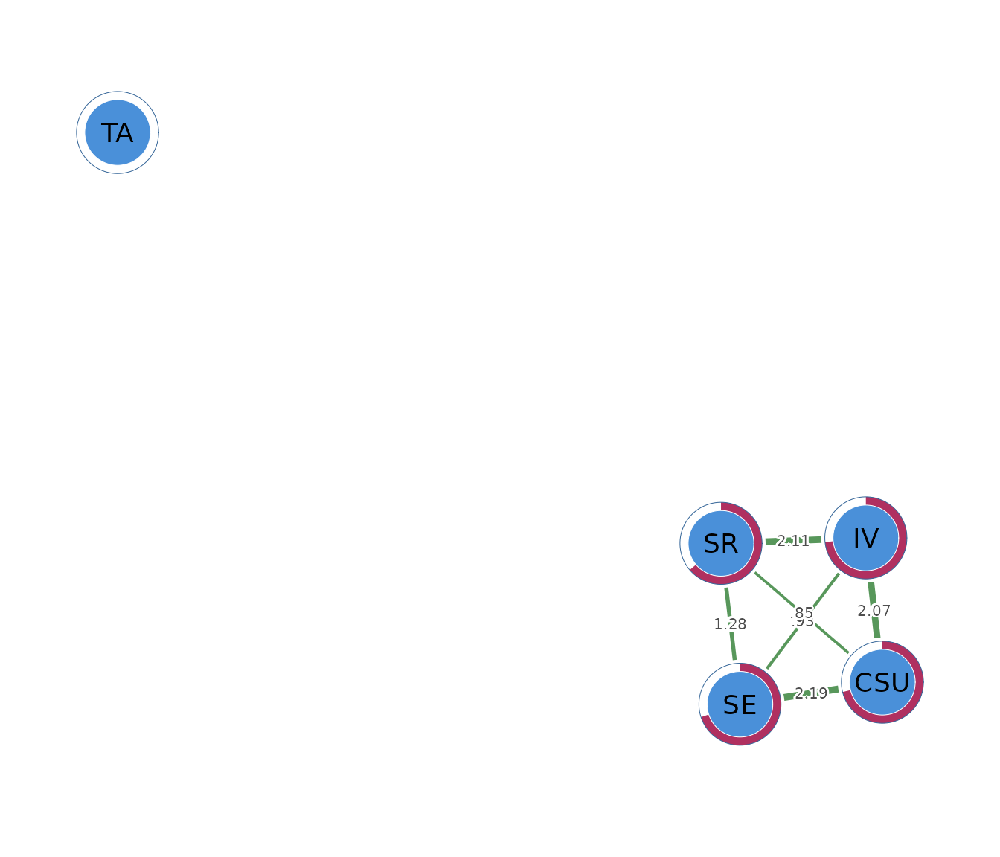

# Ising networks for binary data

## What an Ising network is

An Ising network models the conditional dependence structure among
binary variables. Each node represents a variable with two possible
states, conventionally coded as 0 and 1, such as the absence or presence
of a symptom, failure or success on an assessment, or non-endorsement
and endorsement of a questionnaire item. The model estimates the
conditional association between every pair of variables while accounting
for all remaining variables in the network.

The edge parameters of an Ising model are expressed on the log-odds
scale and quantify conditional dependence between binary variables. A
positive edge indicates that endorsement of one variable is associated
with an increased conditional probability of endorsing the other after
adjustment for the remaining variables, whereas a negative edge
indicates a reduced conditional probability. For example, in a network
of study behaviours, a positive edge between planning and completing
assignments indicates that students who report planning are more likely
to complete assignments after accounting for their other recorded
behaviours. The absence of an edge indicates that the conditional
association between two variables is adequately explained by the
remaining variables included in the model.

Ising models are particularly appropriate for psychometric and
behavioural data that are intrinsically binary, including symptom
checklists, diagnostic criteria, pass–fail outcomes, and dichotomously
scored questionnaire items. Because the model estimates conditional
rather than marginal associations, the resulting network distinguishes
direct statistical dependencies from relationships that arise indirectly
through other variables. As with Gaussian graphical models, the
estimated edges represent conditional statistical dependence and should
not be interpreted as evidence of causal relationships.

## The data

The worked example uses `SRL_GPT`, which contains 300 observations on
cognitive strategy use (`CSU`), intrinsic value (`IV`), self-efficacy
(`SE`), self-regulation (`SR`), and test anxiety (`TA`). The original
variables are continuous composite scores. An Ising model requires
binary data, so the example uses
[`dichotomize()`](https://pak.dynasite.org/psychnets/reference/dichotomize.md)
with `method = "rank"` to code the lower half of each score as 0 and the
upper half as 1.

``` r

binary_data <- dichotomize(data = SRL_GPT, method = "rank")
head(binary_data)
#>      CSU IV SE SR TA
#> [1,]   0  0  0  0  1
#> [2,]   1  1  1  1  1
#> [3,]   1  1  1  1  0
#> [4,]   0  1  1  0  1
#> [5,]   0  0  0  0  1
#> [6,]   0  0  0  0  0
colMeans(binary_data)
#>       CSU        IV        SE        SR        TA 
#> 0.4966667 0.5366667 0.4766667 0.4600000 0.5000000
```

Here, a value of 1 means that the observation falls in the upper half of
that construct. The endorsement rates lie between 0.46 and 0.54 rather
than at exactly 0.50, because tied scores are kept on the same side of
the split. Dichotomization discards information from the original scale,
so it should be used only when a binary research question is
substantively justified. Naturally binary variables can be analyzed
directly.

## Fitting the network with `psychnet()`

[`psychnet()`](https://pak.dynasite.org/psychnets/reference/psychnet.md)
estimates an Ising network when `method = "ising"`. The default AND rule
retains an edge when both nodewise models select it. The function
returns a fitted `psychnet` object containing the symmetric interaction
weights, node thresholds, and numerical certificate.

``` r

ising_net <- psychnet(data = binary_data, method = "ising", rule = "AND")
ising_net
#> <psychnet> ising network
#>   nodes: 5   edges: 6   (undirected)
#>   optimality (KKT residual): 4.90e-10
```

The fitted network contains 5 nodes and 6 edges. Four of the ten
possible pairs are removed by the selected model.

## Inspecting interactions with `summary()` and `as.data.frame()`

[`summary()`](https://rdrr.io/r/base/summary.html) prints the fitted
network with the range and mean of its weights, and
[`as.data.frame()`](https://rdrr.io/r/base/as.data.frame.html) returns
the edge table. The columns `from`, `to`, and `weight` identify the
retained interactions. Positive weights indicate higher conditional odds
of joint endorsement. Negative weights indicate lower conditional odds.

``` r

summary(ising_net)
#> <psychnet> ising network
#>   nodes: 5   edges: 6   (undirected)
#>   optimality (KKT residual): 4.90e-10
#>   edge weight: range [0.853, 2.192], mean 1.573
as.data.frame(ising_net)
#>   from to    weight
#> 1  CSU IV 2.0693278
#> 2  CSU SE 2.1915348
#> 3   IV SE 0.9334331
#> 4  CSU SR 0.8529154
#> 5   IV SR 2.1108751
#> 6   SE SR 1.2808939
```

All six retained edges join the four learning constructs `CSU`, `IV`,
`SE`, and `SR`, and all are positive. The largest is `CSU`-`SE` at
2.192, followed by `IV`-`SR` at 2.111 and `CSU`-`IV` at 2.069; the
weakest is `CSU`-`SR` at 0.853. Students in the upper half of one
construct have higher conditional odds of being in the upper half of the
connected construct after the other binary variables are considered.

Test anxiety has no retained edge. After dichotomization, the selected
model finds no conditional association between upper-half test anxiety
and any other construct. The Gaussian graphical model of the continuous
scores retains a negative self-regulation to test anxiety edge (-0.350;
see the Gaussian graphical models vignette), so its absence here
illustrates the information lost by dichotomizing.

Ising weights are logistic interaction coefficients, not correlations.
Their magnitudes should therefore be interpreted on the model’s log-odds
scale and compared within the fitted network.

## Checking numerical optimality with `certificate()`

[`certificate()`](https://pak.dynasite.org/psychnets/reference/certificate.md)
reports the largest stationarity residual across the fitted nodewise
logistic models. It returns `method`, `certificate`, `kind`, and
`certified`. A small residual indicates that the optimization satisfies
its first-order conditions to the requested tolerance.

``` r

certificate(ising_net)
#>   method  certificate kind certified
#> 1  ising 4.895834e-10  kkt      TRUE
```

The residual is $`4.90 \times 10^{-10}`$ and `certified` is `TRUE`. This
value is close to machine precision and indicates that the penalized
logistic fits satisfy their numerical conditions to numerical precision.
The certificate checks optimization, not sampling stability, measurement
validity, or causation.

## Describing node position with `net_centralities()`

[`net_centralities()`](https://pak.dynasite.org/psychnets/reference/net_centralities.md)
returns `node`, `strength`, and `expected_influence` by default.
Strength sums the absolute interaction weights. Expected influence sums
the signed weights, so negative connections reduce the total.

``` r

net_centralities(ising_net)
#>   node strength expected_influence
#> 1  CSU 5.113778           5.113778
#> 2   IV 5.113636           5.113636
#> 3   SE 4.405862           4.405862
#> 4   SR 4.244684           4.244684
#> 5   TA 0.000000           0.000000
```

Cognitive strategy use and intrinsic value have the highest strength
(5.114 each), followed by self-efficacy (4.406) and self-regulation
(4.245). Every retained edge is positive, so expected influence equals
strength for every node. Test anxiety has no edge, giving strength and
expected influence of 0.

These indices describe connection patterns in the estimated binary
network. They do not show which construct should be targeted by an
intervention.

## Evaluating binary predictability with `net_predict()`

[`net_predict()`](https://pak.dynasite.org/psychnets/reference/net_predict.md)
evaluates how accurately each node is classified from the others. Binary
nodes use normalized classification accuracy (`nCC`). An `nCC` of 0
means that prediction is no better than always choosing the more
frequent category. An `nCC` of 1 means perfect classification. The
`accuracy` column reports the unadjusted proportion classified
correctly.

``` r

net_predict(ising_net, data = binary_data)
#>   node   type metric predictability  accuracy
#> 1  CSU binary    nCC      0.7114094 0.8566667
#> 2   IV binary    nCC      0.7338129 0.8766667
#> 3   SE binary    nCC      0.6993007 0.8566667
#> 4   SR binary    nCC      0.6376812 0.8333333
#> 5   TA binary    nCC      0.0000000 0.5000000
```

Intrinsic value has the highest normalized accuracy (0.734) and a raw
accuracy of 0.877. Cognitive strategy use and self-efficacy have `nCC`
values of 0.711 and 0.699 with raw accuracy 0.857, and self-regulation
has `nCC = 0.638` with raw accuracy 0.833. Their neighbours provide
substantial classification information beyond the marginal baseline of
about 0.50.

Test anxiety has `nCC = 0` and accuracy 0.50. Without neighbours, it is
predicted no better than by always choosing its more frequent category.
These are in-sample values; assessment on new observations requires
validation data.

## Comparing an unregularized Ising estimator

[`psychnet()`](https://pak.dynasite.org/psychnets/reference/psychnet.md)
fits unregularized nodewise logistic models when
`method = "ising_sampler"`. The argument `alpha = 0.05` removes edges
whose Wald tests exceed the selected level. This comparison checks
whether the main structure persists under a different estimation
procedure.

``` r

unregularized_net <- psychnet(data = binary_data, method = "ising_sampler", alpha = 0.05)
unregularized_net
#> <psychnet> ising_sampler network
#>   nodes: 5   edges: 6   (undirected)
#>   optimality: unavailable
```

``` r

as.data.frame(unregularized_net)
#>   from to    weight
#> 1  CSU IV 2.2425237
#> 2  CSU SE 2.3454742
#> 3   IV SE 1.1870117
#> 4  CSU SR 0.8818853
#> 5   IV SR 2.2882117
#> 6   SE SR 1.4609560
```

The unregularized model retains the same 6 edges, and test anxiety again
has none. Its interactions are larger than the penalized ones (for
example `CSU`-`SE` is 2.345 rather than 2.192, and `IV`-`SR` 2.288
rather than 2.111) because no penalty shrinks them. The shared structure
provides evidence that the main qualitative pattern is not specific to
the penalized estimator. The change in magnitude reflects the different
estimation and pruning procedures.

``` r

certificate(unregularized_net)
#>          method certificate kind certified
#> 1 ising_sampler          NA  kkt        NA
```

The certificate is `NA`. Wald pruning set the non-significant
coefficients to zero after the unpenalized fits, so the returned network
is no longer the maximum-likelihood solution whose score conditions the
certificate checks. The residual of the fits before pruning is retained
on the object, and the penalized model above is the certified estimate
of this network.

## Visualizing the network with `cograph::splot()`

[`cograph::splot()`](https://sonsoles.me/cograph/reference/splot.html)
draws the network when the optional `cograph` package is available.
Psychological styling uses green for positive interactions and red for
negative interactions. Predictability rings summarize node
classification.

``` r

cograph::splot(ising_net, psych_styling = TRUE, predictability = TRUE)
```



Node placement is determined by a layout algorithm and has no
statistical scale. The edge table remains the primary source for
numerical interpretation.

## Reporting the analysis

A report should define what 0 and 1 mean for every node, describe any
dichotomization rule, state the sample size, estimator, EBIC setting,
edge rule, and missing-data procedure, and report interaction weights
numerically. Results should be described as conditional associations on
a log-odds scale.

The present analysis used rank dichotomization, 300 complete
observations, the EBIC-regularized Ising estimator, and the AND rule.
The model retained 6 positive edges among the four learning constructs;
test anxiety was isolated. The largest interaction was `CSU`-`SE`
(2.192). The KKT residual was $`4.90 \times 10^{-10}`$. An unregularized
sensitivity model with Wald pruning at 0.05 retained the same edge set.

## How the Ising network is estimated

Each binary node is modeled with logistic regression using the remaining
nodes as predictors. The regularized estimator applies an $`\ell_1`$
penalty and selects a penalty value by EBIC for every node. Small
coefficients can be set to zero, which removes the corresponding
neighbour from that node’s model.

Each pair receives two estimates because either node can be treated as
the outcome. The AND rule retains a pair when both regressions select it
and averages the two estimates into one undirected interaction. The OR
rule retains a pair when either regression selects it.

## Mathematical foundations

For a binary vector $`\mathbf{x} \in \{0,1\}^p`$, the Ising model is

``` math
P(\mathbf{x}) = \frac{1}{Z}\exp\left(
\sum_i \tau_i x_i + \sum_{i<j}\omega_{ij}x_ix_j
\right),
```

where $`\tau_i`$ is a node threshold, $`\omega_{ij}`$ is an interaction,
and $`Z`$ is the normalizing constant. The conditional model for node
$`i`$ is

``` math
\operatorname{logit}P(X_i=1\mid\mathbf{X}_{-i})
= \tau_i + \sum_{j\ne i}\omega_{ij}X_j.
```

The regularized estimator minimizes the negative nodewise log-likelihood
plus $`\lambda\sum_{j\ne i}|\omega_{ij}|`$. EBIC selects $`\lambda`$.
The certificate is the largest violation of the penalized logistic
stationarity conditions across all nodes.

For binary predictability, normalized classification accuracy is

``` math
\operatorname{nCC}_j
= \frac{\operatorname{CC}_j-m_j}{1-m_j},
```

where $`\operatorname{CC}_j`$ is classification accuracy and $`m_j`$ is
the larger marginal class proportion.

## References

Haslbeck, J. M. B., & Waldorp, L. J. (2018). How well do network models
predict observations? On the importance of predictability in network
models. *Behavior Research Methods*, 50(2), 853-861.
[doi:10.3758/s13428-017-0910-x](https://doi.org/10.3758/s13428-017-0910-x)

van Borkulo, C. D., Borsboom, D., Epskamp, S., Blanken, T. F., Boschloo,
L., Schoevers, R. A., & Waldorp, L. J. (2014). A new method for
constructing networks from binary data. *Scientific Reports*, 4, 5918.
[doi:10.1038/srep05918](https://doi.org/10.1038/srep05918)
