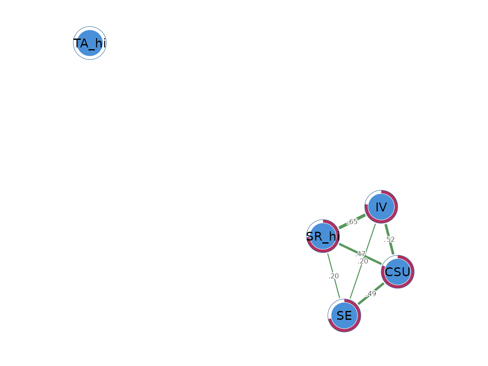

# Mixed graphical models

Studies in psychology and education often measure variables of different
types together: continuous scale scores such as motivation or
self-efficacy alongside binary variables such as a diagnosis, a passed
course or a reported behaviour. A Gaussian graphical model requires
every variable to be continuous and an Ising model requires every
variable to be binary, so neither can place both kinds in one network
without transforming some of them. A mixed graphical model (Haslbeck &
Waldorp, 2020) does. Each variable is regressed on all the others with a
model suited to its type, linear for continuous and logistic for binary
variables, and the regression coefficients form the edges. An edge is an
association that remains with all other variables held constant; a
missing edge means that the association is accounted for by the rest of
the network.

This article estimates a mixed network of three continuous and two
binary indicators of self-regulated learning, reads its edges, describes
the nodes by centrality and by type-appropriate predictability, and
examines how the rule that combines the two regressions of each pair
changes the result.

``` r

library(psychnets)
```

## Data

`SRL_GPT` holds 300 sets of responses to the Motivated Strategies for
Learning Questionnaire. The responses were generated by a large language
model (GPT) in a study of how such models answer psychological surveys
(Saqr, 2025); they serve as a well-structured example and are not
evidence about students. To obtain variables of both types, two of the
five construct scores are recoded as binary indicators.

- **Continuous nodes:** `CSU` (cognitive strategy use), `IV` (intrinsic
  value) and `SE` (self-efficacy), construct scores on a scale from 1 to
  7.
- **Binary nodes:** `SR_hi`, 1 when self-regulation is at or above its
  median; `TA_hi`, 1 when test anxiety is at or above its median.
- **Observations:** one row per respondent; the data are complete.

``` r

mixed_data <- transform(SRL_GPT,
                        SR_hi = as.integer(SR >= median(SR)),
                        TA_hi = as.integer(TA >= median(TA)),
                        SR = NULL, TA = NULL)
head(mixed_data)
#>        CSU       IV       SE SR_hi TA_hi
#> 1 5.307692 5.666667 5.777778     0     1
#> 2 5.846154 6.444444 6.000000     1     1
#> 3 6.615385 6.666667 6.222222     1     0
#> 4 5.692308 6.555556 6.333333     1     1
#> 5 4.384615 5.555556 4.888889     0     1
#> 6 4.846154 5.444444 5.666667     0     0
```

The recoding is for illustration. In an applied study a continuous
variable is kept continuous unless its two states have a substantive
meaning.

## The model

A mixed graphical model is a pairwise Markov random field,

``` math
p(x_1, \ldots, x_p) \propto \exp\left(\sum_j \phi_j(x_j)
+ \sum_{j<k}\phi_{jk}(x_j, x_k)\right),
```

in which a zero pairwise term $`\phi_{jk}`$ means that $`x_j`$ and
$`x_k`$ are independent given all other variables. It is estimated one
node at a time: for node $`j`$, the coefficients $`\boldsymbol\beta`$
minimize

``` math
\frac{1}{n}\sum_{i=1}^n \ell\left(x_{ij}, \beta_0
+ \mathbf{x}_{i,-j}^{\mathsf T}\boldsymbol\beta\right)
+ \lambda_j\lVert\boldsymbol\beta\rVert_1 ,
```

where $`\ell`$ is the Gaussian or binomial negative log-likelihood and
the $`\ell_1`$ penalty sets weak coefficients to zero. The penalty
$`\lambda_j`$ is chosen for each node by the extended BIC
($`\gamma = 0.25`$ by default), and selected coefficients below a small
threshold that shrinks with the sample size are then set to zero
(`threshold = "LW"`, as in mgm). Continuous variables are standardized,
so their units do not determine the coefficients. Each pair then has two
estimates, one from each regression. The AND rule keeps the pair when
both regressions select it, the OR rule when either does, and the edge
weight is the mean of the two estimates.

Node types are detected from the data: factor and character columns, and
numeric columns with at most 10 distinct integer values, are
categorical, and other numeric columns are Gaussian. Here the two 0/1
indicators are binary and the three scores Gaussian. When the integer
rule turns a numeric column into a categorical node, a warning names it;
the `types` argument overrides the detection.

## Which variables are directly associated?

[`psychnet()`](https://pak.dynasite.org/psychnets/reference/psychnet.md)
with `method = "mgm"` estimates the network with the AND rule.

``` r

mixed_net <- psychnet(data = mixed_data, method = "mgm")
summary(mixed_net)
#> <psychnet> mgm network
#>   nodes: 5   edges: 6   (undirected)
#>   optimality (KKT residual): 5.00e-11
#>   edge weight: range [0.196, 0.632], mean 0.413
as.data.frame(mixed_net)
#>   from    to    weight
#> 1  CSU    IV 0.5179205
#> 2  CSU    SE 0.4850679
#> 3   IV    SE 0.1970362
#> 4  CSU SR_hi 0.4509658
#> 5   IV SR_hi 0.6323683
#> 6   SE SR_hi 0.1956633
```

The network has 6 edges, all positive, with weights from 0.196 to 0.632.
The strongest joins intrinsic value and high self-regulation (0.632):
with the other variables held constant, respondents with higher
intrinsic value are more likely to be in the upper half of
self-regulation. Cognitive strategy use is joined to intrinsic value
(0.518), self-efficacy (0.485) and high self-regulation (0.451). High
test anxiety has no edge: under the AND rule, no pair involving it is
selected by both of its regressions.

Edge weights are on different scales for continuous–continuous,
continuous–binary and binary–binary pairs, so magnitudes are compared
within a pair type. For a binary–binary edge, the sign of the logistic
coefficient is kept; some software reports only its magnitude, because
that sign depends on how the categories are coded.

## Is the fitted network the optimum of its objective?

Each penalized regression is solved iteratively. Any solution must
satisfy the problem’s optimality (Karush–Kuhn–Tucker) conditions; the
amount by which a fitted network violates them, the largest over the
nodewise regressions, is its certificate, and a value near zero shows
that the network is the optimum of its objective.

``` r

certificate(mixed_net)
#>   method  certificate kind certified
#> 1    mgm 4.997067e-11  kkt      TRUE
```

The violation is $`5.00 \times 10^{-11}`$, so the edges are the
solutions of the penalized regressions. The certificate concerns the
computation, not the sampling stability of the edges or the measurement
of the variables.

## Which variables are most connected?

[`net_centralities()`](https://pak.dynasite.org/psychnets/reference/net_centralities.md)
returns strength, the sum of absolute edge weights, and expected
influence, the signed sum.

``` r

net_centralities(mixed_net)
#>    node  strength expected_influence
#> 1   CSU 1.4539542          1.4539542
#> 2    IV 1.3473249          1.3473249
#> 3    SE 0.8777674          0.8777674
#> 4 SR_hi 1.2789974          1.2789974
#> 5 TA_hi 0.0000000          0.0000000
```

Cognitive strategy use has the largest strength (1.454), followed by
intrinsic value (1.347) and high self-regulation (1.279). All edges are
positive, so expected influence equals strength, and high test anxiety
has 0 on both. Because the edge scales differ by pair type, centrality
compares the continuous and binary nodes only roughly.

## How well is each variable predicted by the others?

Predictability uses a measure suited to each node type: $`R^2`$ for
continuous nodes, and for binary nodes the normalized classification
accuracy,
$`\operatorname{nCC}_j = (\operatorname{CC}_j - m_j)/(1 - m_j)`$, where
$`\operatorname{CC}_j`$ is the proportion classified correctly and
$`m_j`$ the proportion in the larger category (Haslbeck & Waldorp,
2018).
[`net_predict()`](https://pak.dynasite.org/psychnets/reference/net_predict.md)
needs the data to compute both.

``` r

net_predict(mixed_net, data = mixed_data)
#>    node     type metric predictability accuracy
#> 1   CSU gaussian     R2      0.8131079       NA
#> 2    IV gaussian     R2      0.7757368       NA
#> 3    SE gaussian     R2      0.7153497       NA
#> 4 SR_hi   binary    nCC      0.7391304     0.88
#> 5 TA_hi   binary    nCC      0.0000000     0.50
```

The other variables explain 81% of the variance in cognitive strategy
use ($`R^2 = 0.813`$), 78% in intrinsic value and 72% in self-efficacy.
High self-regulation is classified correctly for 88% of the respondents,
an nCC of 0.739 over its base rate. High test anxiety has nCC = 0 and
50% correct: with no edges, it is predicted no better than by its base
rate. These are in-sample values.

## Does the edge-combination rule change the network?

The two regressions of a pair can disagree. With `rule = "OR"` a pair is
kept when either regression selects it.

``` r

mixed_or <- psychnet(data = mixed_data, method = "mgm", rule = "OR")
summary(mixed_or)
#> <psychnet> mgm network
#>   nodes: 5   edges: 7   (undirected)
#>   optimality (KKT residual): 5.00e-11
#>   edge weight: range [-0.168, 0.632], mean 0.330
as.data.frame(mixed_or)
#>    from    to     weight
#> 1   CSU    IV  0.5179205
#> 2   CSU    SE  0.4850679
#> 3    IV    SE  0.1970362
#> 4   CSU SR_hi  0.4509658
#> 5    IV SR_hi  0.6323683
#> 6    SE SR_hi  0.1956633
#> 7 SR_hi TA_hi -0.1681336
```

The OR network has 7 edges: the six AND edges with the same weights and
a negative edge between high self-regulation and high test anxiety
(-0.168). Respondents in the upper half of self-regulation are less
likely to be in the upper half of test anxiety, with the continuous
constructs held constant, but only one of the two regressions supports
this association. It is the edge through which test anxiety connects to
the network, and it is reported as dependent on the combination rule.
The other six edges are selected under either rule.

## What does the network look like?

[`cograph::splot()`](https://sonsoles.me/cograph/reference/splot.html)
draws the network, with green positive and red negative edges and a ring
showing each node’s predictability.

``` r

cograph::splot(mixed_net, psych_styling = TRUE, predictability = TRUE)
```



The figure shows four connected nodes and an isolated high test anxiety
node with an empty predictability ring. Node positions come from a
layout algorithm and carry no statistical meaning.

## Reporting the analysis

A report identifies each node as continuous or binary, defines the
binary coding, and states the sample size, $`\gamma`$, the combination
rule and the treatment of missing data. Edge weights are reported
numerically, and predictability with the measure matching each node
type.

In this analysis, a mixed graphical model of three continuous and two
binary nodes from 300 complete responses kept 6 positive edges under the
AND rule, the largest between intrinsic value and high self-regulation
(0.632), and left high test anxiety isolated. Under the OR rule a
seventh, negative edge joined high self-regulation and high test anxiety
(-0.168).

## Assumptions and when to use a mixed graphical model

- The model is for data that combine continuous and binary variables.
  With continuous variables only, a Gaussian graphical model is simpler;
  with binary variables only, the Ising model.
- Continuous nodes are modelled by linear regression, binary nodes by
  logistic regression, and observations are independent of one another.
- Categorical variables with more than two levels require
  `native = FALSE`, which fits a multinomial regression through the
  optional `glmnet` package and keeps the variable as one node. One-hot
  coding is not an equivalent alternative, because it turns one variable
  into several nodes.
- Edges selected only under the OR rule are less certain than those
  selected under both rules.
- Edges are conditional associations, not causal effects.

## References

Haslbeck, J. M. B., & Waldorp, L. J. (2018). How well do network models
predict observations? On the importance of predictability in network
models. *Behavior Research Methods*, 50(2), 853-861.
[doi:10.3758/s13428-017-0910-x](https://doi.org/10.3758/s13428-017-0910-x)

Haslbeck, J. M. B., & Waldorp, L. J. (2020). mgm: Estimating
time-varying mixed graphical models in high-dimensional data. *Journal
of Statistical Software*, 93(8), 1-46.
[doi:10.18637/jss.v093.i08](https://doi.org/10.18637/jss.v093.i08)

Saqr, M. (2025). Delving into the psychology of machines: Exploring the
structure of self-regulated learning via LLM-generated survey responses.
*Computers in Human Behavior*, 173, 108769.
[doi:10.1016/j.chb.2025.108769](https://doi.org/10.1016/j.chb.2025.108769)
