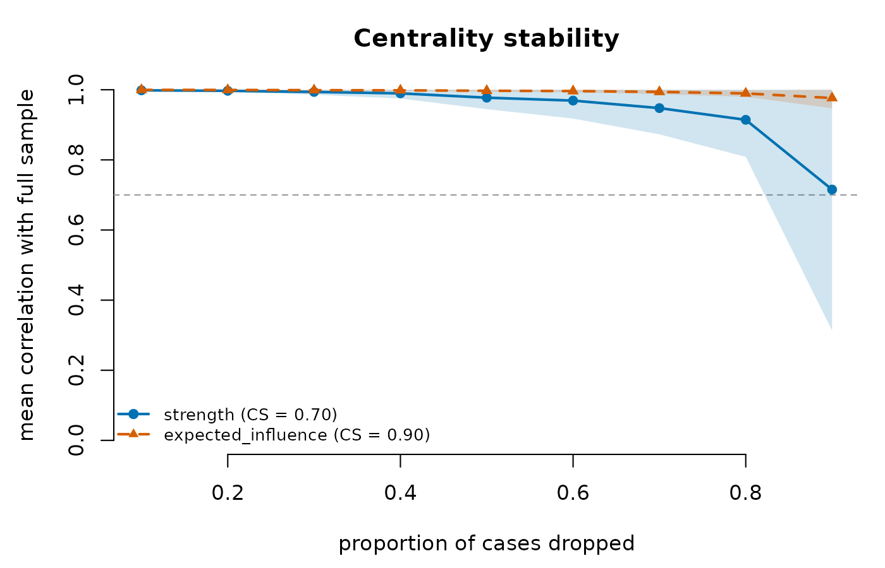

# Edge-weight stability and split-half reliability

Can the strongest edges and most prominent nodes in a psychological
network be trusted to remain similar in another sample? Consider a
network of self-efficacy, learning strategies and test anxiety, in which
the constructs are nodes and their estimated associations are edges. In
a partial correlation network, each edge describes an association
adjusted for the other variables, while centrality measures summarise
aspects of each node’s position. These tools allow researchers to
explore multivariate patterns rather than examine every construct in
isolation (Borsboom et al., 2021). Yet the interpretation of edge
weights and centrality depends on the estimation method and available
data, making stability and reliability important considerations
(Isvoranu & Epskamp, 2023).

Network methods have been used in education to study the relationships
among learning processes and how these relationships vary across
contexts and time. Saqr et al. (2024) introduce psychological networks
as an approach to analysing learning and complex learning processes.
Applications include networks of students’ monitoring events across
phases of regulation (Malmberg et al., 2022) and the temporal dynamics
of self-regulation during academic writing (Saqr et al., 2021). These
studies illustrate the value of examining patterns of relationships, but
an apparent connection or prominent node in an estimated network should
not automatically be treated as a reproducible finding.

A network fitted to one sample will generally differ from a network
fitted to another sample from the same population. Consequently, applied
researchers need to assess uncertainty in individual edge weights,
whether nodes can be distinguished in centrality, and how much the
network changes when observations are omitted or divided into groups.
Resampling provides an empirical way to investigate these questions by
repeatedly estimating networks from the available observations (Epskamp
et al., 2018). Assessing and clearly reporting such uncertainty is also
part of good practice in cross-sectional network analysis (Burger et
al., 2023). These checks describe the robustness of an estimated
network; they do not establish causal relationships or guarantee
replication in a new population.

This article demonstrates five complementary diagnostics in `psychnets`:
bootstrap intervals for edges and centrality, bootstrap comparisons of
nodes, case-dropping stability of centrality, case-dropping reliability
of edge weights, and split-half reliability. The worked example uses
questionnaire responses generated by a large language model, rather than
observations of students, and therefore illustrates methods rather than
substantive findings about learners. For each diagnostic, we explain the
question it addresses, show the relevant output, and discuss what
researchers can reasonably report. The functions use a consistent
network-estimation interface, allowing the same workflow to be used with
other estimators.

``` r

library(psychnets)
set.seed(1)
```

Because the procedures involve random resampling, setting the seed makes
the illustrative results reproducible.

## Data

`SRL_Claude` contains 300 sets of responses to the Motivated Strategies
for Learning Questionnaire generated by the large language model Claude
for a study of responses to psychological surveys (Vogelsmeier et al.,
2025). The model-generated responses are unusually internally consistent
and produce several large estimated edges. They make the numerical
examples easy to inspect, but do not provide evidence about
relationships among constructs in real students.

- **Nodes:** five construct scores on a scale from 1 to 7: `CSU`
  (cognitive strategy use), `IV` (intrinsic value), `SE`
  (self-efficacy), `SR` (self-regulation) and `TA` (test anxiety).
- **Observations:** one row per respondent; the data are complete.

``` r

head(SRL_Claude)
#>        CSU       IV       SE       SR   TA
#> 1 4.615385 6.444444 4.555556 4.777778 4.00
#> 2 5.692308 7.000000 5.555556 6.222222 3.00
#> 3 5.692308 7.000000 5.777778 6.666667 3.75
#> 4 5.461538 6.222222 5.777778 5.777778 4.75
#> 5 4.846154 5.333333 5.000000 5.333333 3.75
#> 6 4.538462 4.333333 5.777778 4.000000 5.00
```

The main analyses use an EBIC graphical lasso (`method = "glasso"`) to
estimate a regularised network of partial correlations. All five
diagnostics therefore assess the same type of fitted network.

## How precise is each edge?

[`net_boot()`](https://pak.dynasite.org/psychnets/reference/net_boot.md)
draws samples of observations with replacement, estimates a network for
each sample and summarises the resulting edge weights. The output
provides each observed weight, the bootstrap mean, a 95% percentile
interval and the proportion of resamples in which the edge has a
non-zero estimate. The `significant` flag indicates that the percentile
interval excludes zero; it should not be read as proof of an underlying
relationship. For substantive research, at least 1,000 bootstrap samples
provide a more useful basis for assessing precision. Here, 200 resamples
keep the demonstration manageable.

``` r

b <- net_boot(SRL_Claude, method = "glasso", n_boot = 200, cores = 1)
b
#> <psychnet_bootstrap> glasso, 200 resamples, 95% CI
#>   10 edges (8 significant), 5 nodes, measures: strength, expected_influence
as.data.frame(b)
#>    from to     observed        mean      lower      upper prop_nonzero
#> 1   CSU IV  0.001744267  0.02777141  0.0000000  0.1202986        0.550
#> 2   CSU SE  0.223973564  0.22825629  0.1360369  0.3243276        1.000
#> 3    IV SE -0.402239002 -0.40747351 -0.5171210 -0.2997294        1.000
#> 4   CSU SR  0.728177591  0.72069631  0.6520409  0.7748107        1.000
#> 5    IV SR  0.574170376  0.55984489  0.4974457  0.6284297        1.000
#> 6    SE SR  0.221496430  0.22481115  0.1522627  0.3150743        1.000
#> 7   CSU TA  0.525584044  0.52512504  0.4465139  0.6111719        1.000
#> 8    IV TA -0.013854928 -0.03375546 -0.1320652  0.0245725        0.755
#> 9    SE TA -0.417575459 -0.41986895 -0.4934429 -0.3408875        1.000
#> 10   SR TA -0.428181457 -0.42032870 -0.4852677 -0.3476119        1.000
#>    significant
#> 1        FALSE
#> 2         TRUE
#> 3         TRUE
#> 4         TRUE
#> 5         TRUE
#> 6         TRUE
#> 7         TRUE
#> 8        FALSE
#> 9         TRUE
#> 10        TRUE
```

Eight of the ten edges have percentile intervals that exclude zero, and
all eight are selected in every bootstrap sample. The largest positive
edge, `CSU`–`SR`, has an observed weight of 0.73 and an interval from
0.65 to 0.77. By contrast, `CSU`–`IV` has a weight of 0.002, an interval
from 0 to 0.12 and a non-zero estimate in 55% of resamples. The
`IV`–`TA` edge has a weight of -0.014, an interval from -0.13 to 0.02
and a non-zero estimate in 75.5% of resamples. The latter two intervals
include zero, so these data do not support confident interpretation of
those edges. The plot presents the edge estimates alongside their
intervals, ordered by weight:

``` r

plot(b)
```


## How precise is each node’s centrality?

The bootstrap samples also provide intervals for node centrality.
Strength is the sum of the absolute weights of a node’s edges, whereas
expected influence sums signed edge weights. This distinction matters
when the network contains both positive and negative associations.

``` r

as.data.frame(b, what = "centrality")
#>   node  strength strength_lower strength_upper expected_influence
#> 1  CSU 1.4794795      1.3523996       1.667857          1.4794795
#> 2   IV 0.9920086      0.8349704       1.266730          0.1598207
#> 3   SE 1.2652845      1.0903270       1.502809         -0.3743445
#> 4   SR 1.9520259      1.8288036       2.030832          1.0956629
#> 5   TA 1.3851959      1.2491191       1.574835         -0.3340278
#>   expected_influence_lower expected_influence_upper
#> 1               1.35239959                1.6678566
#> 2               0.01245256                0.2507549
#> 3              -0.45804609               -0.2573138
#> 4               0.96124498                1.2166942
#> 5              -0.43162878               -0.2568683
plot(b, type = "centrality")
```


Self-regulation (`SR`) has the highest observed strength, 1.95, with a
bootstrap interval from 1.83 to 2.03. This interval does not overlap the
interval of any other node. Intrinsic value (`IV`) has the lowest
observed strength, 0.99, with an interval from 0.83 to 1.27. The
intervals for cognitive strategy use, self-efficacy and test anxiety
overlap, so their ranking cannot be inferred from separate intervals
alone. Expected influence answers a different question: self-efficacy
and test anxiety have negative values (-0.37 and -0.33), reflecting the
balance of their signed edges. The next analysis compares strengths
directly.

## Which nodes can be ranked?

[`difference_test()`](https://pak.dynasite.org/psychnets/reference/difference_test.md)
compares the centralities of pairs of nodes or the weights of pairs of
edges. It calculates each difference across the existing bootstrap
samples, then reports its percentile interval and a two-sided bootstrap
p-value. The stored samples from
[`net_boot()`](https://pak.dynasite.org/psychnets/reference/net_boot.md)
are reused rather than fitted again. For the ten pairwise strength
comparisons, `p_adjust = "BH"` applies a false discovery rate adjustment
to the p-values (Benjamini & Hochberg, 1995). An interval containing
zero indicates that the bootstrap differences do not clearly distinguish
the pair.

``` r

difference_test(b, type = "strength", p_adjust = "BH")
#>    item1 item2    value1    value2    obs_diff        lower       upper
#> 1    CSU    IV 1.4794795 0.9920086  0.48747089  0.241546367  0.66372411
#> 2    CSU    SE 1.4794795 1.2652845  0.21419501  0.038286544  0.42634973
#> 3     IV    SE 0.9920086 1.2652845 -0.27327588 -0.334413124 -0.13532664
#> 4    CSU    SR 1.4794795 1.9520259 -0.47254639 -0.623609013 -0.21321640
#> 5     IV    SR 0.9920086 1.9520259 -0.96001728 -1.093928157 -0.59055176
#> 6     SE    SR 1.2652845 1.9520259 -0.68674140 -0.877109385 -0.38029431
#> 7    CSU    TA 1.4794795 1.3851959  0.09428358  0.003900685  0.19887099
#> 8     IV    TA 0.9920086 1.3851959 -0.39318731 -0.563676398 -0.15302913
#> 9     SE    TA 1.2652845 1.3851959 -0.11991143 -0.332646886  0.08003091
#> 10    SR    TA 1.9520259 1.3851959  0.56682997  0.285722615  0.69319578
#>       p_value significant
#> 1  0.00000000        TRUE
#> 2  0.04444444        TRUE
#> 3  0.00000000        TRUE
#> 4  0.00000000        TRUE
#> 5  0.00000000        TRUE
#> 6  0.00000000        TRUE
#> 7  0.04444444        TRUE
#> 8  0.00000000        TRUE
#> 9  0.26000000       FALSE
#> 10 0.00000000        TRUE
```

Nine of the ten comparisons have intervals excluding zero and are
flagged as significant in the output. Self-regulation has greater
strength than every other node, with adjusted p-values reported as 0 for
these comparisons at the available bootstrap resolution. Cognitive
strategy use also exceeds self-efficacy and test anxiety (adjusted p =
0.044 for each comparison). The only pair not distinguished is
self-efficacy and test anxiety: their observed difference is -0.12, with
an interval from -0.33 to 0.08 and an adjusted p-value of 0.26. Thus,
self-regulation can be placed first and intrinsic value last in this
example, but the evidence does not establish an ordering between
self-efficacy and test anxiety.

## Is the centrality ranking stable when cases are dropped?

[`net_stability()`](https://pak.dynasite.org/psychnets/reference/net_stability.md)
re-estimates the network on random subsets that drop an increasing
proportion of the respondents and correlates the centralities of each
subset with those of the full sample. The correlation-stability
coefficient (CS-coefficient) is the largest proportion of cases that can
be dropped while the correlation stays at or above 0.7 in at least 95%
of the subsets (Epskamp et al., 2018).

``` r

st <- net_stability(SRL_Claude, method = "glasso", iter = 100)
st
#> <psychnet_stability> glasso, 100 subsets/proportion
#>   CS-coefficient (pearson cor > 0.70 in > 95% of subsets):
#>     strength             0.70
#>     expected_influence   0.90
```

The reported CS-coefficients are 0.70 for strength and 0.90 for expected
influence. Under the diagnostic’s criterion, a drop proportion of 0.70
retains correlations of at least 0.7 with full-sample strength in at
least 95% of the sampled subsets. Epskamp et al. (2018) recommend a
coefficient above 0.25, preferably above 0.5, for interpreting
centrality. Both estimates comfortably exceed these reference values.
This supports the stability of the centrality pattern in the example,
although it does not resolve every pairwise difference. The plot
displays mean correlations by drop proportion, with a band showing one
standard deviation and a horizontal threshold at 0.7:

``` r

plot(st)
```



## Is the edge structure stable when cases are dropped?

[`net_casedrop_reliability()`](https://pak.dynasite.org/psychnets/reference/net_casedrop_reliability.md)
applies the same case-dropping design to the edges. At each drop
proportion it compares the edge weights of each subset with those of the
full sample through their correlation and through the mean, median and
largest absolute difference. The edge-weight CS-coefficient is defined
as for centrality.

``` r

cd <- net_casedrop_reliability(SRL_Claude, method = "glasso", iter = 100)
cd
#> # edge-weight stability: glasso | CS = 0.90 (pearson cor > 0.70 in > 95% of subsets)
#>            metric drop_prop actual_drop       mean          sd n_valid
#> 1    mean_abs_dev       0.1         0.1 0.01223453 0.007078789     100
#> 2    mean_abs_dev       0.2         0.2 0.01702795 0.006598546     100
#> 3    mean_abs_dev       0.3         0.3 0.02274269 0.009531099     100
#> 4    mean_abs_dev       0.4         0.4 0.02958753 0.013176682     100
#> 5    mean_abs_dev       0.5         0.5 0.03467924 0.015125426     100
#> 6    mean_abs_dev       0.6         0.6 0.04525305 0.021570568     100
#> 7    mean_abs_dev       0.7         0.7 0.05571419 0.024151750     100
#> 8    mean_abs_dev       0.8         0.8 0.07334800 0.028299586     100
#> 9    mean_abs_dev       0.9         0.9 0.11167002 0.039600394     100
#> 10 median_abs_dev       0.1         0.1 0.01113632 0.007721301     100
#> 11 median_abs_dev       0.2         0.2 0.01477376 0.006876153     100
#> 12 median_abs_dev       0.3         0.3 0.02009654 0.010843466     100
#> 13 median_abs_dev       0.4         0.4 0.02714279 0.014258682     100
#> 14 median_abs_dev       0.5         0.5 0.03001670 0.015792390     100
#> 15 median_abs_dev       0.6         0.6 0.04140568 0.021707532     100
#> 16 median_abs_dev       0.7         0.7 0.04887775 0.025843871     100
#> 17 median_abs_dev       0.8         0.8 0.06558498 0.031147359     100
#> 18 median_abs_dev       0.9         0.9 0.10044642 0.044467062     100
#> 19    correlation       0.1         0.1 0.99918303 0.001171843     100
#> 20    correlation       0.2         0.2 0.99865420 0.001195384     100
#> 21    correlation       0.3         0.3 0.99753130 0.002272435     100
#> 22    correlation       0.4         0.4 0.99571692 0.003849700     100
#> 23    correlation       0.5         0.5 0.99410291 0.005682065     100
#> 24    correlation       0.6         0.6 0.99008016 0.009930387     100
#> 25    correlation       0.7         0.7 0.98536877 0.012430219     100
#> 26    correlation       0.8         0.8 0.97543937 0.018315939     100
#> 27    correlation       0.9         0.9 0.94321695 0.043557770     100
#> 28    max_abs_dev       0.1         0.1 0.02827627 0.014355432     100
#> 29    max_abs_dev       0.2         0.2 0.03945443 0.015041128     100
#> 30    max_abs_dev       0.3         0.3 0.05301608 0.020119036     100
#> 31    max_abs_dev       0.4         0.4 0.06977815 0.030387123     100
#> 32    max_abs_dev       0.5         0.5 0.08135286 0.033159361     100
#> 33    max_abs_dev       0.6         0.6 0.10019480 0.044161063     100
#> 34    max_abs_dev       0.7         0.7 0.12779105 0.048349703     100
#> 35    max_abs_dev       0.8         0.8 0.16748415 0.057766787     100
#> 36    max_abs_dev       0.9         0.9 0.26079883 0.093049603     100
```

The edge-weight CS-coefficient is 0.90. Mean correlations between subset
and full-sample edge weights are 0.999 after dropping 10% of cases and
0.943 after dropping 90%, suggesting that the overall arrangement of
edge weights is retained across the sampled subsets. This does not mean
that individual estimates remain equally precise. The mean absolute
deviation rises from 0.012 to 0.112 across these drop proportions, while
the mean maximum absolute deviation rises from 0.028 to 0.261. At the
largest drop proportion, appreciable differences in individual edge
estimates can therefore coexist with a high overall correlation.

``` r

plot(cd)
```


## Does the network replicate across halves of the sample?

[`net_split_reliability()`](https://pak.dynasite.org/psychnets/reference/net_split_reliability.md)
divides the sample at random into two halves, estimates a network on
each, and compares the two sets of edges, repeating the split many
times. The result has one row per comparison measure, with its mean,
standard deviation and the 2.5% and 97.5% quantiles across splits.

``` r

rel <- net_split_reliability(SRL_Claude, method = "glasso", iter = 100)
rel
#> # split-half reliability: glasso | 100 iterations (50/50 split)
#>           metric       mean         sd      lower     upper n_valid
#> 1   mean_abs_dev 0.06406132 0.02201012 0.03319670 0.1092927     100
#> 2 median_abs_dev 0.05674286 0.02297601 0.02204948 0.1086049     100
#> 3    correlation 0.98243129 0.01208858 0.95313106 0.9960735     100
#> 4    max_abs_dev 0.14177087 0.05219793 0.06749545 0.2635560     100
```

Across 100 random 50/50 splits, the mean correlation between the two
sets of edge weights is 0.982. The 2.5th and 97.5th percentiles of the
correlations are 0.953 and 0.996. Each half contains 150 observations,
but the halves are repeatedly drawn from the same dataset, not from two
new independent studies. The mean absolute edge-weight deviation across
splits is 0.064, and the mean of the maximum absolute deviations is
0.142. These results indicate strong agreement in the overall edge
pattern within this dataset, alongside some variation in particular edge
weights; they do not by themselves demonstrate external replication.

``` r

plot(rel)
```


## Do the diagnostics apply to other estimators?

Each diagnostic refits the network through `psychnet(method = )`, so it
applies to any estimator. With the unregularized partial correlation
network:

``` r

net_casedrop_reliability(SRL_Claude, method = "pcor", iter = 100)
#> # edge-weight stability: pcor | CS = 0.90 (pearson cor > 0.70 in > 95% of subsets)
#>            metric drop_prop actual_drop       mean          sd n_valid
#> 1    mean_abs_dev       0.1         0.1 0.01407596 0.005722099     100
#> 2    mean_abs_dev       0.2         0.2 0.02103369 0.008735917     100
#> 3    mean_abs_dev       0.3         0.3 0.03135441 0.013653667     100
#> 4    mean_abs_dev       0.4         0.4 0.03533740 0.015310550     100
#> 5    mean_abs_dev       0.5         0.5 0.04366644 0.019115731     100
#> 6    mean_abs_dev       0.6         0.6 0.05544954 0.022945464     100
#> 7    mean_abs_dev       0.7         0.7 0.06709600 0.027703213     100
#> 8    mean_abs_dev       0.8         0.8 0.08590790 0.034829376     100
#> 9    mean_abs_dev       0.9         0.9 0.13930127 0.050714693     100
#> 10 median_abs_dev       0.1         0.1 0.01255458 0.005728588     100
#> 11 median_abs_dev       0.2         0.2 0.01868817 0.009034031     100
#> 12 median_abs_dev       0.3         0.3 0.02904228 0.014722232     100
#> 13 median_abs_dev       0.4         0.4 0.03149873 0.015085832     100
#> 14 median_abs_dev       0.5         0.5 0.03877024 0.019599609     100
#> 15 median_abs_dev       0.6         0.6 0.05061707 0.025013217     100
#> 16 median_abs_dev       0.7         0.7 0.06252573 0.027848899     100
#> 17 median_abs_dev       0.8         0.8 0.07818641 0.038656186     100
#> 18 median_abs_dev       0.9         0.9 0.12953302 0.052834482     100
#> 19    correlation       0.1         0.1 0.99918308 0.000782910     100
#> 20    correlation       0.2         0.2 0.99817888 0.001589584     100
#> 21    correlation       0.3         0.3 0.99592459 0.003917103     100
#> 22    correlation       0.4         0.4 0.99485719 0.004399123     100
#> 23    correlation       0.5         0.5 0.99200702 0.006954841     100
#> 24    correlation       0.6         0.6 0.98779973 0.010788655     100
#> 25    correlation       0.7         0.7 0.98233205 0.014669997     100
#> 26    correlation       0.8         0.8 0.97160972 0.021543350     100
#> 27    correlation       0.9         0.9 0.93267114 0.045277930     100
#> 28    max_abs_dev       0.1         0.1 0.03107886 0.012465500     100
#> 29    max_abs_dev       0.2         0.2 0.04640442 0.017538560     100
#> 30    max_abs_dev       0.3         0.3 0.06831509 0.029755783     100
#> 31    max_abs_dev       0.4         0.4 0.07758760 0.031489940     100
#> 32    max_abs_dev       0.5         0.5 0.09775775 0.041505461     100
#> 33    max_abs_dev       0.6         0.6 0.12091082 0.046760671     100
#> 34    max_abs_dev       0.7         0.7 0.14489778 0.060423740     100
#> 35    max_abs_dev       0.8         0.8 0.19218553 0.071761675     100
#> 36    max_abs_dev       0.9         0.9 0.29803031 0.104489216     100
```

The unregularised partial correlation network also has an edge-weight
CS-coefficient of 0.90. Its mean absolute deviations exceed those of the
graphical lasso at each reported drop proportion, reaching 0.139 rather
than 0.112 when 90% of cases are dropped. The absence of regularisation
may contribute to this difference, but these figures alone do not
establish its cause. Each diagnostic also accepts group networks fitted
using `psychnet(..., group = )` and returns results for each group.

## When to use which diagnostic

| Question | Verb | Read the result with |
|----|----|----|
| How precise is each edge and centrality? | [`net_boot()`](https://pak.dynasite.org/psychnets/reference/net_boot.md) | `as.data.frame(b)`, `as.data.frame(b, what = "centrality")`, [`plot()`](https://rdrr.io/r/graphics/plot.default.html) |
| Do two edges or two nodes differ? | [`difference_test()`](https://pak.dynasite.org/psychnets/reference/difference_test.md) | the returned table, [`plot()`](https://rdrr.io/r/graphics/plot.default.html) |
| Is the centrality order stable when cases are dropped? | [`net_stability()`](https://pak.dynasite.org/psychnets/reference/net_stability.md) | `as.data.frame(st, what = "cs")`, `as.data.frame(st)`, [`plot()`](https://rdrr.io/r/graphics/plot.default.html) |
| Is the edge structure stable when cases are dropped? | [`net_casedrop_reliability()`](https://pak.dynasite.org/psychnets/reference/net_casedrop_reliability.md) | the returned table, [`plot()`](https://rdrr.io/r/graphics/plot.default.html) |
| Does the network replicate across halves? | [`net_split_reliability()`](https://pak.dynasite.org/psychnets/reference/net_split_reliability.md) | the returned table, [`plot()`](https://rdrr.io/r/graphics/plot.default.html) |

- Report bootstrap intervals for edges of substantive interest. Treat an
  interval containing zero as insufficient evidence to interpret that
  edge confidently, rather than as proof that the relationship is
  absent.
- Use pairwise difference tests alongside case-dropping stability when
  discussing node rankings. A CS-coefficient below 0.25 warrants
  particular caution about centrality interpretation.
- Distinguish uncertainty in a particular edge from agreement in the
  network as a whole. Here, high case-dropping and split-half
  correlations coexist with two edge intervals that include zero.
- These procedures assume independent observations. For repeated
  observations from the same individuals, resampling must respect the
  dependence between observations from each individual.

## How to cite this article

Saqr, M., & López-Pernas, S. (2026). *Edge-weight stability and
split-half reliability*. psychnets.
<https://doi.org/10.5281/zenodo.24567528> ·
[HTML](https://pak.dynasite.org/psychnets/articles/network-reliability.html)
· [PDF](https://pak.dynasite.org/psychnets/pdf/network-reliability.pdf)

## References

Benjamini, Y., & Hochberg, Y. (1995). Controlling the false discovery
rate: A practical and powerful approach to multiple testing. *Journal of
the Royal Statistical Society: Series B (Methodological)*, 57(1),
289-300.
[doi:10.1111/j.2517-6161.1995.tb02031.x](https://doi.org/10.1111/j.2517-6161.1995.tb02031.x)

Borsboom, D., Deserno, M. K., Rhemtulla, M., Epskamp, S., Fried, E. I.,
McNally, R. J., Robinaugh, D. J., Perugini, M., Dalege, J., Costantini,
G., Isvoranu, A.-M., Wysocki, A. C., van Borkulo, C. D., van Bork, R., &
Waldorp, L. J. (2021). Network analysis of multivariate data in
psychological science. *Nature Reviews Methods Primers*, 1, 58.
[doi:10.1038/s43586-021-00055-w](https://doi.org/10.1038/s43586-021-00055-w)

Burger, J., Isvoranu, A.-M., Lunansky, G., Haslbeck, J. M. B., Epskamp,
S., Hoekstra, R. H. A., Fried, E. I., Borsboom, D., & Blanken, T. F.
(2023). Reporting standards for psychological network analyses in
cross-sectional data. *Psychological Methods*, 28(4), 806-824.
[doi:10.1037/met0000471](https://doi.org/10.1037/met0000471)

Epskamp, S., Borsboom, D., & Fried, E. I. (2018). Estimating
psychological networks and their accuracy: A tutorial paper. *Behavior
Research Methods*, 50(1), 195-212.
[doi:10.3758/s13428-017-0862-1](https://doi.org/10.3758/s13428-017-0862-1)

Isvoranu, A.-M., & Epskamp, S. (2023). Which estimation method to choose
in network psychometrics? Deriving guidelines for applied researchers.
*Psychological Methods*, 28(4), 925-946.
[doi:10.1037/met0000439](https://doi.org/10.1037/met0000439)

Malmberg, J., Saqr, M., Järvenoja, H., & Järvelä, S. (2022). How the
monitoring events of individual students are associated with phases of
regulation: A network analysis approach. *Journal of Learning
Analytics*, 9(1), 77-92.
[doi:10.18608/jla.2022.7429](https://doi.org/10.18608/jla.2022.7429)

Saqr, M., Beck, E., & López-Pernas, S. (2024). Psychological networks: A
modern approach to analysis of learning and complex learning processes.
In M. Saqr & S. López-Pernas (Eds.), *Learning analytics methods and
tutorials: A practical guide using R* (pp. 639-671). Springer.
[doi:10.1007/978-3-031-54464-4_19](https://doi.org/10.1007/978-3-031-54464-4_19)

Saqr, M., Peeters, W., & Viberg, O. (2021). The relational, co-temporal,
contemporaneous, and longitudinal dynamics of self-regulation for
academic writing. *Research and Practice in Technology Enhanced
Learning*, 16, 29.
[doi:10.1186/s41039-021-00175-7](https://doi.org/10.1186/s41039-021-00175-7)

Vogelsmeier, L. V. D. E., Oliveira, E., Misiejuk, K., López-Pernas, S.,
& Saqr, M. (2025). Delving into the psychology of machines: Exploring
the structure of self-regulated learning via LLM-generated survey
responses. *Computers in Human Behavior*, 173, 108769.
[doi:10.1016/j.chb.2025.108769](https://doi.org/10.1016/j.chb.2025.108769)
