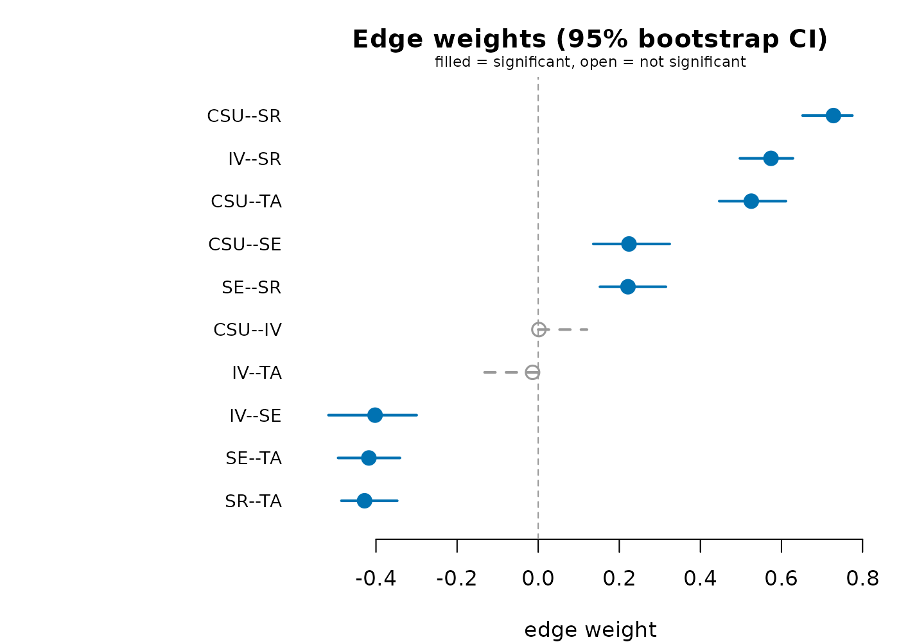
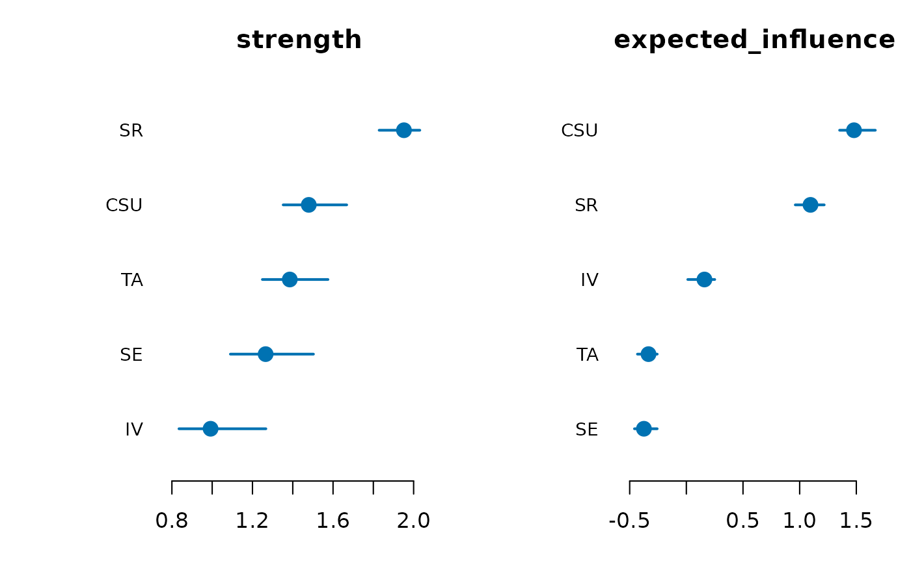
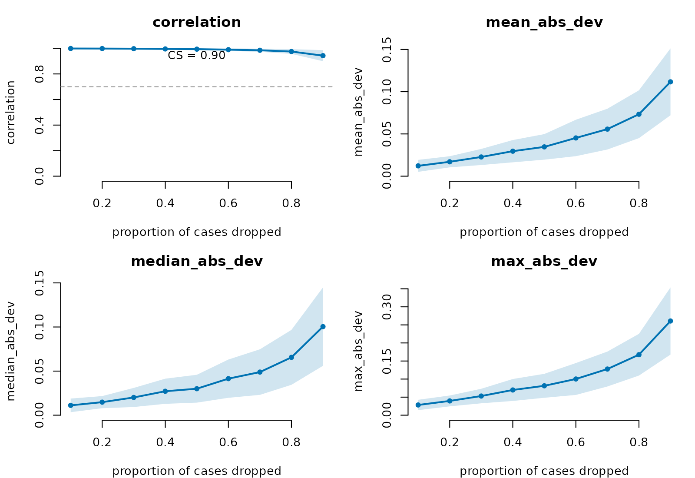
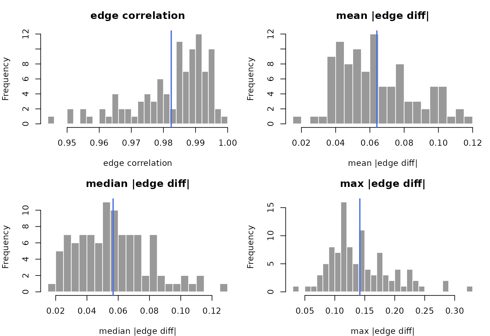

# Edge-weight stability and split-half reliability

A psychological network is estimated from one sample, and another sample
from the same population would give a somewhat different network. Before
an edge is interpreted or a node is called the most central, the analyst
needs to know whether the result would reappear: whether an edge differs
reliably from zero, whether two nodes can be ranked, and whether the
structure survives when part of the sample is removed or when the sample
is split in two. Resampling answers these questions without
distributional assumptions, by re-estimating the network many times on
samples drawn from the data (Epskamp et al., 2018).

This article applies five such diagnostics to one network: bootstrap
confidence intervals for edges and centralities, bootstrap tests of
differences between nodes, the stability of centrality and of edge
weights when cases are dropped, and the agreement of networks estimated
on two halves of the sample. Each diagnostic refits the network with the
same estimator, so the same steps apply to any estimator.

``` r

library(psychnets)
set.seed(1)
```

The diagnostics resample at random, so the seed is set once to make the
results reproducible.

## Data

`SRL_Claude` holds 300 sets of responses to the Motivated Strategies for
Learning Questionnaire generated by a large language model (Claude) in a
study of how such models answer psychological surveys (Saqr, 2025). Its
responses are more internally consistent than human responses, which
yields a network with large edges; it serves here as an example and is
not evidence about students.

- **Nodes:** five construct scores on a scale from 1 to 7: `CSU`
  (cognitive strategy use), `IV` (intrinsic value), `SE`
  (self-efficacy), `SR` (self-regulation) and `TA` (test anxiety).
- **Observations:** one row per respondent; the data are complete.

``` r

head(SRL_Claude)
#>        CSU       IV       SE       SR   TA
#> 1 4.615385 6.444444 4.555556 4.777778 4.00
#> 2 5.692308 7.000000 5.555556 6.222222 3.00
#> 3 5.692308 7.000000 5.777778 6.666667 3.75
#> 4 5.461538 6.222222 5.777778 5.777778 4.75
#> 5 4.846154 5.333333 5.000000 5.333333 3.75
#> 6 4.538462 4.333333 5.777778 4.000000 5.00
```

Every diagnostic below estimates an EBIC graphical lasso
(`method = "glasso"`), whose edges are partial correlations.

## How precise is each edge?

[`net_boot()`](https://pak.dynasite.org/psychnets/reference/net_boot.md)
draws bootstrap samples of the respondents with replacement,
re-estimates the network on each, and summarizes the distribution of
every edge weight: its mean, its 95% percentile interval, and the
proportion of samples in which the edge was selected. An edge is flagged
`significant` when its interval excludes zero. An applied analysis uses
at least 1,000 samples; 200 keep this example short.

``` r

b <- net_boot(SRL_Claude, method = "glasso", n_boot = 200, cores = 1)
b
#> <psychnet_bootstrap> glasso, 200 resamples, 95% CI
#>   10 edges (8 significant), 5 nodes, measures: strength, expected_influence
as.data.frame(b)
#>    from to     observed        mean      lower      upper prop_nonzero
#> 1   CSU IV  0.001744267  0.02777141  0.0000000  0.1202986        0.550
#> 2   CSU SE  0.223973564  0.22825629  0.1360369  0.3243276        1.000
#> 3    IV SE -0.402239002 -0.40747351 -0.5171210 -0.2997294        1.000
#> 4   CSU SR  0.728177591  0.72069631  0.6520409  0.7748107        1.000
#> 5    IV SR  0.574170376  0.55984489  0.4974457  0.6284297        1.000
#> 6    SE SR  0.221496430  0.22481115  0.1522627  0.3150743        1.000
#> 7   CSU TA  0.525584044  0.52512504  0.4465139  0.6111719        1.000
#> 8    IV TA -0.013854928 -0.03375546 -0.1320652  0.0245725        0.755
#> 9    SE TA -0.417575459 -0.41986895 -0.4934429 -0.3408875        1.000
#> 10   SR TA -0.428181457 -0.42032870 -0.4852677 -0.3476119        1.000
#>    significant
#> 1        FALSE
#> 2         TRUE
#> 3         TRUE
#> 4         TRUE
#> 5         TRUE
#> 6         TRUE
#> 7         TRUE
#> 8        FALSE
#> 9         TRUE
#> 10        TRUE
```

Eight of the ten edges have intervals that exclude zero and are selected
in every bootstrap sample. The strongest, `CSU`–`SR` (0.73, interval
0.65 to 0.77), is estimated precisely. Two edges are not reliable.
`CSU`–`IV` has an observed weight of 0.002 and an interval from 0 to
0.12, and is selected in only 55% of the samples; `IV`–`TA` (-0.014,
interval -0.13 to 0.02) is selected in 76%. Neither their presence nor
their sign can be interpreted at this sample size. The plot shows each
edge with its interval, ordered by size:

``` r

plot(b)
```



## How precise is each node’s centrality?

The same bootstrap samples give intervals for the centrality of each
node.

``` r

as.data.frame(b, what = "centrality")
#>   node  strength strength_lower strength_upper expected_influence
#> 1  CSU 1.4794795      1.3523996       1.667857          1.4794795
#> 2   IV 0.9920086      0.8349704       1.266730          0.1598207
#> 3   SE 1.2652845      1.0903270       1.502809         -0.3743445
#> 4   SR 1.9520259      1.8288036       2.030832          1.0956629
#> 5   TA 1.3851959      1.2491191       1.574835         -0.3340278
#>   expected_influence_lower expected_influence_upper
#> 1               1.35239959                1.6678566
#> 2               0.01245256                0.2507549
#> 3              -0.45804609               -0.2573138
#> 4               0.96124498                1.2166942
#> 5              -0.43162878               -0.2568683
plot(b, type = "centrality")
```



Self-regulation has the largest strength, 1.95 with an interval from
1.83 to 2.03, which does not overlap with the interval of any other
node. Intrinsic value has the smallest strength (0.99, interval 0.83 to
1.27). The intervals of cognitive strategy use, self-efficacy and test
anxiety overlap, so their order cannot be read from the intervals alone;
the difference test below addresses it. Expected influence separates the
nodes differently, because self-efficacy and test anxiety have negative
expected influence (-0.37 and -0.33).

## Which nodes can be ranked?

[`difference_test()`](https://pak.dynasite.org/psychnets/reference/difference_test.md)
tests whether two nodes differ in centrality, or two edges in weight,
within the network. For each pair it takes the difference in every
bootstrap sample, forms its percentile interval and a two-sided
bootstrap p-value, and flags the pair when the interval excludes zero.
It reads the samples already stored by
[`net_boot()`](https://pak.dynasite.org/psychnets/reference/net_boot.md),
so nothing is refitted. With ten pairs, `p_adjust = "BH"` controls the
false discovery rate (Benjamini & Hochberg, 1995).

``` r

difference_test(b, type = "strength", p_adjust = "BH")
#>    item1 item2    value1    value2    obs_diff        lower       upper
#> 1    CSU    IV 1.4794795 0.9920086  0.48747089  0.241546367  0.66372411
#> 2    CSU    SE 1.4794795 1.2652845  0.21419501  0.038286544  0.42634973
#> 3     IV    SE 0.9920086 1.2652845 -0.27327588 -0.334413124 -0.13532664
#> 4    CSU    SR 1.4794795 1.9520259 -0.47254639 -0.623609013 -0.21321640
#> 5     IV    SR 0.9920086 1.9520259 -0.96001728 -1.093928157 -0.59055176
#> 6     SE    SR 1.2652845 1.9520259 -0.68674140 -0.877109385 -0.38029431
#> 7    CSU    TA 1.4794795 1.3851959  0.09428358  0.003900685  0.19887099
#> 8     IV    TA 0.9920086 1.3851959 -0.39318731 -0.563676398 -0.15302913
#> 9     SE    TA 1.2652845 1.3851959 -0.11991143 -0.332646886  0.08003091
#> 10    SR    TA 1.9520259 1.3851959  0.56682997  0.285722615  0.69319578
#>       p_value significant
#> 1  0.00000000        TRUE
#> 2  0.04444444        TRUE
#> 3  0.00000000        TRUE
#> 4  0.00000000        TRUE
#> 5  0.00000000        TRUE
#> 6  0.00000000        TRUE
#> 7  0.04444444        TRUE
#> 8  0.00000000        TRUE
#> 9  0.26000000       FALSE
#> 10 0.00000000        TRUE
```

Nine of the ten pairs differ. Self-regulation is stronger than every
other node (all adjusted p \< 0.01), and cognitive strategy use is
stronger than self-efficacy and test anxiety (adjusted p = 0.044 for
both). The one pair that cannot be ordered is self-efficacy and test
anxiety: their difference is -0.12, with an interval from -0.33 to 0.08
and p = 0.26. A report can rank self-regulation first and intrinsic
value last, but should not order self-efficacy and test anxiety.

## Is the centrality ranking stable when cases are dropped?

[`net_stability()`](https://pak.dynasite.org/psychnets/reference/net_stability.md)
re-estimates the network on random subsets that drop an increasing
proportion of the respondents and correlates the centralities of each
subset with those of the full sample. The correlation-stability
coefficient (CS-coefficient) is the largest proportion of cases that can
be dropped while the correlation stays at or above 0.7 in at least 95%
of the subsets (Epskamp et al., 2018).

``` r

st <- net_stability(SRL_Claude, method = "glasso", iter = 100)
st
#> <psychnet_stability> glasso, 100 subsets/proportion
#>   CS-coefficient (pearson cor > 0.70 in > 95% of subsets):
#>     strength             0.70
#>     expected_influence   0.90
```

The CS-coefficient is 0.70 for strength and 0.90 for expected influence.
Up to 70% of the respondents can be dropped and the strength values of
the subsets still correlate at least 0.7 with those of the full sample
in 95% of the subsets. Epskamp et al. (2018) suggest a CS-coefficient of
at least 0.25, and preferably 0.5, before centrality is interpreted;
both measures exceed it, so the centrality order of this network can be
reported. The plot shows the mean correlation at each drop proportion
with a band of one standard deviation and the 0.7 threshold:

``` r

plot(st)
```


## Is the edge structure stable when cases are dropped?

[`net_casedrop_reliability()`](https://pak.dynasite.org/psychnets/reference/net_casedrop_reliability.md)
applies the same case-dropping design to the edges. At each drop
proportion it compares the edge weights of each subset with those of the
full sample through their correlation and through the mean, median and
largest absolute difference. The edge-weight CS-coefficient is defined
as for centrality.

``` r

cd <- net_casedrop_reliability(SRL_Claude, method = "glasso", iter = 100)
cd
#> # edge-weight stability: glasso | CS = 0.90 (pearson cor > 0.70 in > 95% of subsets)
#>            metric drop_prop actual_drop       mean          sd n_valid
#> 1    mean_abs_dev       0.1         0.1 0.01223453 0.007078789     100
#> 2    mean_abs_dev       0.2         0.2 0.01702795 0.006598546     100
#> 3    mean_abs_dev       0.3         0.3 0.02274269 0.009531099     100
#> 4    mean_abs_dev       0.4         0.4 0.02958753 0.013176682     100
#> 5    mean_abs_dev       0.5         0.5 0.03467924 0.015125426     100
#> 6    mean_abs_dev       0.6         0.6 0.04525305 0.021570568     100
#> 7    mean_abs_dev       0.7         0.7 0.05571419 0.024151750     100
#> 8    mean_abs_dev       0.8         0.8 0.07334800 0.028299586     100
#> 9    mean_abs_dev       0.9         0.9 0.11167002 0.039600394     100
#> 10 median_abs_dev       0.1         0.1 0.01113632 0.007721301     100
#> 11 median_abs_dev       0.2         0.2 0.01477376 0.006876153     100
#> 12 median_abs_dev       0.3         0.3 0.02009654 0.010843466     100
#> 13 median_abs_dev       0.4         0.4 0.02714279 0.014258682     100
#> 14 median_abs_dev       0.5         0.5 0.03001670 0.015792390     100
#> 15 median_abs_dev       0.6         0.6 0.04140568 0.021707532     100
#> 16 median_abs_dev       0.7         0.7 0.04887775 0.025843871     100
#> 17 median_abs_dev       0.8         0.8 0.06558498 0.031147359     100
#> 18 median_abs_dev       0.9         0.9 0.10044642 0.044467062     100
#> 19    correlation       0.1         0.1 0.99918303 0.001171843     100
#> 20    correlation       0.2         0.2 0.99865420 0.001195384     100
#> 21    correlation       0.3         0.3 0.99753130 0.002272435     100
#> 22    correlation       0.4         0.4 0.99571692 0.003849700     100
#> 23    correlation       0.5         0.5 0.99410291 0.005682065     100
#> 24    correlation       0.6         0.6 0.99008016 0.009930387     100
#> 25    correlation       0.7         0.7 0.98536877 0.012430219     100
#> 26    correlation       0.8         0.8 0.97543937 0.018315939     100
#> 27    correlation       0.9         0.9 0.94321695 0.043557770     100
#> 28    max_abs_dev       0.1         0.1 0.02827627 0.014355432     100
#> 29    max_abs_dev       0.2         0.2 0.03945443 0.015041128     100
#> 30    max_abs_dev       0.3         0.3 0.05301608 0.020119036     100
#> 31    max_abs_dev       0.4         0.4 0.06977815 0.030387123     100
#> 32    max_abs_dev       0.5         0.5 0.08135286 0.033159361     100
#> 33    max_abs_dev       0.6         0.6 0.10019480 0.044161063     100
#> 34    max_abs_dev       0.7         0.7 0.12779105 0.048349703     100
#> 35    max_abs_dev       0.8         0.8 0.16748415 0.057766787     100
#> 36    max_abs_dev       0.9         0.9 0.26079883 0.093049603     100
```

The edge-weight CS-coefficient is 0.90. The correlation between subset
and full-sample edges is 0.999 when 10% of the cases are dropped and
still 0.943 when 90% are dropped, so the pattern of edges is preserved
even in small subsets. The absolute differences show the cost in
precision: the mean difference grows from 0.012 at a 10% drop to 0.112
at a 90% drop, and the largest single-edge difference from 0.028 to
0.261. The pattern is stable, but individual edge values estimated from
a small subsample can be off by more than 0.2.

``` r

plot(cd)
```



## Does the network replicate across halves of the sample?

[`net_split_reliability()`](https://pak.dynasite.org/psychnets/reference/net_split_reliability.md)
divides the sample at random into two halves, estimates a network on
each, and compares the two sets of edges, repeating the split many
times. The result has one row per comparison measure, with its mean,
standard deviation and the 2.5% and 97.5% quantiles across splits.

``` r

rel <- net_split_reliability(SRL_Claude, method = "glasso", iter = 100)
rel
#> # split-half reliability: glasso | 100 iterations (50/50 split)
#>           metric       mean         sd      lower     upper n_valid
#> 1   mean_abs_dev 0.06406132 0.02201012 0.03319670 0.1092927     100
#> 2 median_abs_dev 0.05674286 0.02297601 0.02204948 0.1086049     100
#> 3    correlation 0.98243129 0.01208858 0.95313106 0.9960735     100
#> 4    max_abs_dev 0.14177087 0.05219793 0.06749545 0.2635560     100
```

Across 100 splits, the edges of the two halves correlate 0.982 on
average, with 95% of the splits between 0.953 and 0.996. Two independent
samples of 150 respondents thus recover nearly the same edge structure.
The mean absolute difference between the halves is 0.064, and the
largest single-edge difference averages 0.142: a typical edge moves by
less than 0.1 between halves, while the least stable edge can move by
about 0.14.

``` r

plot(rel)
```



## Do the diagnostics apply to other estimators?

Each diagnostic refits the network through `psychnet(method = )`, so it
applies to any estimator. With the unregularized partial correlation
network:

``` r

net_casedrop_reliability(SRL_Claude, method = "pcor", iter = 100)
#> # edge-weight stability: pcor | CS = 0.90 (pearson cor > 0.70 in > 95% of subsets)
#>            metric drop_prop actual_drop       mean          sd n_valid
#> 1    mean_abs_dev       0.1         0.1 0.01407596 0.005722099     100
#> 2    mean_abs_dev       0.2         0.2 0.02103369 0.008735917     100
#> 3    mean_abs_dev       0.3         0.3 0.03135441 0.013653667     100
#> 4    mean_abs_dev       0.4         0.4 0.03533740 0.015310550     100
#> 5    mean_abs_dev       0.5         0.5 0.04366644 0.019115731     100
#> 6    mean_abs_dev       0.6         0.6 0.05544954 0.022945464     100
#> 7    mean_abs_dev       0.7         0.7 0.06709600 0.027703213     100
#> 8    mean_abs_dev       0.8         0.8 0.08590790 0.034829376     100
#> 9    mean_abs_dev       0.9         0.9 0.13930127 0.050714693     100
#> 10 median_abs_dev       0.1         0.1 0.01255458 0.005728588     100
#> 11 median_abs_dev       0.2         0.2 0.01868817 0.009034031     100
#> 12 median_abs_dev       0.3         0.3 0.02904228 0.014722232     100
#> 13 median_abs_dev       0.4         0.4 0.03149873 0.015085832     100
#> 14 median_abs_dev       0.5         0.5 0.03877024 0.019599609     100
#> 15 median_abs_dev       0.6         0.6 0.05061707 0.025013217     100
#> 16 median_abs_dev       0.7         0.7 0.06252573 0.027848899     100
#> 17 median_abs_dev       0.8         0.8 0.07818641 0.038656186     100
#> 18 median_abs_dev       0.9         0.9 0.12953302 0.052834482     100
#> 19    correlation       0.1         0.1 0.99918308 0.000782910     100
#> 20    correlation       0.2         0.2 0.99817888 0.001589584     100
#> 21    correlation       0.3         0.3 0.99592459 0.003917103     100
#> 22    correlation       0.4         0.4 0.99485719 0.004399123     100
#> 23    correlation       0.5         0.5 0.99200702 0.006954841     100
#> 24    correlation       0.6         0.6 0.98779973 0.010788655     100
#> 25    correlation       0.7         0.7 0.98233205 0.014669997     100
#> 26    correlation       0.8         0.8 0.97160972 0.021543350     100
#> 27    correlation       0.9         0.9 0.93267114 0.045277930     100
#> 28    max_abs_dev       0.1         0.1 0.03107886 0.012465500     100
#> 29    max_abs_dev       0.2         0.2 0.04640442 0.017538560     100
#> 30    max_abs_dev       0.3         0.3 0.06831509 0.029755783     100
#> 31    max_abs_dev       0.4         0.4 0.07758760 0.031489940     100
#> 32    max_abs_dev       0.5         0.5 0.09775775 0.041505461     100
#> 33    max_abs_dev       0.6         0.6 0.12091082 0.046760671     100
#> 34    max_abs_dev       0.7         0.7 0.14489778 0.060423740     100
#> 35    max_abs_dev       0.8         0.8 0.19218553 0.071761675     100
#> 36    max_abs_dev       0.9         0.9 0.29803031 0.104489216     100
```

The partial correlation network has the same edge-weight CS-coefficient
(0.90), with slightly larger differences than the graphical lasso at
every drop proportion (mean absolute difference 0.139 against 0.112 at a
90% drop), because no penalty stabilizes the small edges. Each
diagnostic also accepts a set of group networks built with
`psychnet(..., group = )` and returns one result per group.

## When to use which diagnostic

| Question | Verb | Read the result with |
|----|----|----|
| How precise is each edge and centrality? | [`net_boot()`](https://pak.dynasite.org/psychnets/reference/net_boot.md) | `as.data.frame(b)`, `as.data.frame(b, what = "centrality")`, [`plot()`](https://rdrr.io/r/graphics/plot.default.html) |
| Do two edges or two nodes differ? | [`difference_test()`](https://pak.dynasite.org/psychnets/reference/difference_test.md) | the returned table, [`plot()`](https://rdrr.io/r/graphics/plot.default.html) |
| Is the centrality order stable when cases are dropped? | [`net_stability()`](https://pak.dynasite.org/psychnets/reference/net_stability.md) | `as.data.frame(st, what = "cs")`, `as.data.frame(st)`, [`plot()`](https://rdrr.io/r/graphics/plot.default.html) |
| Is the edge structure stable when cases are dropped? | [`net_casedrop_reliability()`](https://pak.dynasite.org/psychnets/reference/net_casedrop_reliability.md) | the returned table, [`plot()`](https://rdrr.io/r/graphics/plot.default.html) |
| Does the network replicate across halves? | [`net_split_reliability()`](https://pak.dynasite.org/psychnets/reference/net_split_reliability.md) | the returned table, [`plot()`](https://rdrr.io/r/graphics/plot.default.html) |

- Report bootstrap intervals with every edge that is interpreted, and do
  not interpret edges whose interval includes zero.
- Rank nodes only after the difference test and the CS-coefficient
  support the ranking; a CS-coefficient below 0.25 means that centrality
  should not be interpreted.
- Case-dropping and split-half reliability describe the whole structure;
  bootstrap intervals describe individual edges. A network can be stable
  as a whole while some of its edges are not, as in this example.
- All diagnostics assume that the respondents are independent. Repeated
  measures of the same persons need a resampling scheme that keeps each
  person’s observations together.

## References

Benjamini, Y., & Hochberg, Y. (1995). Controlling the false discovery
rate: A practical and powerful approach to multiple testing. *Journal of
the Royal Statistical Society: Series B (Methodological)*, 57(1),
289-300.
[doi:10.1111/j.2517-6161.1995.tb02031.x](https://doi.org/10.1111/j.2517-6161.1995.tb02031.x)

Epskamp, S., Borsboom, D., & Fried, E. I. (2018). Estimating
psychological networks and their accuracy: A tutorial paper. *Behavior
Research Methods*, 50(1), 195-212.
[doi:10.3758/s13428-017-0862-1](https://doi.org/10.3758/s13428-017-0862-1)

Saqr, M. (2025). Delving into the psychology of machines: Exploring the
structure of self-regulated learning via LLM-generated survey responses.
*Computers in Human Behavior*, 173, 108769.
[doi:10.1016/j.chb.2025.108769](https://doi.org/10.1016/j.chb.2025.108769)
