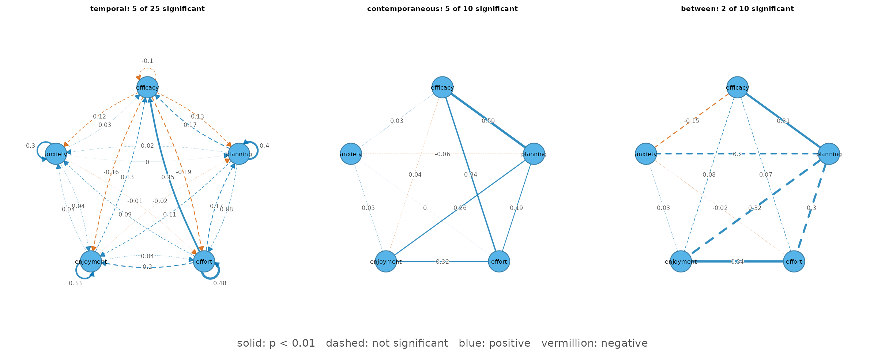
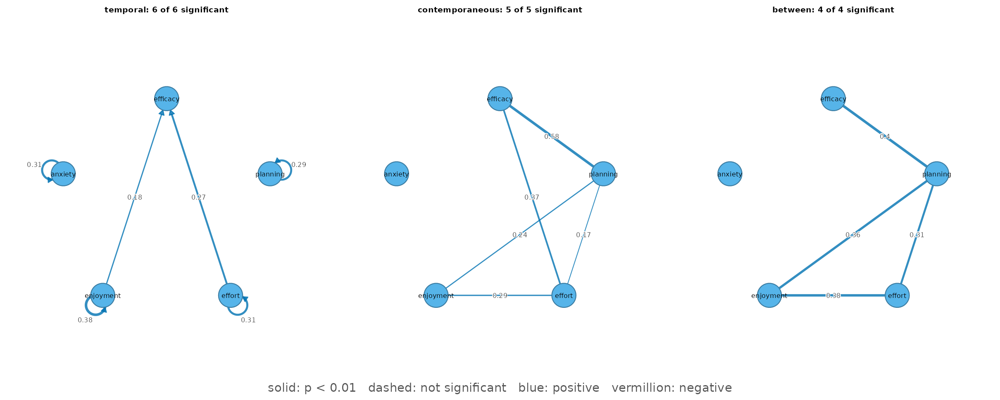

# Panel graphical VAR: temporal, contemporaneous, and between-person networks

## What the model estimates

Panel data measure the same people a few times. The panel graphical
vector-autoregressive model (panel-GVAR; Epskamp, 2020) splits each
person’s scores into a stable personal level and week-to-week deviations
from it, and estimates three networks:

- a **temporal** network: does being above one’s own level on one
  variable in one wave predict the next wave? Arrows are lag-1 effects;
  self-loops are autoregressive (carry-over) effects.
- a **contemporaneous** network: which deviations move together within a
  wave, after the lagged effects (partial correlations)?
- a **between-person** network: how are the stable personal levels
  related (partial correlations)?

[`panel_gvar()`](https://pak.dynasite.org/psychnets/reference/panel_gvar.md)
fits the model of
[`psychonetrics::panelgvar()`](https://rdrr.io/pkg/psychonetrics/man/panelvar_family.html)
by maximum likelihood, entirely in base R, and certifies the optimum.

## The data

`srl_panel` is a synthetic panel of 100 students measured in four
consecutive weeks on five self-regulated-learning indicators (0-100
scales). It was simulated from a panel-GVAR whose structure was taken
from real experience-sampling data, so it is realistic and fully
shareable (see
[`?srl_panel`](https://pak.dynasite.org/psychnets/reference/srl_panel.md)).
The data are in long format: one row per student per week.

``` r

head(srl_panel)
#>   student week efficacy planning effort enjoyment anxiety
#> 1    S001    1     38.7     54.1   52.1      53.1    44.2
#> 2    S001    2     32.9     55.4   50.7      62.2    48.8
#> 3    S001    3     34.5     40.9   52.9      50.3    36.9
#> 4    S001    4     28.6     44.5   41.0      42.4    39.6
#> 5    S002    1     45.0     54.7   48.6      48.1    38.4
#> 6    S002    2     62.8     67.2   63.7      47.5    44.8
vars <- c("efficacy", "planning", "effort", "enjoyment", "anxiety")
```

## The full model

By default every edge is estimated and reported with its standard error
and p-value; nothing is removed.

``` r

fit <- panel_gvar(srl_panel, vars = vars, id = "student", wave = "week")
fit
#> <psychnet_panelgvar> panel graphical VAR (temporal + contemporaneous + between)
#>   persons: 100   waves: 4   nodes: 5
#>   edges (significant/estimated, p < 0.01): temporal 1/20 (+4/5 autoregressive)   contemporaneous 5/10   between 2/10
#>   selection: none (full model)
#>   fit: chisq(170) = 207.19, p = 0.0273   CFI = 0.957   TLI = 0.946   RMSEA = 0.047
#>   optimality (ML score): 5.91e-13
#>   starts: 3 of 3 reached the best saturated optimum
```

The edge table has one row per edge, with a 95% Wald interval and a
`significant` flag at `alpha = 0.01`:

``` r

head(as.data.frame(fit), 8)
#>    network     from        to       weight         se           p   ci_lower
#> 1 temporal  anxiety   anxiety  0.296628278 0.10027278 0.003094278  0.1000972
#> 2 temporal  anxiety  efficacy  0.026009263 0.08031053 0.746045017 -0.1313965
#> 3 temporal  anxiety    effort -0.014936851 0.08549642 0.861309611 -0.1825068
#> 4 temporal  anxiety enjoyment  0.036480078 0.08218780 0.657142045 -0.1246051
#> 5 temporal  anxiety  planning  0.003375992 0.07857850 0.965730789 -0.1506350
#> 6 temporal efficacy   anxiety -0.122338773 0.13119129 0.351066802 -0.3794690
#> 7 temporal efficacy  efficacy -0.096672635 0.13467200 0.472857381 -0.3606249
#> 8 temporal efficacy    effort -0.185033790 0.13554948 0.172232751 -0.4507059
#>    ci_upper significant
#> 1 0.4931593        TRUE
#> 2 0.1834150       FALSE
#> 3 0.1526331       FALSE
#> 4 0.1975652       FALSE
#> 5 0.1573870       FALSE
#> 6 0.1347914       FALSE
#> 7 0.1672796       FALSE
#> 8 0.0806383       FALSE
summary(fit)
#>           network directed nodes edges significant mean_abs_weight
#> 1        temporal     TRUE     5    20           1       0.1046718
#> 2 contemporaneous    FALSE     5    10           5       0.1877681
#> 3         between    FALSE     5    10           2       0.1831649
```

[`plot()`](https://rdrr.io/r/graphics/plot.default.html) draws the three
networks on one layout. **Solid edges are significant, dashed edges are
not**; blue is positive, vermillion negative, and the weight is printed
on each edge.

``` r

plot(fit)
```



Reading the significant edges:

- **Temporal.** 4 of the 5 autoregressive effects are significant
  (anxiety -\> anxiety (0.30), effort -\> effort (0.48), enjoyment -\>
  enjoyment (0.33), planning -\> planning (0.40)): a student who is
  above their own level in one week tends to stay above it the next. One
  lagged effect between variables is significant: effort -\> efficacy
  (0.35).
- **Contemporaneous.** 5 edges (efficacy-effort (0.34),
  efficacy-planning (0.59), effort-enjoyment (0.32), planning-effort
  (0.19), planning-enjoyment (0.26)): in weeks when a student’s
  efficacy, planning, effort and enjoyment are above their usual level,
  they rise together. Anxiety is not connected.
- **Between-person.** 2 edges (efficacy-planning (0.31),
  effort-enjoyment (0.34)): students with a higher personal level of
  efficacy tend to have a higher personal level of planning; students
  with a higher personal level of effort tend to have a higher personal
  level of enjoyment. Between-person edges are estimated from only 100
  personal levels, so they carry more uncertainty than the within-person
  ones.

## Selecting edges

Marking significance does not change the model. To report a sparser
network,
[`panel_gvar()`](https://pak.dynasite.org/psychnets/reference/panel_gvar.md)
offers two selection methods.

`select = "prune"` removes every edge with p \> 0.01 in one pass,
refits, and then runs a **step-up** search that adds edges back while
they significantly improve the model and lower BIC (psychonetrics’
`prune()` followed by `stepup()`). The step-up matters: edges that stand
in for each other, such as an autoregression and a correlated lagged
effect, can each look unnecessary while the other is present, and
one-pass pruning would remove both.

``` r

pruned <- panel_gvar(srl_panel, vars = vars, id = "student", wave = "week",
                     select = "prune")
pruned
#> <psychnet_panelgvar> panel graphical VAR (temporal + contemporaneous + between)
#>   persons: 100   waves: 4   nodes: 5
#>   edges (significant/estimated, p < 0.01): temporal 2/2 (+4/4 autoregressive)   contemporaneous 5/5   between 4/4
#>   selection: prune (alpha = 0.01, adjust = none; stepup (bic) re-added 3)
#>   fit: chisq(200) = 227.13, p = 0.0913   CFI = 0.969   TLI = 0.966   RMSEA = 0.037
#>   optimality (ML score): 3.71e-13
#>   starts: 3 of 3 reached the best saturated optimum
```

The pruned model keeps 4 autoregressive effects, 2 lagged effects
between variables, 5 contemporaneous and 4 between-person edges. The
step-up search re-added 3 of the edges that one-pass pruning had
removed, and the sparser model still fits acceptably (CFI = 0.969, RMSEA
= 0.037).

``` r

plot(pruned)
```



`select = "ebic"` instead shrinks edges with a lasso penalty chosen by
EBIC – the panel counterpart of
[`ebic_glasso()`](https://pak.dynasite.org/psychnets/reference/ebic_glasso.md)
(psychonetrics’ `panelgvar(estimator = "PML")`). Weak edges become
exactly zero in one optimization. The estimates are penalized, so they
carry no p-values (`refit = TRUE` refits the selected network without
the penalty). A shorter penalty path keeps this example fast:

``` r

lasso <- panel_gvar(srl_panel, vars = vars, id = "student", wave = "week",
                    select = "ebic", nlambda = 20)
summary(lasso)
#>           network directed nodes edges significant mean_abs_weight
#> 1        temporal     TRUE     5     2          NA       0.1436679
#> 2 contemporaneous    FALSE     5     5          NA       0.3385725
#> 3         between    FALSE     5     0          NA       0.0000000
```

The lasso keeps the temporal and contemporaneous structure but no
between-person edge: with 100 students the penalty is more conservative
than the significance-based selection for the between-person network.

## When wave means drift

The model assumes **stationary means**: the average level of each
variable does not change across waves. If it drifts (for instance a
steady decline across a term), `standardize = "z_per_wave"` z-scores
every variable within every wave, which removes the drift; the edges are
then standardized.

``` r

z_fit <- panel_gvar(srl_panel, vars = vars, id = "student", wave = "week",
                    standardize = "z_per_wave")
subset(as.data.frame(z_fit, what = "fit"), select = c(chisq, df, cfi, rmsea))
#>     chisq  df       cfi      rmsea
#> 1 182.507 170 0.9851576 0.02712385
```

## Fit and diagnostics

Fit indices compare the model with the saturated model and with a
baseline without temporal or network structure:

``` r

as.data.frame(fit, what = "fit")
#>        logl npar  df    chisq     pvalue baseline_chisq baseline_df       cfi
#> 1 -6802.528   60 170 207.1872 0.02733013       1084.025         215 0.9572082
#>         tli      rmsea      aic      bic
#> 1 0.9458809 0.04677052 13725.06 13881.37
```

The diagnostics report the optimality certificate (the largest remaining
gradient of the likelihood, ~0 at the optimum), whether any part of the
solution sits on a boundary of the parameter space, whether standard
errors exist, and how many of the three optimizer starts reached the
best optimum:

``` r

as.data.frame(fit, what = "diagnostics")
#>     n waves        score boundary boundary_part se_available starts_agree
#> 1 100     4 5.906386e-13    FALSE          <NA>         TRUE            3
#>   starts
#> 1      3
```

The variance split shows how much of each variable is stable between
students and how much fluctuates within them:

``` r

as.data.frame(fit, what = "variance")
#>    variable  between   within share_between
#> 1  efficacy 65.39817 66.42409     0.4961087
#> 2  planning 72.92447 57.68286     0.5583490
#> 3    effort 82.63922 69.22678     0.5441588
#> 4 enjoyment 53.83746 65.44361     0.4513496
#> 5   anxiety 95.00513 59.25030     0.6158949
```

## Reference

Epskamp, S. (2020). Psychometric network models from time-series and
panel data. *Psychometrika*, 85(1), 206-231.
[doi:10.1007/s11336-020-09697-3](https://doi.org/10.1007/s11336-020-09697-3)
