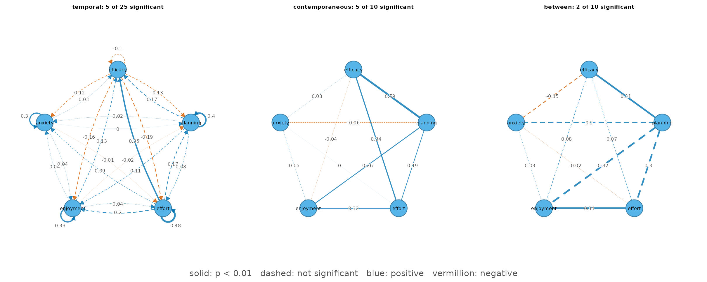
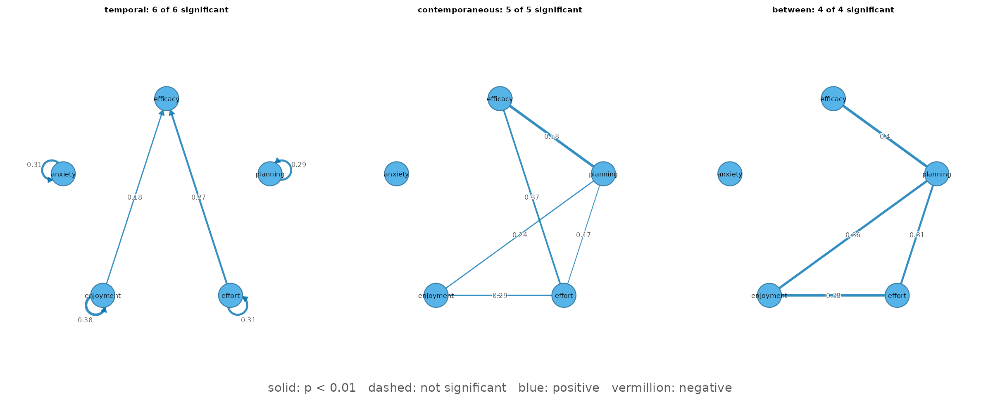

# Panel graphical VAR with the psychnets R package: Temporal, contemporaneous, and between-person networks

An association observed between students may not describe what happens
when one student’s experiences change over time. To distinguish these
patterns, researchers need to consider relationships among experiences,
behaviours and beliefs both across individuals and across measurement
occasions. Network models examine such interrelated processes through
associations between measured variables, rather than treating each scale
as a separate outcome (Borsboom et al., 2021). A Gaussian graphical
model describes conditional associations at one occasion, while
longitudinal network models can examine how variables relate across
occasions (Epskamp et al., 2018). Separating temporal, contemporaneous
and between-person relationships is therefore important when
interpreting changes within students alongside differences between them.

In educational research, psychological networks have been used to
examine learning as a system of interacting motivational, emotional and
behavioural processes (Saqr, Beck, & López-Pernas, 2024). Work on
self-regulated learning has considered how its components relate
dynamically rather than operating independently (Saqr & López-Pernas,
2024). Related research has argued for examining within-person variation
to understand and potentially individualise learning (Saqr, 2023), and
has distinguished person-specific from person-centred ways of locating
learning processes (Saqr, Vogelsmeier, & López-Pernas, 2024). These
applications motivate methods that do not mistake differences between
students for changes occurring within a student.

Panel studies follow the same people over a small number of occasions,
such as consecutive weeks of a course. They raise two different
questions: do students with higher typical self-efficacy also tend to
plan more, and does a student plan more when their self-efficacy is
higher than usual? Associations within a week and predictions from one
week to the next are also distinct. Pooling observations in a single
cross-sectional network can obscure these levels of analysis. The
distinction is important in longitudinal research because conventional
cross-lagged comparisons can conflate stable between-person differences
with within-person processes (Hamaker et al., 2015). The panel graphical
vector-autoregressive model (panel-GVAR; Epskamp, 2020) addresses this
problem by estimating temporal, contemporaneous and between-person
networks separately.

This article demonstrates the panel-GVAR using `psychnets` and a
synthetic four-wave panel of five self-regulated learning indicators. It
introduces the model and data, interprets estimated edges and their
uncertainty, and compares two methods of selecting a sparser network. It
then examines model fit, optimisation diagnostics and the proportion of
variance attributable to stable student differences, before discussing
the assumptions that matter when applying the method to educational
panel data.

``` r

library(psychnets)
```

## The model

For person $`p`$ at wave $`t`$, the observed vector of scores can be
written as the sum of the overall mean, a stable person-specific
component and a wave-specific deviation. The latter is predicted from
the preceding wave:

``` math
\mathbf{y}_{pt} = \boldsymbol\mu + \boldsymbol\eta_p + \mathbf{w}_{pt},
\qquad
\mathbf{w}_{pt} = \mathbf{B}\,\mathbf{w}_{p,t-1} + \boldsymbol\zeta_{pt},
```

where $`\boldsymbol\mu`$ is the grand mean, $`\boldsymbol\eta_p`$ is the
person’s stable deviation from that mean, and $`\mathbf{w}_{pt}`$ is the
deviation from their own typical level at wave $`t`$. The model
describes three related but different networks:

- **temporal:** the matrix $`\mathbf{B}`$ contains lag-1 regression
  coefficients for deviations from personal levels. An edge points from
  a variable at one wave to the variable it predicts at the next. A
  self-loop is an autoregressive coefficient, indicating persistence in
  a variable;
- **contemporaneous:** partial correlations among the innovations
  $`\boldsymbol\zeta_{pt}`$ describe associations within a wave after
  the lagged predictors have been accounted for. These edges are
  undirected;
- **between-person:** partial correlations among the stable components
  $`\boldsymbol\eta_p`$ describe how students’ typical levels are
  related, conditional on the other variables in that network.

The full model is estimated by maximum likelihood. It provides standard
errors, Wald tests and confidence intervals for individual edges. Its
interpretation depends on assumptions including stable wave means and
common lagged relations across occasions. In particular, a temporal edge
is a conditional lagged association, not evidence that changing one
variable would cause a change in another.

## Data

`srl_panel` contains synthetic measurements of 100 students over four
consecutive weeks. The generating panel-GVAR was based on a structure
derived from experience-sampling data (see
[`?srl_panel`](https://pak.dynasite.org/psychnets/reference/srl_panel.md)).
The example therefore has plausible dependencies while avoiding the use
of identifiable student data. The dataset is in long format, with one
row for each student and week. Its columns identify the student, the
measurement occasion and five indicators of self-regulated learning:

- **Person:** `student`, the student identifier.
- **Occasion:** `week`, from 1 to 4.
- **Nodes:** five indicators on 0–100 scales: `efficacy`, `planning`,
  `effort`, `enjoyment` and `anxiety`.

``` r

head(srl_panel)
#>   student week efficacy planning effort enjoyment anxiety
#> 1    S001    1     38.7     54.1   52.1      53.1    44.2
#> 2    S001    2     32.9     55.4   50.7      62.2    48.8
#> 3    S001    3     34.5     40.9   52.9      50.3    36.9
#> 4    S001    4     28.6     44.5   41.0      42.4    39.6
#> 5    S002    1     45.0     54.7   48.6      48.1    38.4
#> 6    S002    2     62.8     67.2   63.7      47.5    44.8
vars <- c("efficacy", "planning", "effort", "enjoyment", "anxiety")
```

## What do the three networks show?

[`panel_gvar()`](https://pak.dynasite.org/psychnets/reference/panel_gvar.md)
takes the dataset, the selected variables, the student identifier and
the wave indicator. Without edge selection, all eligible edges are
estimated and retained. Statistical significance is indicated at
$`p < 0.01`$; this flag changes how an edge is reported, not whether the
edge is included in the full model.

``` r

fit <- panel_gvar(srl_panel, vars = vars, id = "student", wave = "week")
fit
#> <psychnet_panelgvar> panel graphical VAR (temporal + contemporaneous + between)
#>   persons: 100   waves: 4   nodes: 5
#>   edges (significant/estimated, p < 0.01): temporal 1/20 (+4/5 autoregressive)   contemporaneous 5/10   between 2/10
#>   selection: none (full model)
#>   fit: chisq(170) = 207.19, p = 0.0273   CFI = 0.957   TLI = 0.946   RMSEA = 0.047
#>   optimality (ML score): 5.91e-13
#>   starts: 3 of 3 reached the best saturated optimum
```

The fitted model covers 100 students at four waves. It identifies one
significant cross-variable temporal edge among 20 possible directed
lagged edges, alongside four significant autoregressive effects among
five. Five of the ten contemporaneous edges and two of the ten
between-person edges meet the same threshold. These counts describe
evidence for individual parameters in the full model; they do not imply
that all other estimated associations are exactly zero. The edge table
reports estimates, standard errors, p-values and 95% Wald confidence
intervals:

``` r

head(as.data.frame(fit), 8)
#>    network     from        to       weight         se           p   ci_lower
#> 1 temporal  anxiety   anxiety  0.296628278 0.10027278 0.003094278  0.1000972
#> 2 temporal  anxiety  efficacy  0.026009263 0.08031053 0.746045017 -0.1313965
#> 3 temporal  anxiety    effort -0.014936851 0.08549642 0.861309611 -0.1825068
#> 4 temporal  anxiety enjoyment  0.036480078 0.08218780 0.657142045 -0.1246051
#> 5 temporal  anxiety  planning  0.003375992 0.07857850 0.965730789 -0.1506350
#> 6 temporal efficacy   anxiety -0.122338773 0.13119129 0.351066802 -0.3794690
#> 7 temporal efficacy  efficacy -0.096672635 0.13467200 0.472857381 -0.3606249
#> 8 temporal efficacy    effort -0.185033790 0.13554948 0.172232751 -0.4507059
#>    ci_upper significant
#> 1 0.4931593        TRUE
#> 2 0.1834150       FALSE
#> 3 0.1526331       FALSE
#> 4 0.1975652       FALSE
#> 5 0.1573870       FALSE
#> 6 0.1347914       FALSE
#> 7 0.1672796       FALSE
#> 8 0.0806383       FALSE
summary(fit)
#>           network directed nodes edges significant mean_abs_weight
#> 1        temporal     TRUE     5    20           1       0.1046718
#> 2 contemporaneous    FALSE     5    10           5       0.1877681
#> 3         between    FALSE     5    10           2       0.1831649
```

[`summary()`](https://rdrr.io/r/base/summary.html) provides a compact
description of each network. Mean absolute edge weights are 0.105 for
the cross-variable temporal network, 0.188 for the contemporaneous
network and 0.183 for the between-person network. These quantities
describe different types of parameters and should not be read as
comparable measures of practical importance.
[`plot()`](https://rdrr.io/r/graphics/plot.default.html) presents all
three networks with a common layout. Solid edges meet the significance
threshold, whereas dashed edges do not; blue indicates positive
estimates and vermillion negative estimates, with estimated weights
shown beside the edges.

``` r

plot(fit)
```



The edges meeting the specified significance threshold illustrate the
interpretation at each level:

- **Temporal.** 4 of the five autoregressive estimates are significant
  (anxiety -\> anxiety (0.30), effort -\> effort (0.48), enjoyment -\>
  enjoyment (0.33), planning -\> planning (0.40)). Positive
  autoregressive coefficients indicate that a deviation above a
  student’s typical level tends to persist to the next week. The one
  significant cross-variable lagged estimate is effort -\> efficacy
  (0.35): above-usual effort predicts higher-than-usual efficacy in the
  following week, conditional on the other lagged variables.
- **Contemporaneous.** 5 edges meet the threshold (efficacy-effort
  (0.34), efficacy-planning (0.59), effort-enjoyment (0.32),
  planning-effort (0.19), planning-enjoyment (0.26)). These positive
  partial correlations indicate that the connected indicators tend to
  deviate in the same direction within a week after accounting for
  lagged relations and other innovation variables. None of the
  contemporaneous edges involving anxiety meets the threshold; this is
  not proof of no association.
- **Between-person.** 2 edges meet the threshold (efficacy-planning
  (0.31), effort-enjoyment (0.34)): students with a higher personal
  level of efficacy tend to have a higher personal level of planning;
  students with a higher personal level of effort tend to have a higher
  personal level of enjoyment. These associations concern differences in
  typical levels across 100 students, rather than weekly changes within
  students. Their uncertainty should be considered when interpreting
  this part of the network.

## Which edges should a sparser model keep?

Significance flags in the full model do not remove parameters. For an
analysis in which a smaller set of edges is easier to interpret,
[`panel_gvar()`](https://pak.dynasite.org/psychnets/reference/panel_gvar.md)
offers two selection procedures. Selection changes both the model and
the estimates, so the selected edges should be interpreted in the
context of the refitted or penalised model.

`select = "prune"` first removes edges with $`p > 0.01`$ and refits the
restricted model. A subsequent step-up search considers reinstating
removed edges when doing so improves fit according to its significance
criterion and reduces the Bayesian information criterion (BIC). This
additional search is useful because the evidence for an edge can change
when other parameters are constrained to zero; a single pass through the
original p-values need not produce the preferred reduced model.

``` r

pruned <- panel_gvar(srl_panel, vars = vars, id = "student", wave = "week",
                     select = "prune")
pruned
#> <psychnet_panelgvar> panel graphical VAR (temporal + contemporaneous + between)
#>   persons: 100   waves: 4   nodes: 5
#>   edges (significant/estimated, p < 0.01): temporal 2/2 (+4/4 autoregressive)   contemporaneous 5/5   between 4/4
#>   selection: prune (alpha = 0.01, adjust = none; stepup (bic) re-added 3)
#>   fit: chisq(200) = 227.13, p = 0.0913   CFI = 0.969   TLI = 0.966   RMSEA = 0.037
#>   optimality (ML score): 3.71e-13
#>   starts: 3 of 3 reached the best saturated optimum
```

The pruned model retains four autoregressive effects, two cross-variable
lagged edges, five contemporaneous edges and four between-person edges.
The step-up procedure reinstates three edges. Its fit indices are CFI =
0.969, TLI = 0.966 and RMSEA = 0.037, with $`\chi^2(200) = 227.13`$ and
$`p = 0.0913`$. Thus, the more restricted model provides an acceptable
approximation to the observed covariance structure, although this alone
does not establish that excluded relationships are absent. The retained
estimates and their uncertainty are shown below:

``` r

as.data.frame(pruned)
#>            network      from        to    weight         se            p
#> 1         temporal   anxiety   anxiety 0.3097634 0.10142690 2.257702e-03
#> 2         temporal    effort  efficacy 0.2745331 0.05772377 1.974862e-06
#> 3         temporal    effort    effort 0.3050205 0.06630006 4.212623e-06
#> 4         temporal enjoyment  efficacy 0.1771524 0.04998380 3.938117e-04
#> 5         temporal enjoyment enjoyment 0.3811826 0.07083908 7.408767e-08
#> 6         temporal  planning  planning 0.2937572 0.06026909 1.093089e-06
#> 7  contemporaneous  efficacy    effort 0.3736857 0.05047766 1.331492e-13
#> 8  contemporaneous  efficacy  planning 0.5750641 0.03916613 8.322431e-49
#> 9  contemporaneous    effort enjoyment 0.2875605 0.04897720 4.323548e-09
#> 10 contemporaneous  planning    effort 0.1747501 0.05512077 1.522752e-03
#> 11 contemporaneous  planning enjoyment 0.2427458 0.04454979 5.069247e-08
#> 12         between  efficacy  planning 0.3994936 0.08012929 6.176604e-07
#> 13         between    effort enjoyment 0.3784409 0.11858021 1.415685e-03
#> 14         between  planning    effort 0.3085720 0.10517305 3.346829e-03
#> 15         between  planning enjoyment 0.3560514 0.10934260 1.128777e-03
#>      ci_lower  ci_upper significant
#> 1  0.11097033 0.5085565        TRUE
#> 2  0.16139658 0.3876696        TRUE
#> 3  0.17507478 0.4349663        TRUE
#> 4  0.07918596 0.2751189        TRUE
#> 5  0.24234055 0.5200246        TRUE
#> 6  0.17563197 0.4118825        TRUE
#> 7  0.27475132 0.4726201        TRUE
#> 8  0.49829988 0.6518283        TRUE
#> 9  0.19156696 0.3835541        TRUE
#> 10 0.06671533 0.2827848        TRUE
#> 11 0.15542977 0.3300617        TRUE
#> 12 0.24244302 0.5565441        TRUE
#> 13 0.14602795 0.6108538        TRUE
#> 14 0.10243661 0.5147074        TRUE
#> 15 0.14174384 0.5703590        TRUE
```

In this model, both cross-variable temporal edges predict efficacy:
above-usual effort (0.27) and above-usual enjoyment (0.18) each predict
higher-than-usual efficacy at the following wave. The five retained
contemporaneous connections have the same pairs of nodes as the five
significant contemporaneous edges in the full model, although their
estimated weights differ after selection. The between-person network
additionally retains planning with effort (0.31) and planning with
enjoyment (0.36). Neither edge reached $`p < 0.01`$ in the full model,
but both do in the restricted model. Their change in significance
illustrates why selection results should not be treated as if they were
tests from the original model.

``` r

plot(pruned)
```



`select = "ebic"` takes a different approach, applying lasso
regularisation with the penalty chosen by the extended BIC. The penalty
shrinks coefficients, setting some exactly to zero. Because these are
penalised estimates, the displayed edge table does not provide
conventional standard errors or p-values. `refit = TRUE` can be used to
fit the selected structure without the penalty. For this illustration,
the search uses 20 penalty values.

``` r

lasso <- panel_gvar(srl_panel, vars = vars, id = "student", wave = "week",
                    select = "ebic", nlambda = 20)
summary(lasso)
#>           network directed nodes edges significant mean_abs_weight
#> 1        temporal     TRUE     5     2          NA       0.1436679
#> 2 contemporaneous    FALSE     5     5          NA       0.3385725
#> 3         between    FALSE     5     0          NA       0.0000000
as.data.frame(lasso)
#>            network      from        to     weight se  p ci_lower ci_upper
#> 1         temporal   anxiety   anxiety 0.01126022 NA NA       NA       NA
#> 2         temporal  efficacy  efficacy 0.01940377 NA NA       NA       NA
#> 3         temporal    effort  efficacy 0.16267521 NA NA       NA       NA
#> 4         temporal    effort    effort 0.16069469 NA NA       NA       NA
#> 5         temporal enjoyment  efficacy 0.12466058 NA NA       NA       NA
#> 6         temporal enjoyment enjoyment 0.25094809 NA NA       NA       NA
#> 7         temporal  planning  planning 0.17284327 NA NA       NA       NA
#> 8  contemporaneous  efficacy    effort 0.35072292 NA NA       NA       NA
#> 9  contemporaneous  efficacy  planning 0.58378554 NA NA       NA       NA
#> 10 contemporaneous    effort enjoyment 0.29072556 NA NA       NA       NA
#> 11 contemporaneous  planning    effort 0.21147396 NA NA       NA       NA
#> 12 contemporaneous  planning enjoyment 0.25615455 NA NA       NA       NA
#>    significant
#> 1           NA
#> 2           NA
#> 3           NA
#> 4           NA
#> 5           NA
#> 6           NA
#> 7           NA
#> 8           NA
#> 9           NA
#> 10          NA
#> 11          NA
#> 12          NA
```

The penalised model retains two cross-variable temporal edges, both
predicting efficacy from effort and enjoyment, and the same five
contemporaneous node pairs as the pruned model. It retains no
between-person edges. The edge table also shows non-zero estimates for
all five autoregressive coefficients, including very small estimates for
anxiety (0.011) and efficacy (0.019). Thus, the selection procedures
broadly agree on the principal within-person cross-variable connections,
but differ in which between-person edges survive. In this example, EBIC
selection is more restrictive for the between-person network; this
comparison alone does not establish that either selection procedure will
perform better in other data.

## How well does the model fit?

Model fit provides a check on how adequately the specified covariance
structure represents the data. The reported indices compare the fitted
model with a saturated model, which reproduces the observed covariances,
and a more restrictive baseline model. The chi-square test evaluates
exact fit, whereas CFI, TLI and RMSEA provide complementary measures of
approximate fit.

``` r

as.data.frame(fit, what = "fit")
#>        logl npar  df    chisq     pvalue baseline_chisq baseline_df       cfi
#> 1 -6802.528   60 170 207.1872 0.02733013       1084.025         215 0.9572082
#>         tli      rmsea      aic      bic
#> 1 0.9458809 0.04677052 13725.06 13881.37
```

For the full model, the exact-fit test gives $`\chi^2(170) = 207.19`$
with $`p = 0.0273`$, providing evidence against exact fit at the
conventional 5% level. Approximate fit is more favourable, with CFI =
0.957, TLI = 0.946 and RMSEA = 0.047. Taken together, these indices
suggest a reasonably close, though not exact, representation of the
covariance structure across the four waves. Good global fit does not
establish that each individual edge is correctly specified.

## Is the estimate the maximum-likelihood solution?

Maximum-likelihood estimation of a panel-GVAR requires numerical
optimisation of a non-convex objective. The procedure therefore uses
three starting points to assess whether the optimiser repeatedly finds
the same solution. At a stationary point, the likelihood gradient, or
score, is close to zero. Diagnostics also indicate whether parameters
lie at admissible boundaries and whether standard errors can be
calculated. These checks provide evidence about numerical reliability,
although agreement among starts and a small gradient cannot prove that a
solution is the global maximum.

``` r

as.data.frame(fit, what = "diagnostics")
#>     n waves        score boundary boundary_part se_available starts_agree
#> 1 100     4 5.906386e-13    FALSE          <NA>         TRUE            3
#>   starts
#> 1      3
```

The maximum absolute score is approximately $`9.99 \times 10^{-13}`$,
well below $`10^{-11}`$. No parameter is at a boundary, standard errors
are available, and all three starts reached the same reported optimum.
These results support the numerical stability of this fit and the use of
its reported standard errors, subject to the model assumptions. They do
not constitute a guarantee of a unique global maximum.

## How much of each variable is stable between persons?

The model partitions the variance in each indicator into a component
associated with differences in students’ stable levels and a component
associated with deviations from those levels over time. The
`share_between` column expresses the between-person component as a
proportion of the total for each indicator.

``` r

as.data.frame(fit, what = "variance")
#>    variable  between   within share_between
#> 1  efficacy 65.39817 66.42409     0.4961087
#> 2  planning 72.92447 57.68286     0.5583490
#> 3    effort 82.63922 69.22678     0.5441588
#> 4 enjoyment 53.83746 65.44361     0.4513496
#> 5   anxiety 95.00513 59.25030     0.6158949
```

The estimated between-person shares range from 0.451 for enjoyment to
0.616 for anxiety. The corresponding proportions are 0.496 for efficacy,
0.558 for planning and 0.544 for effort. Thus, both stable differences
between students and week-to-week deviations account for substantial
variation in each indicator. A between-person network and within-person
networks answer complementary questions about these two sources of
variation.

## What if the wave means drift?

The model assumes that variable means are constant across waves.
Educational measures may instead show systematic changes over a course,
such as an overall rise in confidence or a decline in enjoyment. The
option `standardize = "z_per_wave"` centres and scales each variable
separately at each wave. This removes observed wave-specific location
and scale differences, so estimated edges refer to standardised
deviations. It changes the estimand and should be chosen for substantive
reasons, not simply to improve fit indices.

``` r

z_fit <- panel_gvar(srl_panel, vars = vars, id = "student", wave = "week",
                    standardize = "z_per_wave")
subset(as.data.frame(z_fit, what = "fit"), select = c(chisq, df, cfi, rmsea))
#>     chisq  df       cfi      rmsea
#> 1 182.507 170 0.9851576 0.02712385
```

For these simulated data, which were generated with stable means,
wave-wise standardisation gives CFI = 0.985 and RMSEA = 0.027, compared
with 0.957 and 0.047 in the unstandardised model. These indices are more
favourable for the standardised analysis, but the comparison does not
show that wave-wise standardisation is necessary or preferable in
general. Where means vary, researchers should examine the pattern of
change and consider whether standardisation is compatible with their
research question.

## Assumptions and when to use the panel-GVAR

- Panel-GVAR is designed for panels with several people observed at a
  relatively small number of equally spaced waves. Studies with many
  repeated observations per individual may instead be better suited to
  time-series or multilevel graphical VAR approaches.
- The fitted specification assumes stable wave means and common lagged
  coefficients across waves. `standardize = "z_per_wave"` addresses
  observed wave-specific means and scales but does not by itself
  establish that other stationarity assumptions are met.
- Relatively few waves limit the information available for separating
  stable personal differences from fluctuations within people.
  Between-person estimates are particularly dependent on the number of
  individuals, and boundary estimates can signal difficulties in
  estimation.
- The full model retains all estimated edges and reports their
  uncertainty. Pruning with step-up and penalised EBIC selection yield
  more economical structures, but their inferential outputs and
  interpretation differ.
- Temporal edges describe conditional predictions across successive
  waves, not causal effects. The interval between measurements also
  determines what kinds of changes the temporal network can capture.

## How to cite this article

Saqr, M., & López-Pernas, S. (2026). *Panel graphical VAR with the
psychnets R package: Temporal, contemporaneous, and between-person
networks*. psychnets. <https://doi.org/10.5281/zenodo.24569500> ·
[HTML](https://pak.dynasite.org/psychnets/articles/panel-graphical-var.html)
· [PDF](https://pak.dynasite.org/psychnets/pdf/panel-graphical-var.pdf)

## References

Borsboom, D., Deserno, M. K., Rhemtulla, M., Epskamp, S., Fried, E. I.,
McNally, R. J., Robinaugh, D. J., Perugini, M., Dalege, J., Costantini,
G., Isvoranu, A.-M., Wysocki, A. C., van Borkulo, C. D., van Bork, R., &
Waldorp, L. J. (2021). Network analysis of multivariate data in
psychological science. *Nature Reviews Methods Primers*, 1, 58.
[doi:10.1038/s43586-021-00055-w](https://doi.org/10.1038/s43586-021-00055-w)

Epskamp, S. (2020). Psychometric network models from time-series and
panel data. *Psychometrika*, 85(1), 206-231.
[doi:10.1007/s11336-020-09697-3](https://doi.org/10.1007/s11336-020-09697-3)

Epskamp, S., Waldorp, L. J., Mõttus, R., & Borsboom, D. (2018). The
Gaussian graphical model in cross-sectional and time-series data.
*Multivariate Behavioral Research*, 53(4), 453-480.
[doi:10.1080/00273171.2018.1454823](https://doi.org/10.1080/00273171.2018.1454823)

Hamaker, E. L., Kuiper, R. M., & Grasman, R. P. P. P. (2015). A critique
of the cross-lagged panel model. *Psychological Methods*, 20(1),
102-116. [doi:10.1037/a0038889](https://doi.org/10.1037/a0038889)

Saqr, M. (2023). Modelling within-person idiographic variance could help
explain and individualize learning. *British Journal of Educational
Technology*, 54(5), 1077-1094.
[doi:10.1111/bjet.13309](https://doi.org/10.1111/bjet.13309)

Saqr, M., Beck, E., & López-Pernas, S. (2024). Psychological networks: A
modern approach to analysis of learning and complex learning processes.
In M. Saqr & S. López-Pernas (Eds.), *Learning analytics methods and
tutorials: A practical guide using R* (pp. 639-671). Springer.
[doi:10.1007/978-3-031-54464-4_19](https://doi.org/10.1007/978-3-031-54464-4_19)

Saqr, M., & López-Pernas, S. (2024). Mapping the self in self-regulation
using complex dynamic systems approach. *British Journal of Educational
Technology*, 55(4), 1376-1397.
[doi:10.1111/bjet.13452](https://doi.org/10.1111/bjet.13452)

Saqr, M., Vogelsmeier, L. V. D. E., & López-Pernas, S. (2024). Capturing
where the learning process takes place: A person-specific and
person-centered primer. *Learning and Individual Differences*, 113,
102492.
[doi:10.1016/j.lindif.2024.102492](https://doi.org/10.1016/j.lindif.2024.102492)
