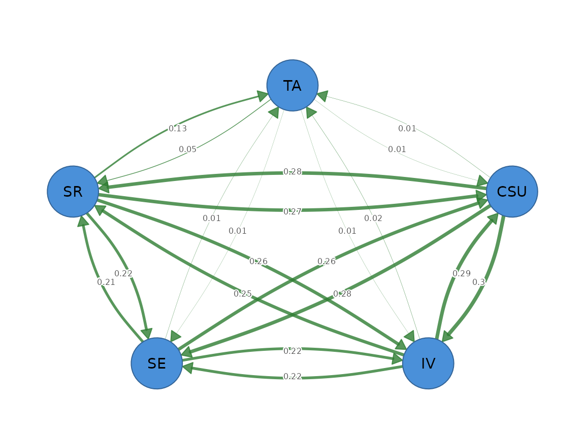

# Relative-importance networks

When the variables of a questionnaire are strongly correlated, a
regression coefficient or a partial correlation credits each predictor
only with its unique contribution, and the variance that two predictors
explain together is credited to neither. For a researcher who asks how
much self-efficacy contributes to explaining strategy use, that unique
contribution understates the answer. Relative importance analysis
divides the explained variance of an outcome, its $`R^2`$, among all
predictors, giving each a share of both its unique and its jointly
explained variance. The LMG decomposition (Lindeman et al., 1980;
Groemping, 2006) does so by averaging the increase in $`R^2`$ that a
predictor brings over every order in which the predictors could be
entered.

A relative-importance network applies this decomposition to every
variable in turn, with all the others as predictors. The shares become
directed edges: an edge from A to B is the part of B’s explained
variance attributed to A, and the edges arriving at a node sum to that
node’s $`R^2`$. This article builds the network for five self-regulated
learning constructs, reads the directed shares, checks that they sum to
each node’s explained variance, contrasts incoming and outgoing totals,
and repeats the analysis on rank correlations.

``` r

library(psychnets)
```

## Data

`SRL_GPT` holds 300 sets of responses to the Motivated Strategies for
Learning Questionnaire, each a construct score on a scale from 1 to 7.
The responses were generated by a large language model (GPT) in a study
of how such models answer psychological surveys (Saqr, 2025); they serve
as a well-structured example and are not evidence about students.

- **Nodes:** five construct scores, treated as continuous: `CSU`
  (cognitive strategy use), `IV` (intrinsic value), `SE`
  (self-efficacy), `SR` (self-regulation) and `TA` (test anxiety). Each
  is in turn the outcome of a linear regression and a predictor in the
  four others.
- **Observations:** one row per respondent; the data are complete.

``` r

head(SRL_GPT)
#>        CSU       IV       SE       SR   TA
#> 1 5.307692 5.666667 5.777778 5.333333 4.00
#> 2 5.846154 6.444444 6.000000 5.777778 4.00
#> 3 6.615385 6.666667 6.222222 6.333333 3.25
#> 4 5.692308 6.555556 6.333333 5.555556 4.50
#> 5 4.384615 5.555556 4.888889 4.777778 4.00
#> 6 4.846154 5.444444 5.666667 5.111111 3.50
```

## The model

For outcome $`j`$ with predictor set $`P`$, the LMG share of predictor
$`k`$ is the average increase in $`R^2`$ when $`k`$ joins a subset $`S`$
of the other predictors, weighted so that every entry order counts
equally:

``` math
\varphi_{kj} = \sum_{S \subseteq P \setminus \{k\}}
\frac{|S|!\,(|P| - |S| - 1)!}{|P|!}
\left[R^2(S \cup \{k\}) - R^2(S)\right].
```

Each $`R^2(A)`$ follows from the correlation matrix $`\mathbf{S}`$ as
$`R^2(A) = \mathbf{S}_{jA}\mathbf{S}_{AA}^{-1}\mathbf{S}_{Aj}`$. The
shares are non-negative and add up to the outcome’s full-model explained
variance,

``` math
\sum_{k} \varphi_{kj} = R_j^2 .
```

The directed network has edge weight $`\varphi_{kj}`$ from $`k`$ to
$`j`$. The incoming edges of a node sum to its $`R^2`$; the outgoing
edges of a node sum to its total contribution to the other regressions.
With $`p`$ nodes, each outcome requires $`2^{p-1}`$ subset regressions,
so the computation is limited to 21 nodes by default.

## How is each construct’s explained variance divided?

[`psychnet()`](https://pak.dynasite.org/psychnets/reference/psychnet.md)
with `method = "relimp"` fits the five regressions and decomposes their
$`R^2`$.

``` r

importance_net <- psychnet(data = SRL_GPT, method = "relimp")
summary(importance_net)
#> <psychnet> relimp network
#>   nodes: 5   edges: 20   (directed)
#>   structural certificate (decomposition residual): 2.22e-16
#>   edge weight: range [0.006, 0.299], mean 0.165
```

The network has 20 directed edges, one for every ordered pair, because
every predictor receives some share. The shares range from 0.006 to
0.299. The edge table lists them with `from` as the predictor and `to`
as the outcome:

``` r

as.data.frame(importance_net)
#>    from  to      weight
#> 1    IV CSU 0.288505266
#> 2    SE CSU 0.263574096
#> 3    SR CSU 0.274082666
#> 4    TA CSU 0.007326148
#> 5   CSU  IV 0.299473895
#> 6    SE  IV 0.216286692
#> 7    SR  IV 0.258608009
#> 8    TA  IV 0.007032583
#> 9   CSU  SE 0.280588934
#> 10   IV  SE 0.219009605
#> 11   SR  SE 0.220573037
#> 12   TA  SE 0.006045547
#> 13  CSU  SR 0.277393999
#> 14   IV  SR 0.253052645
#> 15   SE  SR 0.212824511
#> 16   TA  SR 0.052422918
#> 17  CSU  TA 0.014154964
#> 18   IV  TA 0.015416846
#> 19   SE  TA 0.012055817
#> 20   SR  TA 0.127772080
```

The largest share runs from cognitive strategy use to intrinsic value
(0.299): of the variance in intrinsic value explained by the other four
constructs, a share of 0.299 is attributed to strategy use. The reverse
edge, from intrinsic value to strategy use, is 0.289. The two directions
are close here but come from different regressions, and they need not
agree. Among the learning constructs the shares lie between 0.213 and
0.299, so each is explained by the other three in roughly equal parts.

Test anxiety is the exception. Of its explained variance,
self-regulation accounts for 0.128, while cognitive strategy use
(0.014), intrinsic value (0.015) and self-efficacy (0.012) contribute
little. In the other direction, test anxiety contributes almost nothing
to the learning constructs (0.006 to 0.007), except to self-regulation
(0.052). The association between test anxiety and the learning
constructs passes through self-regulation, in both directions.

## Do the shares add up to each construct’s explained variance?

By construction, the shares arriving at a node must sum to that node’s
full-model $`R^2`$.
[`certificate()`](https://pak.dynasite.org/psychnets/reference/certificate.md)
reports the largest difference between the two across nodes; a value
near zero shows that the decomposition is complete and exact.

``` r

certificate(importance_net)
#>   method  certificate       kind certified
#> 1 relimp 2.220446e-16 structural      TRUE
```

The largest difference is at the level of machine precision (below
$`10^{-15}`$), so every edge in the table is part of an exact division
of the explained variance. The check concerns the arithmetic of the
decomposition, not the adequacy of the linear regressions.

## How much of each construct is explained?

[`net_predict()`](https://pak.dynasite.org/psychnets/reference/net_predict.md)
reports the full-model $`R^2`$ of each node, the total of its incoming
shares.

``` r

net_predict(importance_net)
#>   node     type metric predictability accuracy
#> 1  CSU gaussian     R2      0.8334882       NA
#> 2   IV gaussian     R2      0.7814012       NA
#> 3   SE gaussian     R2      0.7262171       NA
#> 4   SR gaussian     R2      0.7956941       NA
#> 5   TA gaussian     R2      0.1693997       NA
```

The other four constructs explain 83% of the variance in cognitive
strategy use ($`R^2 = 0.833`$), 80% in self-regulation, 78% in intrinsic
value and 73% in self-efficacy. They explain 17% of the variance in test
anxiety ($`R^2 = 0.169`$), and the incoming shares above show that three
quarters of that (0.128) comes from self-regulation. Most of the
variation in test anxiety lies outside this five-construct model.

## Which constructs contribute most to explaining the others?

[`net_centralities()`](https://pak.dynasite.org/psychnets/reference/net_centralities.md)
sums the outgoing edges of each node. Because all shares are
non-negative, strength and expected influence are equal.

``` r

net_centralities(importance_net)
#>   node  strength expected_influence
#> 1  CSU 0.8716118          0.8716118
#> 2   IV 0.7759844          0.7759844
#> 3   SE 0.7047411          0.7047411
#> 4   SR 0.8810358          0.8810358
#> 5   TA 0.0728272          0.0728272
```

Self-regulation has the largest outgoing total (0.881), closely followed
by cognitive strategy use (0.872); test anxiety has the smallest
(0.073). Self-regulation is thus the construct that contributes most to
explaining the others, partly because it is the only construct with a
substantial share in test anxiety. Incoming totals ($`R^2`$) describe
how well a construct is explained; outgoing totals describe how much it
explains. The two answer different questions and are reported
separately.

## What does the network look like?

[`cograph::splot()`](https://sonsoles.me/cograph/reference/splot.html)
draws the directed network, with arrows from predictor to outcome and
the share printed on each edge.

``` r

cograph::splot(importance_net, directed = TRUE, edge_labels = TRUE)
```



The figure is dense because every ordered pair has an edge. The thick
reciprocal arrows among the learning constructs and the thin arrows to
and from test anxiety are visible, but exact values are read from the
edge table.

## Do the conclusions depend on the correlation estimator?

Refitting with `cor_method = "spearman"` bases the regressions on rank
correlations.

``` r

importance_spearman <- psychnet(data = SRL_GPT, method = "relimp",
                                cor_method = "spearman")
as.data.frame(importance_spearman)
#>    from  to      weight
#> 1    IV CSU 0.286725129
#> 2    SE CSU 0.270159694
#> 3    SR CSU 0.265419989
#> 4    TA CSU 0.005393971
#> 5   CSU  IV 0.299066051
#> 6    SE  IV 0.203370231
#> 7    SR  IV 0.263749828
#> 8    TA  IV 0.005279123
#> 9   CSU  SE 0.292490014
#> 10   IV  SE 0.206036816
#> 11   SR  SE 0.209495026
#> 12   TA  SE 0.004346020
#> 13  CSU  SR 0.271471270
#> 14   IV  SR 0.260383389
#> 15   SE  SR 0.203334385
#> 16   TA  SR 0.037126693
#> 17  CSU  TA 0.009240756
#> 18   IV  TA 0.011339759
#> 19   SE  TA 0.008842802
#> 20   SR  TA 0.086215285
net_predict(importance_spearman)
#>   node     type metric predictability accuracy
#> 1  CSU gaussian     R2      0.8276988       NA
#> 2   IV gaussian     R2      0.7714652       NA
#> 3   SE gaussian     R2      0.7123679       NA
#> 4   SR gaussian     R2      0.7723157       NA
#> 5   TA gaussian     R2      0.1156386       NA
```

The largest share remains cognitive strategy use to intrinsic value
(0.299), and the learning constructs keep $`R^2`$ values from 0.712 to
0.828. The explained variance of test anxiety falls from 0.169 to 0.116,
and the share of self-regulation in it from 0.128 to 0.086. The
structure among the learning constructs does not depend on the
estimator; the explanation of test anxiety is weaker on ranks and should
be reported with that caveat.

## Reporting the analysis

A report states the variables, the sample size, the correlation
estimator, the treatment of missing data, and whether raw or normalized
shares are used. Each edge is described with its direction, from
predictor to outcome, and incoming $`R^2`$ and outgoing contribution are
reported as separate node summaries.

In this analysis, raw LMG shares from Pearson correlations of 300
complete responses formed 20 directed edges. The largest ran from
cognitive strategy use to intrinsic value (0.299). The constructs’
$`R^2`$ ranged from 0.169 (test anxiety) to 0.833 (cognitive strategy
use), and self-regulation carried most of the explained variance of test
anxiety (0.128). A rank-based analysis kept the structure among the
learning constructs and reduced the explained variance of test anxiety.

## Assumptions and when to use relative importance

- Each node is modelled by a linear regression on all the others; the
  shares inherit its assumptions of linearity and of observations
  independent of one another.
- Relative importance answers how explained variance is divided among
  correlated predictors. For conditional associations between pairs, use
  a partial correlation network such as the graphical lasso.
- Raw shares keep the variance scale, so a share of 0.1 means one tenth
  of the outcome’s variance. `normalized = TRUE` rescales the incoming
  shares of each outcome to sum to one, which compares predictors within
  an outcome but hides how much of the outcome is explained at all.
- Direction refers to the regression, not to time or causation: an edge
  from A to B means that A is a predictor of B in the fitted model.
- The number of subset regressions doubles with every added node, which
  limits the method to small and moderate networks.

## References

Groemping, U. (2006). Relative importance for linear regression in R:
The package relaimpo. *Journal of Statistical Software*, 17(1), 1-27.
[doi:10.18637/jss.v017.i01](https://doi.org/10.18637/jss.v017.i01)

Lindeman, R. H., Merenda, P. F., & Gold, R. Z. (1980). *Introduction to
bivariate and multivariate analysis*. Scott, Foresman.

Saqr, M. (2025). Delving into the psychology of machines: Exploring the
structure of self-regulated learning via LLM-generated survey responses.
*Computers in Human Behavior*, 173, 108769.
[doi:10.1016/j.chb.2025.108769](https://doi.org/10.1016/j.chb.2025.108769)
