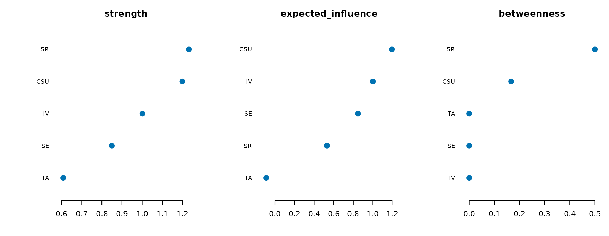
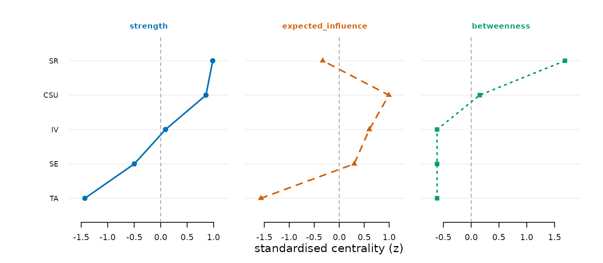
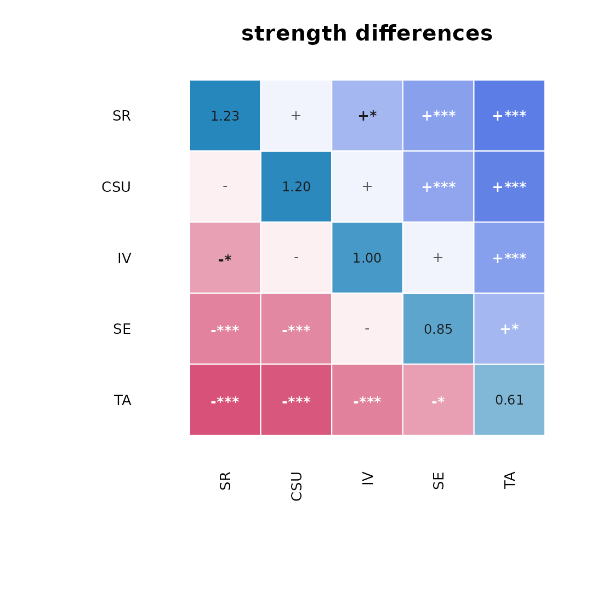
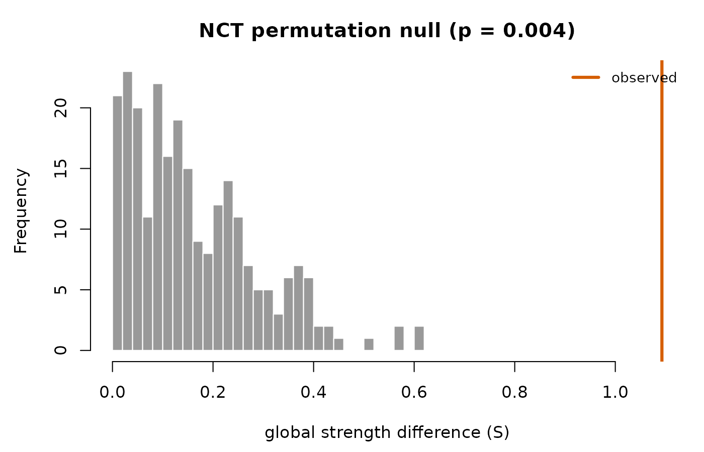
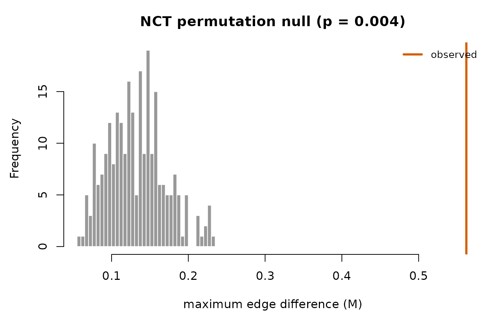
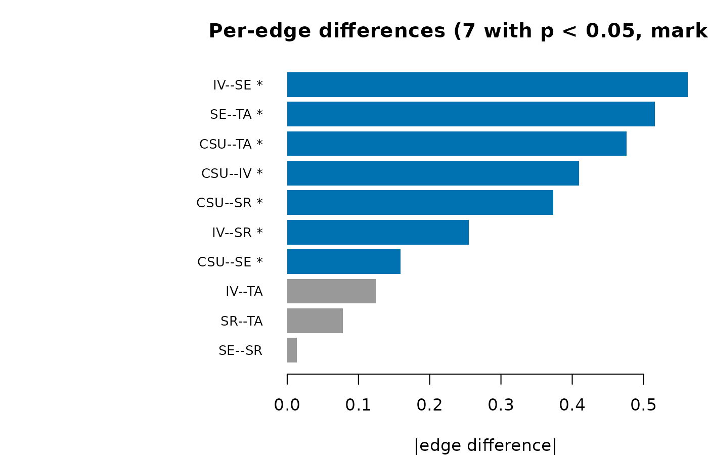

# Visualizing centrality, bootstrap and comparison results

The results of a network analysis are rarely limited to the network
itself. A report also ranks the nodes by centrality, shows how precisely
each edge is estimated, states which edges or nodes differ from one
another, documents whether the centrality order survives the loss of
part of the sample, and, when two groups are studied, tests whether
their networks differ. Each of these results is a distribution or a set
of intervals, and each is read most directly from a figure. A figure
helps only if the reader knows what is plotted against what, which marks
denote significance, and what pattern would support or undermine the
conclusion.

This article draws the figure for each of these results from one network
of five self-regulated learning constructs, and states for each what it
shows and how to read it: centrality profiles, bootstrap intervals for
edges and centralities, difference matrices and forest plots,
case-dropping stability curves, and the permutation distributions of a
network comparison test. All figures are drawn by the
[`plot()`](https://rdrr.io/r/graphics/plot.default.html) method of the
corresponding result.

``` r

library(psychnets)
```

## Data

`SRL_GPT` holds 300 sets of responses to the Motivated Strategies for
Learning Questionnaire, each a construct score on a scale from 1 to 7.
The responses were generated by a large language model (GPT) in a study
of how such models answer psychological surveys (Saqr, 2025). A second
set, `SRL_Claude`, with 300 responses generated by another model, is the
comparison group in the last section.

- **Nodes:** `CSU` (cognitive strategy use), `IV` (intrinsic value),
  `SE` (self-efficacy), `SR` (self-regulation) and `TA` (test anxiety).
- **Observations:** one row per respondent; the data are complete.

``` r

head(SRL_GPT)
#>        CSU       IV       SE       SR   TA
#> 1 5.307692 5.666667 5.777778 5.333333 4.00
#> 2 5.846154 6.444444 6.000000 5.777778 4.00
#> 3 6.615385 6.666667 6.222222 6.333333 3.25
#> 4 5.692308 6.555556 6.333333 5.555556 4.50
#> 5 4.384615 5.555556 4.888889 4.777778 4.00
#> 6 4.846154 5.444444 5.666667 5.111111 3.50
```

[`ebic_glasso()`](https://pak.dynasite.org/psychnets/reference/ebic_glasso.md)
estimates the network whose results are drawn below: a Gaussian
graphical model whose edges are partial correlations selected by the
extended Bayesian information criterion.

``` r

fit <- ebic_glasso(SRL_GPT)
fit
#> <psychnet> glasso network
#>   nodes: 5   edges: 10   (undirected)
#>   lambda: 0.00861   gamma: 0.5
#>   optimality (KKT residual): 2.21e-10
```

The network has 10 edges; the Gaussian graphical models article
interprets them.

## Which nodes are most central?

[`net_centralities()`](https://pak.dynasite.org/psychnets/reference/net_centralities.md)
computes centrality measures, one row per node. Strength is the sum of
absolute edge weights, expected influence the signed sum, and
betweenness the proportion of shortest paths between other nodes that
pass through a node.

``` r

ct <- net_centralities(fit,
                       measures = c("strength", "expected_influence",
                                    "betweenness"))
ct
#>   node  strength expected_influence betweenness
#> 1  CSU 1.1984512         1.19845117   0.1666667
#> 2   IV 1.0012765         1.00127649   0.0000000
#> 3   SE 0.8492185         0.84921854   0.0000000
#> 4   SR 1.2314317         0.53172852   0.5000000
#> 5   TA 0.6082238        -0.09147935   0.0000000
```

Self-regulation has the largest strength (1.231) and betweenness (0.5),
but its negative edge with test anxiety reduces its expected influence
to 0.532, below that of cognitive strategy use (1.198), intrinsic value
(1.001) and self-efficacy (0.849). Only cognitive strategy use and
self-regulation lie on shortest paths between other nodes.
[`plot()`](https://rdrr.io/r/graphics/plot.default.html) draws one panel
per measure, with the nodes sorted by value so that the most central
node is at the top:

``` r

plot(ct)
```



The three panels give three different orders, with self-regulation first
on strength and betweenness and fourth on expected influence. Which node
is “most central” depends on the measure, and a report names the
measure.

## Do the nodes keep their position across measures?

With `type = "line"`, the nodes share one vertical order in all panels,
set by their mean standardized centrality, and each panel keeps its own
axis. A node whose line runs straight is equally central on every
measure; a node whose line bends is central on some measures and
peripheral on others.

``` r

plot(ct, type = "line")
```


The `scale` argument sets the transformation of each panel: `"raw"` (the
default) keeps the original values, `"z"` standardizes each measure to
mean 0 and standard deviation 1, and `"relative"` rescales it to the
range 0 to 1. Standardized values put the three measures on one scale,
so the bends become comparable.

``` r

plot(ct, type = "line", scale = "z")
```



Self-regulation bends most: high on strength and betweenness, low on
expected influence. Test anxiety is lowest on strength and expected
influence.

## How precise are the edges?

[`net_boot()`](https://pak.dynasite.org/psychnets/reference/net_boot.md)
re-estimates the network on bootstrap samples of the respondents and
records every edge and centrality value; the percentile interval of each
is its measure of precision. An applied analysis uses at least 1,000
samples; 250 keep this example short.

``` r

set.seed(1)
bs <- net_boot(SRL_GPT, method = "glasso", n_boot = 250, cores = 1)
bs
#> <psychnet_bootstrap> glasso, 250 resamples, 95% CI
#>   10 edges (7 significant), 5 nodes, measures: strength, expected_influence
```

Seven of the ten edges have 95% intervals that exclude zero. The default
plot shows each edge as its observed weight with its bootstrap interval,
sorted by weight. Edges whose interval excludes zero are drawn as filled
points with solid intervals, the others as open points with dashed
intervals.

``` r

plot(bs)
```


The three edges whose intervals include zero are the small positive
edges of test anxiety with intrinsic value, self-efficacy and cognitive
strategy use. The negative self-regulation–test anxiety edge and the six
edges among the learning constructs are estimated with intervals that
stay clear of zero.

## How precise is each node’s centrality?

With `type = "centrality"`, the plot shows the bootstrap interval of
each node’s centrality, one panel per measure.

``` r

plot(bs, type = "centrality")
```


``` r

as.data.frame(bs, what = "centrality")
#>   node  strength strength_lower strength_upper expected_influence
#> 1  CSU 1.1984512      1.0817999      1.3489871         1.19845117
#> 2   IV 1.0012765      0.8670417      1.1413809         1.00127649
#> 3   SE 0.8492185      0.7196350      1.0077951         0.84921854
#> 4   SR 1.2314317      1.0840409      1.3565767         0.53172852
#> 5   TA 0.6082238      0.3734560      0.7761419        -0.09147935
#>   expected_influence_lower expected_influence_upper
#> 1                1.0726933               1.34898708
#> 2                0.8670417               1.14138092
#> 3                0.7196350               1.00779507
#> 4                0.4018903               0.65431683
#> 5               -0.1648691              -0.02151559
```

The strength intervals of cognitive strategy use (1.08 to 1.35) and
self-regulation (1.08 to 1.36) almost coincide, so these two nodes
cannot be ordered on strength. Test anxiety (0.37 to 0.78) lies below
every other node. Wide and overlapping intervals are the visual signal
that a ranking is uncertain.

## Which edges and nodes differ from one another?

With `type = "edge_diff"` or `type = "centrality_diff"`, the plot shows
a matrix with the items on both axes, ordered from the largest to the
smallest observed value. The diagonal holds the observed values. An
off-diagonal cell is filled when the two items differ across the
bootstrap samples, red when the row item is larger and blue when it is
smaller, and left faint otherwise; stars give the p-value of the
difference.

``` r

plot(bs, type = "edge_diff")
```


``` r

plot(bs, type = "centrality_diff", measure = "strength")
```



The strength matrix shows which pairs of nodes can be ordered. The same
comparisons are available as a table from
[`difference_test()`](https://pak.dynasite.org/psychnets/reference/difference_test.md),
with the observed difference, its interval, a p-value and a
`significant` flag:

``` r

dt <- difference_test(bs, type = "strength")
dt
#>    item1 item2    value1    value2    obs_diff       lower       upper p_value
#> 1    CSU    IV 1.1984512 1.0012765  0.19717467 -0.01516075  0.43862886   0.080
#> 2    CSU    SE 1.1984512 0.8492185  0.34923263  0.12605796  0.63527516   0.000
#> 3     IV    SE 1.0012765 0.8492185  0.15205795 -0.09197932  0.36727209   0.208
#> 4    CSU    SR 1.1984512 1.2314317 -0.03298049 -0.21134715  0.18144546   0.712
#> 5     IV    SR 1.0012765 1.2314317 -0.23015517 -0.41550510 -0.04600301   0.024
#> 6     SE    SR 0.8492185 1.2314317 -0.38221312 -0.54711539 -0.20825524   0.000
#> 7    CSU    TA 1.1984512 0.6082238  0.59022738  0.38908973  0.79088205   0.000
#> 8     IV    TA 1.0012765 0.6082238  0.39305270  0.19311698  0.60820843   0.000
#> 9     SE    TA 0.8492185 0.6082238  0.24099475  0.02772224  0.47534139   0.016
#> 10    SR    TA 1.2314317 0.6082238  0.62320787  0.51502542  0.74080956   0.000
#>    significant
#> 1        FALSE
#> 2         TRUE
#> 3        FALSE
#> 4        FALSE
#> 5         TRUE
#> 6         TRUE
#> 7         TRUE
#> 8         TRUE
#> 9         TRUE
#> 10        TRUE
```

Seven of the ten pairs differ. Test anxiety has lower strength than
every other node, self-regulation is stronger than intrinsic value and
self-efficacy, and cognitive strategy use is stronger than
self-efficacy. Three pairs cannot be ordered: cognitive strategy use and
self-regulation (difference -0.033, p = 0.712), cognitive strategy use
and intrinsic value (p = 0.080), and intrinsic value and self-efficacy
(p = 0.208). A report can place test anxiety last but should not name a
single most central node.

[`plot()`](https://rdrr.io/r/graphics/plot.default.html) on the table
draws the same matrix by default (`style = "box"`), which shows *which*
pairs differ.

``` r

plot(dt)
```


With `style = "forest"`, each pair is a row with its observed difference
and interval and a dashed line at zero, and pairs whose interval
excludes zero are emphasized. This view shows *how large* each
difference is and how uncertain.

``` r

plot(dt, style = "forest")
```


## Is the centrality order stable when cases are dropped?

[`net_stability()`](https://pak.dynasite.org/psychnets/reference/net_stability.md)
re-estimates the network on subsets that drop an increasing proportion
of the respondents and correlates the subset centralities with those of
the full sample. The CS-coefficient is the largest proportion that can
be dropped while the correlation stays at or above 0.7 in at least 95%
of the subsets.

``` r

st <- net_stability(SRL_GPT, method = "glasso",
                    drop_prop = seq(0.1, 0.8, 0.1), iter = 25)
st
#> <psychnet_stability> glasso, 25 subsets/proportion
#>   CS-coefficient (pearson cor > 0.70 in > 95% of subsets):
#>     strength             0.80
#>     expected_influence   0.80
```

The CS-coefficient is 0.80 for both strength and expected influence,
well above the value of 0.5 recommended for interpreting centrality
(Epskamp et al., 2018). The plot shows the drop proportion on the
horizontal axis and the mean correlation with the full sample on the
vertical axis, one line per measure with a band of one standard
deviation, and the threshold as a dashed line. A curve that stays above
the line as more cases are dropped indicates a stable order.

``` r

plot(st)
```


## Do the networks of two groups differ?

[`net_compare()`](https://pak.dynasite.org/psychnets/reference/net_compare.md)
performs the network comparison test (van Borkulo et al., 2023). It
reassigns the respondents of the two groups at random many times,
estimates both networks on each permutation, and compares the observed
differences with their distribution under random assignment. Two global
statistics are tested: M, network structure, the largest absolute
difference of any edge; and S, global strength, the difference in the
sum of absolute edge weights. Each edge is also tested separately.

``` r

cmp <- net_compare(SRL_GPT, SRL_Claude, iter = 250)
summary(cmp)
#>                test statistic observed     p_value significant
#> 1 network structure         M 0.562165 0.003984064        TRUE
#> 2   global strength         S 1.092696 0.003984064        TRUE
```

Both tests reject the hypothesis of equal networks (p = 0.004, the
smallest value possible with 250 permutations). The largest edge
difference is 0.562, and the global strength is 1.093 higher in the
network of the Claude responses (3.537 against 2.444). The default plot
shows the permutation distribution of S, with the observed value marked
and the p-value in the title; an observed value in the tail of the
distribution is evidence of a difference.

``` r

plot(cmp)
```



The observed difference in global strength, 1.09, lies beyond every
value in the permutation distribution, which ends near 0.6.

With `type = "structure"`, the plot shows the same for M.

``` r

plot(cmp, type = "structure")
```



With `type = "edges"`, the plot shows the observed absolute difference
of each edge as a bar, coloured by whether the edge differs at `alpha`,
and the title gives the number of differing edges.

``` r

plot(cmp, type = "edges")
```



The per-edge results behind the bars, with the weight in each network,
the difference and its permutation p-value:

``` r

as.data.frame(cmp)
#>    from to    weight_1     weight_2 difference     p_value       p_raw
#> 1   CSU IV  0.41166866  0.001744267 0.40992440 0.003984064 0.003984064
#> 2   CSU SE  0.38290223  0.223973564 0.15892867 0.007968127 0.007968127
#> 3    IV SE  0.15992605 -0.402239002 0.56216505 0.003984064 0.003984064
#> 4   CSU SR  0.35481359  0.728177591 0.37336401 0.003984064 0.003984064
#> 5    IV SR  0.31909443  0.574170376 0.25507595 0.003984064 0.003984064
#> 6    SE SR  0.20767208  0.221496430 0.01382435 0.884462151 0.884462151
#> 7   CSU TA  0.04906668  0.525584044 0.47651736 0.003984064 0.003984064
#> 8    IV TA  0.11058735 -0.013854928 0.12444228 0.131474104 0.131474104
#> 9    SE TA  0.09871818 -0.417575459 0.51629364 0.003984064 0.003984064
#> 10   SR TA -0.34985157 -0.428181457 0.07832989 0.350597610 0.350597610
#>    significant
#> 1         TRUE
#> 2         TRUE
#> 3         TRUE
#> 4         TRUE
#> 5         TRUE
#> 6        FALSE
#> 7         TRUE
#> 8        FALSE
#> 9         TRUE
#> 10       FALSE
```

Seven of the ten edges differ. The largest differences are `IV`–`SE`
(0.160 against -0.402), `SE`–`TA` (0.099 against -0.418) and `CSU`–`TA`
(0.049 against 0.526): the two sets of responses differ not only in how
strongly the constructs are related but in the sign of several
relations.

## Summary of the plot methods

| Result (verb) | [`plot()`](https://rdrr.io/r/graphics/plot.default.html) options | Question |
|----|----|----|
| [`net_centralities()`](https://pak.dynasite.org/psychnets/reference/net_centralities.md) | `type = "bar"` / `"line"`; `scale = "raw"` / `"z"` / `"relative"` | Which nodes are central, on which measure? |
| [`net_boot()`](https://pak.dynasite.org/psychnets/reference/net_boot.md) | `type = "edges"` / `"centrality"` / `"edge_diff"` / `"centrality_diff"` / `"predictability"` | How precise are edges and centralities, and which differ? |
| [`difference_test()`](https://pak.dynasite.org/psychnets/reference/difference_test.md) | `style = "box"` / `"forest"` | Which pairs differ, and by how much? |
| [`net_stability()`](https://pak.dynasite.org/psychnets/reference/net_stability.md) | one figure | Is the centrality order stable when cases are dropped? |
| [`net_compare()`](https://pak.dynasite.org/psychnets/reference/net_compare.md) | `type = "strength"` / `"structure"` / `"edges"` | Do two networks differ? |

Each figure has a table behind it, read with the verb’s own output or
with [`as.data.frame()`](https://rdrr.io/r/base/as.data.frame.html), and
reported values are taken from the table. The network itself is drawn
with `plot(fit)`, which uses the `cograph` package and is covered in the
article *Visualizing networks with cograph*.

## References

Epskamp, S., Borsboom, D., & Fried, E. I. (2018). Estimating
psychological networks and their accuracy: A tutorial paper. *Behavior
Research Methods*, 50(1), 195-212.
[doi:10.3758/s13428-017-0862-1](https://doi.org/10.3758/s13428-017-0862-1)

Saqr, M. (2025). Delving into the psychology of machines: Exploring the
structure of self-regulated learning via LLM-generated survey responses.
*Computers in Human Behavior*, 173, 108769.
[doi:10.1016/j.chb.2025.108769](https://doi.org/10.1016/j.chb.2025.108769)

van Borkulo, C. D., van Bork, R., Boschloo, L., Kossakowski, J. J., Tio,
P., Schoevers, R. A., Borsboom, D., & Waldorp, L. J. (2023). Comparing
network structures on three aspects: A permutation test. *Psychological
Methods*, 28(6), 1273-1285.
[doi:10.1037/met0000476](https://doi.org/10.1037/met0000476)
