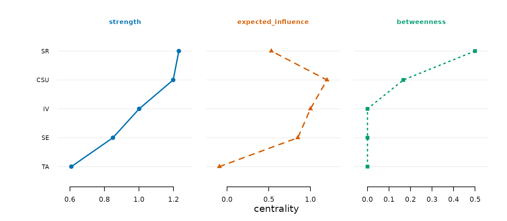
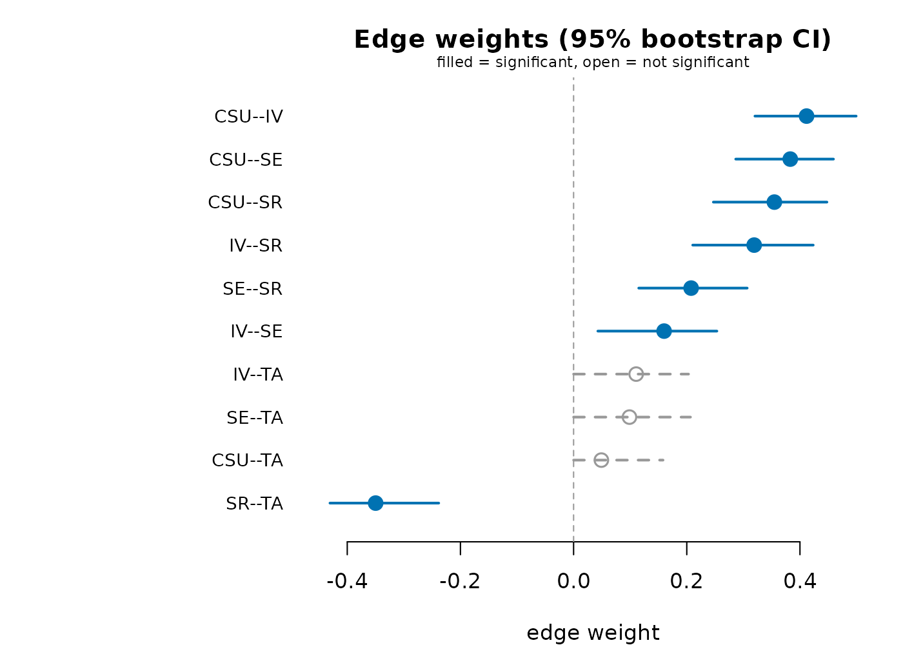
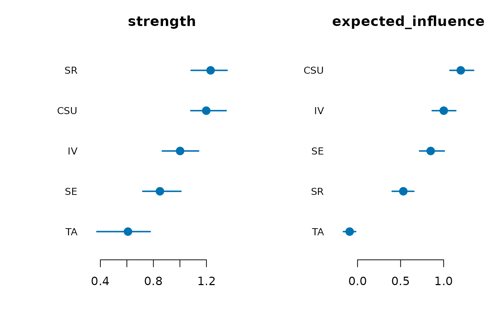
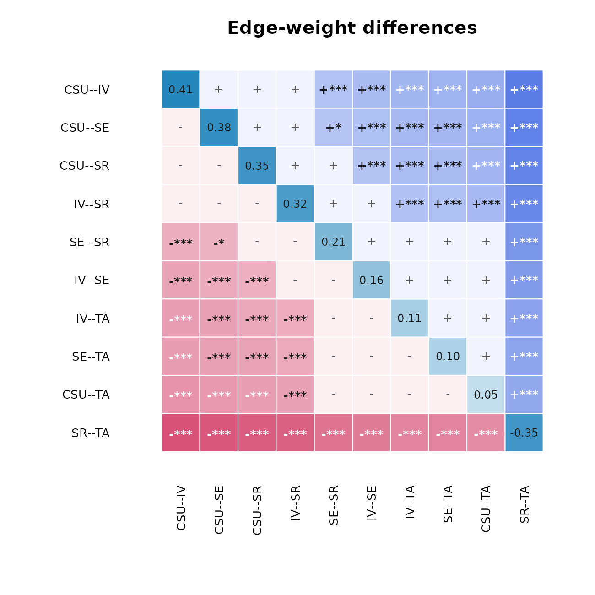
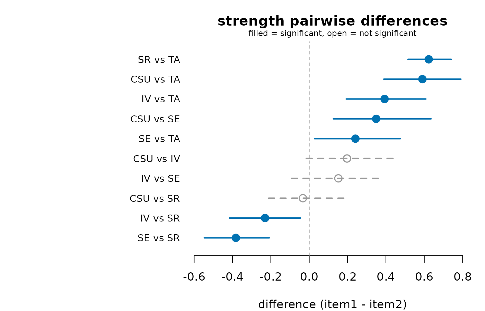
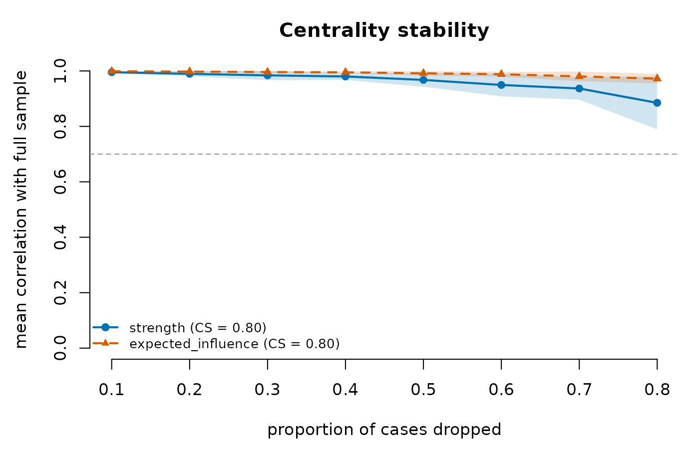

# Visualizing centrality, bootstrap and comparison results

A network diagram may show a striking pattern, but how can researchers
tell which edges are precise and which nodes are comparatively
important? For questionnaire constructs such as motivation and
self-regulated learning, nodes denote measured characteristics and edges
can represent associations adjusted for the other variables. This
focuses attention on relations among constructs rather than on separate
predictors or outcomes (Borsboom et al., 2021). A diagram provides a
useful overview, yet node placement and edge thickness alone cannot
establish estimation precision or comparative prominence. Visualising
centrality, bootstrap and comparison results adds information needed to
interpret those features with appropriate care (Jones et al., 2018).

In education, network methods have been used to examine how learning
processes are connected. Studies have considered the relations among
monitoring events and phases of regulation during collaborative learning
(Malmberg et al., 2022), as well as the temporal and relational dynamics
of self-regulation in academic writing (Saqr et al., 2021). Network
approaches can therefore help researchers investigate how cognitive,
motivational and regulatory processes co-occur or develop together,
without assuming that an observed association demonstrates a causal
effect. Saqr et al. (2024) discuss their use for analysing complex
learning processes and the methodological choices involved.

Interpreting a fitted network requires more than identifying its
visually prominent edges. Centrality measures summarise different
aspects of a node’s position, but their rankings may depend on the
measure used. Bootstrap intervals provide information about estimation
uncertainty, difference tests assess contrasts between edges or nodes,
and case-dropping procedures examine how centrality estimates respond to
changes in the sample (Epskamp et al., 2018). When networks are
estimated for two groups, permutation tests can assess differences in
overall structure, global strength and individual edges (van Borkulo et
al., 2023). Clear figures, paired with numerical results and careful
reporting, help distinguish descriptive patterns from findings supported
by uncertainty assessments (Burger et al., 2023).

This article demonstrates how to visualise and interpret these results
using `psychnets`. It uses five self-regulated learning constructs from
model-generated questionnaire responses to illustrate centrality bar and
line plots, bootstrap intervals, difference matrices and forest plots,
case-dropping stability curves, and network comparison plots. For each
display, the emphasis is on what is plotted, how to read it, and what
the observed results justify. The examples use the
[`plot()`](https://rdrr.io/r/graphics/plot.default.html) method
associated with each result object; the printed tables provide the
values needed for reporting.

``` r

library(psychnets)
```

## Data

`SRL_GPT` contains 300 sets of model-generated responses to the
Motivated Strategies for Learning Questionnaire. Each row contains
construct scores on a scale from 1 to 7, rather than responses from an
individual student. The GPT responses were produced for a study of how
large language models answer psychological questionnaires (Vogelsmeier
et al., 2025). The accompanying `SRL_Claude` data contain 300 responses
generated by another model and are used for the two-group comparison.
These data illustrate the methods; their associations should not be
interpreted as evidence about a population of learners.

- **Nodes:** `CSU` (cognitive strategy use), `IV` (intrinsic value),
  `SE` (self-efficacy), `SR` (self-regulation) and `TA` (test anxiety).
- **Observations:** one row per generated response set; the data are
  complete.

``` r

head(SRL_GPT)
#>        CSU       IV       SE       SR   TA
#> 1 5.307692 5.666667 5.777778 5.333333 4.00
#> 2 5.846154 6.444444 6.000000 5.777778 4.00
#> 3 6.615385 6.666667 6.222222 6.333333 3.25
#> 4 5.692308 6.555556 6.333333 5.555556 4.50
#> 5 4.384615 5.555556 4.888889 4.777778 4.00
#> 6 4.846154 5.444444 5.666667 5.111111 3.50
```

[`ebic_glasso()`](https://pak.dynasite.org/psychnets/reference/ebic_glasso.md)
fits the network used throughout the single-group examples. It estimates
a Gaussian graphical model in which edges represent partial
correlations, with regularisation selected using the extended Bayesian
information criterion. An edge therefore describes a conditional
association, not a causal relation.

``` r

fit <- ebic_glasso(SRL_GPT)
fit
#> <psychnet> glasso network
#>   nodes: 5   edges: 10   (undirected)
#>   lambda: 0.00861   gamma: 0.5
#>   optimality (KKT residual): 2.21e-10
```

The fitted network contains all 10 possible edges among the five
constructs. The companion article on Gaussian graphical models discusses
their interpretation; here the focus is on visualising the associated
summaries and uncertainty estimates.

## Which nodes are most central?

[`net_centralities()`](https://pak.dynasite.org/psychnets/reference/net_centralities.md)
returns one row per node and a column for each requested measure.
Strength adds the absolute values of a node’s edge weights, regardless
of sign. Expected influence adds the signed weights, so positive and
negative associations can offset each other. Betweenness describes the
proportion of shortest paths between other nodes that pass through the
node. These measures answer related but distinct questions, and none
alone identifies a construct as a cause or an intervention target.

``` r

ct <- net_centralities(fit,
                       measures = c("strength", "expected_influence",
                                    "betweenness"))
ct
#>   node  strength expected_influence betweenness
#> 1  CSU 1.1984512         1.19845117   0.1666667
#> 2   IV 1.0012765         1.00127649   0.0000000
#> 3   SE 0.8492185         0.84921854   0.0000000
#> 4   SR 1.2314317         0.53172852   0.5000000
#> 5   TA 0.6082238        -0.09147935   0.0000000
```

Self-regulation has the largest strength (1.231) and betweenness (0.5),
but its negative edge with test anxiety reduces its expected influence
to 0.532, below that of cognitive strategy use (1.198), intrinsic value
(1.001) and self-efficacy (0.849). Only cognitive strategy use and
self-regulation lie on shortest paths between other nodes.
[`plot()`](https://rdrr.io/r/graphics/plot.default.html) draws one panel
per measure, with the nodes sorted by value so that the most central
node is at the top:

``` r

plot(ct)
```


The ordering changes across panels. Self-regulation ranks first for
strength and betweenness, but fourth for expected influence. Thus, a
claim that a node is the most central is incomplete unless the measure
is specified. The bar plots describe the observed values; they do not by
themselves show whether differences in rank are statistically
distinguishable.

## Do the nodes keep their position across measures?

With `type = "line"`, each node is traced across the measures while the
nodes retain a common vertical ordering based on their mean standardised
centrality. Each panel initially uses the scale of its own measure.
Changes in a node’s position across panels make it easier to identify
measures on which that node is relatively prominent or peripheral; the
visual slope should not be treated as a numerical difference between
measures with different units.

``` r

plot(ct, type = "line")
```



The `scale` argument determines how the values are displayed: `"raw"`
(the default) retains the original values, `"z"` standardises each
measure to a mean of 0 and a standard deviation of 1, and `"relative"`
rescales each measure to the range 0 to 1. Standardisation makes
differences in relative position easier to compare across the three
measures, although it does not make the measures conceptually
interchangeable.

``` r

plot(ct, type = "line", scale = "z")
```


Self-regulation changes position markedly: it is highest on strength and
betweenness but much lower on expected influence. Test anxiety has the
lowest strength and expected influence. These profiles help explain why
the choice of centrality measure affects the substantive description of
the same network.

## How precise are the edges?

[`net_boot()`](https://pak.dynasite.org/psychnets/reference/net_boot.md)
repeatedly resamples rows from the data and re-estimates the network,
retaining the resulting edge weights and centrality values. Their
percentile bootstrap intervals summarise sampling uncertainty under this
resampling procedure. More resamples are preferable for a substantive
analysis, often at least 1,000; the example uses 250 to limit
computation. Because these are model-generated response sets, the
resampling units here are rows of generated data rather than human
respondents.

``` r

set.seed(1)
bs <- net_boot(SRL_GPT, method = "glasso", n_boot = 250, cores = 1)
bs
#> <psychnet_bootstrap> glasso, 250 resamples, 95% CI
#>   10 edges (7 significant), 5 nodes, measures: strength, expected_influence
```

Seven of the 10 estimated edges have 95% bootstrap intervals that
exclude zero. The default display places the observed edge weight beside
its interval and sorts the edges by weight. Filled points and solid
intervals identify those that exclude zero; open points and dashed
intervals identify the others. Interval width indicates the precision of
the estimate, while its position relative to zero shows whether that
interval includes values of both signs.

``` r

plot(bs)
```



The intervals for the small positive associations between test anxiety
and intrinsic value, self-efficacy, and cognitive strategy use include
zero. By contrast, the negative association between self-regulation and
test anxiety and the six positive associations among the other four
learning constructs have intervals that exclude zero. This distinguishes
uncertainty about individual edge weights from the mere presence of an
edge in the fitted network.

## How precise is each node’s centrality?

With `type = "centrality"`, the plot displays the observed centrality
estimates and their bootstrap intervals, in separate panels for strength
and expected influence. It allows the reader to consider the uncertainty
around each estimate rather than relying only on its position in the
ranking.

``` r

plot(bs, type = "centrality")
```



``` r

as.data.frame(bs, what = "centrality")
#>   node  strength strength_lower strength_upper expected_influence
#> 1  CSU 1.1984512      1.0817999      1.3489871         1.19845117
#> 2   IV 1.0012765      0.8670417      1.1413809         1.00127649
#> 3   SE 0.8492185      0.7196350      1.0077951         0.84921854
#> 4   SR 1.2314317      1.0840409      1.3565767         0.53172852
#> 5   TA 0.6082238      0.3734560      0.7761419        -0.09147935
#>   expected_influence_lower expected_influence_upper
#> 1                1.0726933               1.34898708
#> 2                0.8670417               1.14138092
#> 3                0.7196350               1.00779507
#> 4                0.4018903               0.65431683
#> 5               -0.1648691              -0.02151559
```

The 95% strength intervals for cognitive strategy use (1.08 to 1.35) and
self-regulation (1.08 to 1.36) overlap almost completely. Test anxiety
has a lower observed strength, with an interval from 0.37 to 0.78. These
displays suggest that the ordering of some nodes is uncertain, but
overlap between separate intervals is not itself a formal test of a
difference. The pairwise results below provide that assessment.

## Which edges and nodes differ from one another?

With `type = "edge_diff"` or `type = "centrality_diff"`, a matrix
compares pairs of edges or centrality values. Items appear on both axes,
ordered by their observed estimates, and the diagonal shows those
estimates. The off-diagonal cells distinguish pairs with evidence of a
difference from pairs without it: red indicates a larger estimate in the
row, blue a smaller estimate, and faint cells indicate no detected
difference. Stars indicate levels of statistical significance. Reading
across a row helps identify which comparisons are supported, rather than
treating the entire rank order as certain.

``` r

plot(bs, type = "edge_diff")
```



``` r

plot(bs, type = "centrality_diff", measure = "strength")
```


The strength matrix shows which observed differences between nodes are
supported by the bootstrap comparisons. The corresponding
[`difference_test()`](https://pak.dynasite.org/psychnets/reference/difference_test.md)
table reports each pair’s values, the observed difference, its interval,
a p-value and a `significant` flag. It also provides the numerical
evidence behind the coloured cells:

``` r

dt <- difference_test(bs, type = "strength")
dt
#>    item1 item2    value1    value2    obs_diff       lower       upper p_value
#> 1    CSU    IV 1.1984512 1.0012765  0.19717467 -0.01516075  0.43862886   0.080
#> 2    CSU    SE 1.1984512 0.8492185  0.34923263  0.12605796  0.63527516   0.000
#> 3     IV    SE 1.0012765 0.8492185  0.15205795 -0.09197932  0.36727209   0.208
#> 4    CSU    SR 1.1984512 1.2314317 -0.03298049 -0.21134715  0.18144546   0.712
#> 5     IV    SR 1.0012765 1.2314317 -0.23015517 -0.41550510 -0.04600301   0.024
#> 6     SE    SR 0.8492185 1.2314317 -0.38221312 -0.54711539 -0.20825524   0.000
#> 7    CSU    TA 1.1984512 0.6082238  0.59022738  0.38908973  0.79088205   0.000
#> 8     IV    TA 1.0012765 0.6082238  0.39305270  0.19311698  0.60820843   0.000
#> 9     SE    TA 0.8492185 0.6082238  0.24099475  0.02772224  0.47534139   0.016
#> 10    SR    TA 1.2314317 0.6082238  0.62320787  0.51502542  0.74080956   0.000
#>    significant
#> 1        FALSE
#> 2         TRUE
#> 3        FALSE
#> 4        FALSE
#> 5         TRUE
#> 6         TRUE
#> 7         TRUE
#> 8         TRUE
#> 9         TRUE
#> 10        TRUE
```

Seven of the 10 pairwise strength comparisons are flagged as
significant. Test anxiety has lower strength than each of the other four
nodes; self-regulation has higher strength than intrinsic value and
self-efficacy; and cognitive strategy use has higher strength than
self-efficacy. The remaining three comparisons are not significant:
cognitive strategy use versus self-regulation (difference -0.033, p =
0.712), cognitive strategy use versus intrinsic value (p = 0.080), and
intrinsic value versus self-efficacy (p = 0.208). The results support
describing test anxiety as lowest in strength, but not identifying a
uniquely highest-strength node.

Calling [`plot()`](https://rdrr.io/r/graphics/plot.default.html) on the
difference-test table produces a matrix by default (`style = "box"`).
This is useful for seeing *which* pairs show evidence of a difference at
a glance.

``` r

plot(dt)
```


With `style = "forest"`, each comparison appears on a separate row,
showing the observed difference and its interval against a dashed
reference line at zero. Comparisons whose intervals exclude zero are
emphasised. Unlike the matrix, the forest plot also conveys the
*magnitude* and direction of the observed differences, together with
their uncertainty.

``` r

plot(dt, style = "forest")
```



## Is the centrality order stable when cases are dropped?

[`net_stability()`](https://pak.dynasite.org/psychnets/reference/net_stability.md)
evaluates how centrality estimates change when progressively larger
proportions of cases are omitted. For each subset, the network is
re-estimated and its centrality values are correlated with those from
the full data. The correlation-stability (CS) coefficient summarises the
largest proportion of cases that can be dropped while a correlation of
at least 0.7 is retained in at least 95% of the subsets. It assesses the
robustness of centrality estimates to case deletion, not the precision
of individual edges.

``` r

st <- net_stability(SRL_GPT, method = "glasso",
                    drop_prop = seq(0.1, 0.8, 0.1), iter = 25)
st
#> <psychnet_stability> glasso, 25 subsets/proportion
#>   CS-coefficient (pearson cor > 0.70 in > 95% of subsets):
#>     strength             0.80
#>     expected_influence   0.80
```

The reported CS-coefficient is 0.80 for both strength and expected
influence, above the recommended value of 0.5 (Epskamp et al., 2018).
This is the highest drop proportion examined here, so the result should
not be extrapolated to larger omissions. The plot shows the proportion
dropped on the horizontal axis and the mean correlation with the
full-sample centrality values on the vertical axis. Each measure has a
line with a band representing one standard deviation, alongside a dashed
threshold. Correlations that remain high as more rows are removed
indicate comparatively stable centrality estimates in this example; the
calculation uses only 25 subsets per proportion.

``` r

plot(st)
```



## Do the networks of two groups differ?

[`net_compare()`](https://pak.dynasite.org/psychnets/reference/net_compare.md)
implements a permutation-based network comparison test (van Borkulo et
al., 2023). The procedure repeatedly shuffles group membership and
re-estimates the two networks, providing reference distributions for the
observed group differences. The network structure statistic, M, is the
largest absolute difference between corresponding edge weights. The
global strength statistic, S, measures the absolute difference between
the groups’ sums of absolute edge weights. The procedure also tests
individual edges. Here the groups comprise GPT-generated and
Claude-generated responses, not samples of students.

``` r

cmp <- net_compare(SRL_GPT, SRL_Claude, iter = 250)
summary(cmp)
#>                test statistic observed     p_value significant
#> 1 network structure         M 0.562165 0.003984064        TRUE
#> 2   global strength         S 1.092696 0.003984064        TRUE
```

Both global tests are significant at the conventional 0.05 level (p =
0.004 for both). The largest absolute edge difference is 0.562. The sum
of absolute edge weights is 1.093 greater in the Claude-response network
(3.537 versus 2.444). The default plot shows the permutation
distribution of S, with the observed statistic indicated and its p-value
in the title. An observed value well into the tail suggests that the
group difference is unusual under random reassignment.

``` r

plot(cmp)
```


The observed global strength difference is approximately 1.09, to the
right of the displayed permutation distribution, whose upper end is
around 0.6. This visualises the small permutation p-value; it does not
identify which edges account for the difference.

With `type = "structure"`, the same display is produced for M, the
largest absolute edge difference. It assesses whether the most
pronounced edge-level discrepancy is unusually large under permutation.

``` r

plot(cmp, type = "structure")
```


With `type = "edges"`, a bar represents the observed absolute difference
for each corresponding edge. Colour indicates whether the edge
comparison is significant at `alpha`, and the title reports how many
edges meet that criterion. The plot therefore complements the two global
tests with a view of where the differences occur.

``` r

plot(cmp, type = "edges")
```


The underlying table gives the weight of each edge in both networks, the
absolute difference, its permutation p-value and the significance
indicator:

``` r

as.data.frame(cmp)
#>    from to    weight_1     weight_2 difference     p_value       p_raw
#> 1   CSU IV  0.41166866  0.001744267 0.40992440 0.003984064 0.003984064
#> 2   CSU SE  0.38290223  0.223973564 0.15892867 0.007968127 0.007968127
#> 3    IV SE  0.15992605 -0.402239002 0.56216505 0.003984064 0.003984064
#> 4   CSU SR  0.35481359  0.728177591 0.37336401 0.003984064 0.003984064
#> 5    IV SR  0.31909443  0.574170376 0.25507595 0.003984064 0.003984064
#> 6    SE SR  0.20767208  0.221496430 0.01382435 0.884462151 0.884462151
#> 7   CSU TA  0.04906668  0.525584044 0.47651736 0.003984064 0.003984064
#> 8    IV TA  0.11058735 -0.013854928 0.12444228 0.131474104 0.131474104
#> 9    SE TA  0.09871818 -0.417575459 0.51629364 0.003984064 0.003984064
#> 10   SR TA -0.34985157 -0.428181457 0.07832989 0.350597610 0.350597610
#>    significant
#> 1         TRUE
#> 2         TRUE
#> 3         TRUE
#> 4         TRUE
#> 5         TRUE
#> 6        FALSE
#> 7         TRUE
#> 8        FALSE
#> 9         TRUE
#> 10       FALSE
```

Seven of the 10 individual edge comparisons are significant. The three
largest absolute differences are `IV`–`SE` (0.160 in GPT versus -0.402
in Claude), `SE`–`TA` (0.099 versus -0.418) and `CSU`–`TA` (0.049 versus
0.526). The first two change sign, whereas the third remains positive
but is substantially larger in the Claude-response network. The
comparisons indicate different patterns in these generated response
sets, not necessarily differences between human learner populations.

## Summary of the plot methods

| Result (verb) | [`plot()`](https://rdrr.io/r/graphics/plot.default.html) options | Question |
|----|----|----|
| [`net_centralities()`](https://pak.dynasite.org/psychnets/reference/net_centralities.md) | `type = "bar"` / `"line"`; `scale = "raw"` / `"z"` / `"relative"` | Which nodes are central, on which measure? |
| [`net_boot()`](https://pak.dynasite.org/psychnets/reference/net_boot.md) | `type = "edges"` / `"centrality"` / `"edge_diff"` / `"centrality_diff"` / `"predictability"` | How precise are edges and centralities, and which differ? |
| [`difference_test()`](https://pak.dynasite.org/psychnets/reference/difference_test.md) | `style = "box"` / `"forest"` | Which pairs differ, and by how much? |
| [`net_stability()`](https://pak.dynasite.org/psychnets/reference/net_stability.md) | one figure | Is the centrality order stable when cases are dropped? |
| [`net_compare()`](https://pak.dynasite.org/psychnets/reference/net_compare.md) | `type = "strength"` / `"structure"` / `"edges"` | Do two networks differ? |

Each display should be interpreted alongside its underlying numerical
results, obtained from the corresponding result object or
[`as.data.frame()`](https://rdrr.io/r/base/as.data.frame.html). In
particular, observed rankings should be distinguished from tested
pairwise differences, and global group differences from edge-specific
findings. The network itself can be drawn with `plot(fit)`, which uses
the `cograph` package and is covered in the article *Visualizing
networks with cograph*.

## How to cite this article

Saqr, M., & López-Pernas, S. (2026). *Visualizing centrality, bootstrap
and comparison results*. psychnets.
<https://doi.org/10.5281/zenodo.24567530> ·
[HTML](https://pak.dynasite.org/psychnets/articles/visualizing-networks.html)
· [PDF](https://pak.dynasite.org/psychnets/pdf/visualizing-networks.pdf)

## References

Borsboom, D., Deserno, M. K., Rhemtulla, M., Epskamp, S., Fried, E. I.,
McNally, R. J., Robinaugh, D. J., Perugini, M., Dalege, J., Costantini,
G., Isvoranu, A.-M., Wysocki, A. C., van Borkulo, C. D., van Bork, R., &
Waldorp, L. J. (2021). Network analysis of multivariate data in
psychological science. *Nature Reviews Methods Primers*, 1, 58.
[doi:10.1038/s43586-021-00055-w](https://doi.org/10.1038/s43586-021-00055-w)

Burger, J., Isvoranu, A.-M., Lunansky, G., Haslbeck, J. M. B., Epskamp,
S., Hoekstra, R. H. A., Fried, E. I., Borsboom, D., & Blanken, T. F.
(2023). Reporting standards for psychological network analyses in
cross-sectional data. *Psychological Methods*, 28(4), 806-824.
[doi:10.1037/met0000471](https://doi.org/10.1037/met0000471)

Epskamp, S., Borsboom, D., & Fried, E. I. (2018). Estimating
psychological networks and their accuracy: A tutorial paper. *Behavior
Research Methods*, 50(1), 195-212.
[doi:10.3758/s13428-017-0862-1](https://doi.org/10.3758/s13428-017-0862-1)

Jones, P. J., Mair, P., & McNally, R. J. (2018). Visualizing
psychological networks: A tutorial in R. *Frontiers in Psychology*, 9,
1742.
[doi:10.3389/fpsyg.2018.01742](https://doi.org/10.3389/fpsyg.2018.01742)

Malmberg, J., Saqr, M., Järvenoja, H., & Järvelä, S. (2022). How the
monitoring events of individual students are associated with phases of
regulation: A network analysis approach. *Journal of Learning
Analytics*, 9(1), 77-92.
[doi:10.18608/jla.2022.7429](https://doi.org/10.18608/jla.2022.7429)

Saqr, M., Beck, E., & López-Pernas, S. (2024). Psychological networks: A
modern approach to analysis of learning and complex learning processes.
In M. Saqr & S. López-Pernas (Eds.), *Learning analytics methods and
tutorials: A practical guide using R* (pp. 639-671). Springer.
[doi:10.1007/978-3-031-54464-4_19](https://doi.org/10.1007/978-3-031-54464-4_19)

Saqr, M., Peeters, W., & Viberg, O. (2021). The relational, co-temporal,
contemporaneous, and longitudinal dynamics of self-regulation for
academic writing. *Research and Practice in Technology Enhanced
Learning*, 16, 29.
[doi:10.1186/s41039-021-00175-7](https://doi.org/10.1186/s41039-021-00175-7)

van Borkulo, C. D., van Bork, R., Boschloo, L., Kossakowski, J. J., Tio,
P., Schoevers, R. A., Borsboom, D., & Waldorp, L. J. (2023). Comparing
network structures on three aspects: A permutation test. *Psychological
Methods*, 28(6), 1273-1285.
[doi:10.1037/met0000476](https://doi.org/10.1037/met0000476)

Vogelsmeier, L. V. D. E., Oliveira, E., Misiejuk, K., López-Pernas, S.,
& Saqr, M. (2025). Delving into the psychology of machines: Exploring
the structure of self-regulated learning via LLM-generated survey
responses. *Computers in Human Behavior*, 173, 108769.
[doi:10.1016/j.chb.2025.108769](https://doi.org/10.1016/j.chb.2025.108769)
