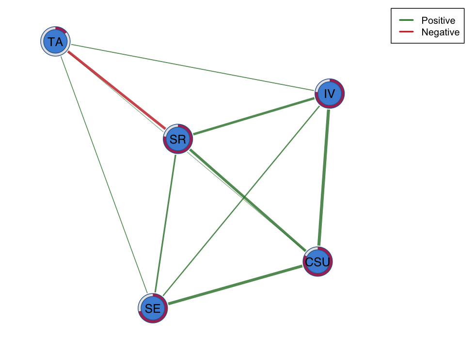
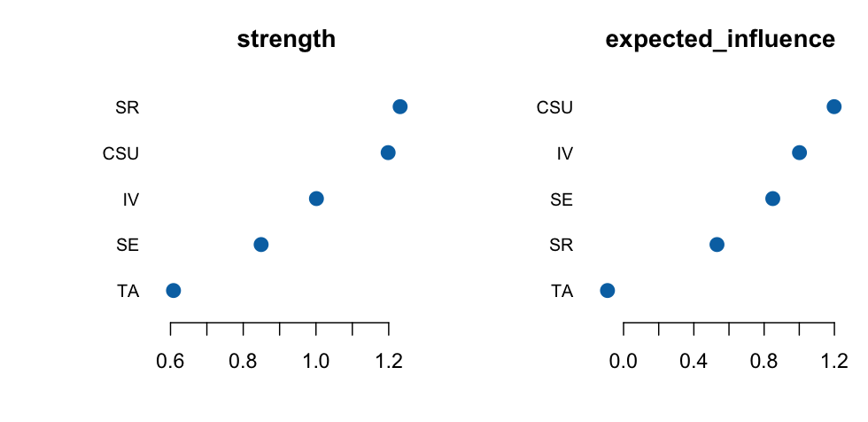
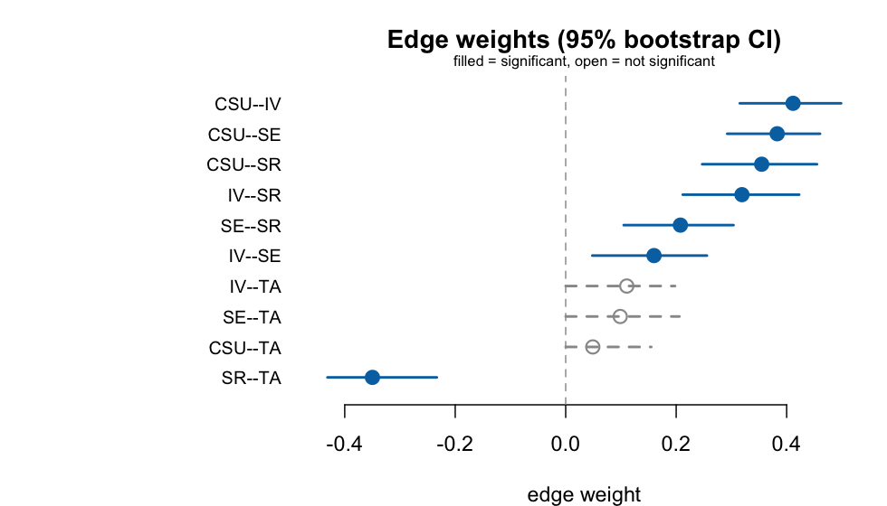

# psychnets

Written by [Mohammed Saqr](https://saqr.me) and [Sonsoles
López-Pernas](https://sonsoles.me)

Provides clean-room implementations for estimating psychometric network
models, including correlation and partial-correlation networks, Gaussian
graphical models with extended Bayesian information criterion (EBIC)
regularization, nonparanormal and stepwise selection variants,
information-filtering networks (the triangulated maximally filtered
graph and the local-global inverse covariance), relative-importance
networks, and Ising and mixed graphical models
([doi:10.3758/s13428-017-0862-1](https://doi.org/10.3758/s13428-017-0862-1);
[doi:10.1007/978-3-031-54464-4_19](https://doi.org/10.1007/978-3-031-54464-4_19)).
All methods are implemented from first principles in base R without
compiled dependencies and return consistent, tidy outputs. Functions are
designed to be transparent and report optimization diagnostics where
applicable. For Gaussian graphical models, the graphical lasso
stationarity (Karush-Kuhn-Tucker) residual quantifies the deviation of
the estimated solution from the optimum of the corresponding convex
optimization problem.

## Overview

`psychnets` estimates psychometric networks and assesses how far they
can be trusted. A psychometric network represents variables such as
questionnaire items, symptoms or behaviours as nodes and the
associations between them as edges; in a partial-correlation network an
edge is the association between two variables that remains once all the
others are taken into account (Epskamp & Fried, 2018). The network shows
which variables are directly related, which hold a central position, and
how the structure differs between groups. The package estimates Gaussian
graphical models (regularized, unregularized and nonparanormal),
information-filtering and relative-importance networks, Ising models for
binary items, mixed graphical models, and the panel graphical VAR for a
few waves of panel data. Each network can be bootstrapped, tested for
the stability of its centralities and the reliability of its edges, and
compared between groups.

Every estimator is written in base R. A regularized fit reports how far
it is from the optimum of its objective
([`certificate()`](https://pak.dynasite.org/psychnets/reference/certificate.md)),
so the network can be checked without a second solver.

## Vignettes and guides

**Vignettes**

- [Gaussian graphical models: estimation and
  interpretation](https://pak.dynasite.org/psychnets/articles/gaussian-graphical-models.html)
- [Stepwise Gaussian graphical model
  selection](https://pak.dynasite.org/psychnets/articles/ggm-model-selection.html)
- [Information-filtering networks with TMFG and
  LoGo](https://pak.dynasite.org/psychnets/articles/information-filtering-networks.html)
- [Relative-importance
  networks](https://pak.dynasite.org/psychnets/articles/relative-importance-networks.html)
- [Ising networks for binary
  data](https://pak.dynasite.org/psychnets/articles/ising-networks.html)
- [Mixed graphical
  models](https://pak.dynasite.org/psychnets/articles/mixed-graphical-models.html)
- [Panel graphical VAR: temporal, contemporaneous, and between-person
  networks](https://pak.dynasite.org/psychnets/articles/panel-graphical-var.html)

**Guides**

- [Regulation networks from Dynalytics event
  data](https://pak.dynasite.org/psychnets/articles/group-networks-from-event-data.html)
- [Edge-weight stability and split-half
  reliability](https://pak.dynasite.org/psychnets/articles/network-reliability.html)
- [Visualizing networks with
  cograph](https://pak.dynasite.org/psychnets/articles/visualizing-with-cograph.html)
- [Visualizing bootstrap, centrality and difference results (base
  R)](https://pak.dynasite.org/psychnets/articles/visualizing-networks.html)

## Installation

``` r

# from CRAN
install.packages("psychnets")

# development version
# install.packages("pak")
pak::pak("mohsaqr/psychnets")
```

## A worked example

`psychnets` estimates an EBIC-regularized Gaussian graphical model from
data or a correlation matrix and reports its certificate on printing.
The example uses `SRL_GPT`, one of the self-regulated-learning datasets
shipped with the package (five MSLQ constructs).

``` r

library(psychnets)

net <- ebic_glasso(SRL_GPT)   # EBIC graphical lasso of the five MSLQ constructs
net                           # edges, lambda, gamma, and the KKT residual
#> <psychnet> glasso network
#>   nodes: 5   edges: 10   (undirected)
#>   lambda: 0.00861   gamma: 0.5
#>   optimality (KKT residual): 2.21e-10

net_centralities(net)         # strength and expected influence, tidy
#>   node  strength expected_influence
#> 1  CSU 1.1984512         1.19845117
#> 2   IV 1.0012765         1.00127649
#> 3   SE 0.8492185         0.84921854
#> 4   SR 1.2314317         0.53172852
#> 5   TA 0.6082238        -0.09147935
```

The network is drawn through
[`cograph::splot()`](https://sonsoles.me/cograph/reference/splot.html):

``` r

cograph::splot(net, layout = "spring", edge_labels = FALSE, legend = TRUE)
```



The certificate is available directly, so the distance of the fit from
the unique optimum of its objective can be read without an external
reference:

``` r

certificate(net)
#>   method  certificate kind certified
#> 1 glasso 2.213347e-10  kkt      TRUE
```

## Models and methods

The estimators, each fitted in base R; the regularized ones report a
certificate
([`certificate()`](https://pak.dynasite.org/psychnets/reference/certificate.md)):

| Verb | Model | Data |
|----|----|----|
| [`cor_network()`](https://pak.dynasite.org/psychnets/reference/cor_network.md) | correlation network (with significance thresholding) | continuous |
| [`pcor_network()`](https://pak.dynasite.org/psychnets/reference/pcor_network.md) | partial-correlation network | continuous |
| [`ebic_glasso()`](https://pak.dynasite.org/psychnets/reference/ebic_glasso.md) | EBIC-regularized Gaussian graphical model (graphical lasso) | continuous |
| [`huge_network()`](https://pak.dynasite.org/psychnets/reference/huge_network.md) | nonparanormal Gaussian graphical model | continuous |
| [`ggm_modselect()`](https://pak.dynasite.org/psychnets/reference/ggm_modselect.md) | unregularized stepwise Gaussian graphical model | continuous |
| [`tmfg_network()`](https://pak.dynasite.org/psychnets/reference/tmfg_network.md) | Triangulated Maximally Filtered Graph | continuous |
| [`logo_network()`](https://pak.dynasite.org/psychnets/reference/logo_network.md) | Local–Global sparse inverse covariance | continuous |
| [`relimp_network()`](https://pak.dynasite.org/psychnets/reference/relimp_network.md) | relative-importance network (LMG / Shapley) | continuous |
| [`ising_fit()`](https://pak.dynasite.org/psychnets/reference/ising_fit.md) | Ising model, L1-penalized | binary |
| [`ising_sampler()`](https://pak.dynasite.org/psychnets/reference/ising_sampler.md) | Ising model, unregularized | binary |
| [`mgm_fit()`](https://pak.dynasite.org/psychnets/reference/mgm_fit.md) | mixed graphical model | Gaussian + binary; multi-level categorical with `native = FALSE` |
| [`panel_gvar()`](https://pak.dynasite.org/psychnets/reference/panel_gvar.md) | panel graphical VAR: temporal, contemporaneous, and between-person networks (stationary random-intercept VAR(1), maximum likelihood; every edge with SE and p-value by default; optional Wald pruning + step-up, or EBIC lasso) | continuous panel data, 3+ waves |
| [`psychnet()`](https://pak.dynasite.org/psychnets/reference/psychnet.md) | unified front door routing the cross-sectional estimators above | — |

The framework verbs operate on any fitted network, and on event logs and
grouped data through
[`psychnet()`](https://pak.dynasite.org/psychnets/reference/psychnet.md):

| Verb | Purpose |
|----|----|
| [`net_centralities()`](https://pak.dynasite.org/psychnets/reference/net_centralities.md), [`net_bridge()`](https://pak.dynasite.org/psychnets/reference/net_bridge.md), [`net_edge_betweenness()`](https://pak.dynasite.org/psychnets/reference/net_edge_betweenness.md) | node, bridge, and edge centrality |
| [`net_clustering()`](https://pak.dynasite.org/psychnets/reference/net_clustering.md), [`net_smallworld()`](https://pak.dynasite.org/psychnets/reference/net_smallworld.md) | weighted clustering coefficients and the small-world index |
| [`net_predict()`](https://pak.dynasite.org/psychnets/reference/net_predict.md) | node predictability (variance explained; classification accuracy) |
| [`net_boot()`](https://pak.dynasite.org/psychnets/reference/net_boot.md), [`difference_test()`](https://pak.dynasite.org/psychnets/reference/difference_test.md) | bootstrapped accuracy and within-network difference tests |
| [`net_stability()`](https://pak.dynasite.org/psychnets/reference/net_stability.md), [`net_casedrop_reliability()`](https://pak.dynasite.org/psychnets/reference/net_casedrop_reliability.md), [`net_split_reliability()`](https://pak.dynasite.org/psychnets/reference/net_split_reliability.md) | case-dropping stability and split-half reliability |
| [`net_compare()`](https://pak.dynasite.org/psychnets/reference/net_compare.md) | the permutation Network Comparison Test |
| [`redundancy()`](https://pak.dynasite.org/psychnets/reference/redundancy.md), [`net_aggregate()`](https://pak.dynasite.org/psychnets/reference/net_aggregate.md) | redundant-node detection and community aggregation |

[`psychnet()`](https://pak.dynasite.org/psychnets/reference/psychnet.md)
additionally constructs networks directly from **event logs** — one row
per action — computing action frequencies and separating within- from
between-actor variation, and estimates a **separate network per group**
on request. Every fitted network inherits the `cograph` plotting
classes, and each result object carries a base-`graphics`
[`plot()`](https://rdrr.io/r/graphics/plot.default.html) method.

Node centrality plots directly from its result object:

``` r

plot(net_centralities(net))
```



[`net_boot()`](https://pak.dynasite.org/psychnets/reference/net_boot.md)
resamples the data, re-estimates, and returns bootstrapped edge-weight
confidence intervals; edges whose interval excludes zero are drawn in
the accent colour:

``` r

set.seed(1)
plot(net_boot(SRL_GPT, method = "glasso", n_boot = 500), type = "edges")
```



## Implementation and certificates

Every estimator is written in base R. The only package dependencies are
*stats*, *parallel*, *graphics* and *grDevices*; the compiled solvers of
*glasso* and *glmnet*, which *qgraph*, *bootnet*, *IsingFit* and *mgm*
call, are not used.

A fitted network carries its own check. For a Gaussian graphical model,
[`certificate()`](https://pak.dynasite.org/psychnets/reference/certificate.md)
reports (and
[`glasso_kkt()`](https://pak.dynasite.org/psychnets/reference/glasso_kkt.md)
computes) the stationarity residual of the graphical-lasso objective;
because that objective is strictly convex its minimizer is unique, so a
near-zero residual shows that the network is the optimum, with no
reference solver involved. The nodewise Ising and mixed graphical models
are checked the same way through the penalized-likelihood score
residual. Because each fit is solved to stationarity before the EBIC is
computed, no edge is selected only because the optimization stopped
early. A network changed after fitting, by a threshold or by pruning,
reports `NA`, and printing it shows the residual of the fit before the
change. External packages (`qgraph`, `IsingFit`, `mgm`, `bootnet`) serve
as cross-checks, not as the definition of a correct fit.

## Validation

`psychnets` is checked against the established reference packages in two
ways, both reproducible from a fixed set of package versions. For the
EBIC graphical lasso, the comparison limit is set by the convergence
criterion of the *glasso* implementation used by *qgraph*, about 1e-4;
`psychnets` solves its own optimization to tighter tolerances.

### Estimator equivalence versus the reference packages

Each model is fitted by `psychnets` and its reference package on the
same data. The table reports the observed comparison criterion; it is
not a claim that every independent implementation returns numerically
identical weights.

| `psychnets` estimator | Reference package | Data | Observed difference |
|----|----|----|----|
| [`ebic_glasso()`](https://pak.dynasite.org/psychnets/reference/ebic_glasso.md) | [`qgraph::EBICglasso`](https://rdrr.io/pkg/qgraph/man/EBICglasso.html) 1.9.8 | AR(1) chain, *n* = 1000, *p* = 8 | edge set identical; max \|Δ\| = 2.2e-06; KKT = 1.5e-10 |
| [`ising_fit()`](https://pak.dynasite.org/psychnets/reference/ising_fit.md) | [`IsingFit::IsingFit`](https://rdrr.io/pkg/IsingFit/man/isingfit.html) 0.4 | AR(1) latent, *n* = 2000, *p* = 6, binarized | edge set identical; max \|Δ\| = 4.6e-03; threshold *r* = 1.000 |
| [`mgm_fit()`](https://pak.dynasite.org/psychnets/reference/mgm_fit.md) | [`mgm::mgm`](https://rdrr.io/pkg/mgm/man/mgm.html) 1.2.15 | mixed Gaussian + binary, *n* = 3000, *p* = 4 | edge set identical; max \|Δ\| = 1.6e-03; KKT = 1.1e-09 |
| [`panel_gvar()`](https://pak.dynasite.org/psychnets/reference/panel_gvar.md) | [`psychonetrics::panelgvar`](https://rdrr.io/pkg/psychonetrics/man/panelvar_family.html) 0.17.8 (+ `prune`; `stepup` supports also identical) | stationary panel, *n* = 400, *p* = 3, 4 waves | pruned edge set identical; max \|Δ\| = 1.4e-04 (psychonetrics’ stopping tolerance: its gradient 6.8e-04, ours 3.0e-13); psychnets reaches a lower ML objective (by 5.7e-08) |
| [`cor_auto()`](https://pak.dynasite.org/psychnets/reference/cor_auto.md) | [`psych::polychoric`](https://rdrr.io/pkg/psych/man/tetrachor.html) / [`qgraph::cor_auto`](https://rdrr.io/pkg/qgraph/man/cor_auto.html) | four-level Likert, *n* = 1000, *p* = 4 | max \|Δ\| = 2.0e-05 (psych), 1.7e-07 (qgraph) |
| `.pbivnorm()` (bivariate normal CDF) | [`mvtnorm::pmvnorm`](https://rdrr.io/pkg/mvtnorm/man/pmvnorm.html) 1.2 | five (*h*, *k*, *ρ*) points | max \|Δ\| = 5.6e-17 |

### Validation databases (published instruments)

On real questionnaire and ability data the `psychnets` EBIC graphical
lasso reproduces the `qgraph` edge set exactly — structure agreement
equals 1 on every instrument, with a largest edge-weight difference of
0.008 — and the Ising model matches `IsingFit` on binary batteries. The
instruments, all loaded from installed CRAN packages so the comparison
downloads nothing:

| Instrument | Source | Items | *n* | Reference | max \|Δ\| |
|----|----|----|----|----|----|
| [`qgraph::big5`](https://rdrr.io/pkg/qgraph/man/big5.html) | Dolan, Oort, Stoel & Wicherts (2009) | 240 | 500 | qgraph | 3.6e-05 |
| [`psych::bfi`](https://rdrr.io/pkg/psych/man/bfi.html) | Revelle, Wilt & Rosenthal (2010) | 25 | 2760 | qgraph | 3e-06 |
| [`psych::sat.act`](https://rdrr.io/pkg/psych/man/sat.act.html) | Revelle (psych) | 6 | 700 | qgraph | 2e-06 |
| `psychTools::msq` | Revelle & Anderson (1998) | 50 | 3876 | qgraph | 1.2e-05 |
| `psychTools::epi.bfi` | Eysenck & Eysenck (1964) | 13 | 231 | qgraph | 8.0e-03 |
| `psychTools::epi` | Eysenck Personality Inventory | 50 | 3476 | qgraph | 6e-06 |
| `psychTools::sai` | Spielberger State Anxiety | 22 | 5282 | qgraph | 3.5e-05 |
| `psychTools::tai` | Spielberger Trait Anxiety | 21 | 3016 | qgraph | 7e-06 |
| `psychTools::spi` | Condon (2018), SAPA Inventory | 50 | 4000 | qgraph | 1.6e-05 |
| `psychTools::blot` | Bond’s Logical Operations Test | 35 | 150 | qgraph | 0 |
| [`mgm::Fried2015`](https://rdrr.io/pkg/mgm/man/datasets.html) | Fried et al. (2015) | 11 | 515 | qgraph | 8e-06 |
| [`mgm::PTSD_data`](https://rdrr.io/pkg/mgm/man/datasets.html) | McNally et al. (2015) | 6 | 344 | qgraph | 1.9e-05 |
| [`mgm::B5MS`](https://rdrr.io/pkg/mgm/man/datasets.html) | Haslbeck & Waldorp (mgm) | 5 | 500 | qgraph | 0 |
| [`mgm::symptom_data`](https://rdrr.io/pkg/mgm/man/datasets.html) | Haslbeck & Waldorp (mgm) | 48 | 1476 | qgraph | 1.5e-05 |
| `NetworkToolbox::neoOpen` | Christensen, Cotter & Silvia (2019) | 48 | 802 | qgraph | 4e-06 |
| [`networktools::depression`](https://rdrr.io/pkg/networktools/man/depression.html) | Jones (networktools) | 9 | 1000 | qgraph | 6.5e-05 |
| [`networktools::social`](https://rdrr.io/pkg/networktools/man/social.html) | Jones (networktools) | 16 | 350 | qgraph | 7e-06 |
| `EGAnet::optimism` | Golino & Christensen (EGAnet) | 10 | 272 | qgraph | 6e-06 |
| `EGAnet::intelligenceBattery` | Golino & Christensen (EGAnet) | 50 | 1152 | qgraph | 2.2e-05 |
| `psychTools::ability` | Revelle; ICAR ability items | 16 | 1248 | IsingFit | 5.9e-02 |
| `psychTools::iqitems` | Condon & Revelle; ICAR | 11 | 1523 | IsingFit | 1.2e-02 |

Where the truth is known — data drawn from a known sparse precision
matrix — the `psychnets` and `qgraph` estimators recover the generating
structure at the same F-measure. The full derivation, the worked
graphical-lasso case, and the complete tables are given in the package’s
technical report.

## Citation

If you use psychnets in your research, please cite
(`citation("psychnets")`):

> Saqr, M., & López-Pernas, S. (2026). *psychnets: Tidy clean-room
> psychological network modeling* (R package).
> <https://CRAN.R-project.org/package=psychnets>

Saqr, M., & López-Pernas, S. (2026). *Estimating and interpreting
Gaussian graphical models with the psychnets R package*. psychnets.
<https://doi.org/10.5281/zenodo.24569494> ·
[HTML](https://pak.dynasite.org/psychnets/articles/gaussian-graphical-models.html)
·
[PDF](https://pak.dynasite.org/psychnets/pdf/gaussian-graphical-models.pdf)

Saqr, M., & López-Pernas, S. (2026). *Stepwise Gaussian graphical model
selection with the psychnets R package*. psychnets.
<https://doi.org/10.5281/zenodo.24569495> ·
[HTML](https://pak.dynasite.org/psychnets/articles/ggm-model-selection.html)
· [PDF](https://pak.dynasite.org/psychnets/pdf/ggm-model-selection.pdf)

Saqr, M., & López-Pernas, S. (2026). *TMFG and LoGo
information-filtering networks with the psychnets R package*. psychnets.
<https://doi.org/10.5281/zenodo.24569497> ·
[HTML](https://pak.dynasite.org/psychnets/articles/information-filtering-networks.html)
·
[PDF](https://pak.dynasite.org/psychnets/pdf/information-filtering-networks.pdf)

Saqr, M., & López-Pernas, S. (2026). *Relative-importance networks with
the psychnets R package*. psychnets.
<https://doi.org/10.5281/zenodo.24569501> ·
[HTML](https://pak.dynasite.org/psychnets/articles/relative-importance-networks.html)
·
[PDF](https://pak.dynasite.org/psychnets/pdf/relative-importance-networks.pdf)

Saqr, M., & López-Pernas, S. (2026). *Ising networks for binary data
with the psychnets R package*. psychnets.
<https://doi.org/10.5281/zenodo.24569498> ·
[HTML](https://pak.dynasite.org/psychnets/articles/ising-networks.html)
· [PDF](https://pak.dynasite.org/psychnets/pdf/ising-networks.pdf)

Saqr, M., & López-Pernas, S. (2026). *Mixed graphical models with the
psychnets R package*. psychnets.
<https://doi.org/10.5281/zenodo.24569499> ·
[HTML](https://pak.dynasite.org/psychnets/articles/mixed-graphical-models.html)
·
[PDF](https://pak.dynasite.org/psychnets/pdf/mixed-graphical-models.pdf)

Saqr, M., & López-Pernas, S. (2026). *Panel graphical VAR with the
psychnets R package: Temporal, contemporaneous, and between-person
networks*. psychnets. <https://doi.org/10.5281/zenodo.24569500> ·
[HTML](https://pak.dynasite.org/psychnets/articles/panel-graphical-var.html)
· [PDF](https://pak.dynasite.org/psychnets/pdf/panel-graphical-var.pdf)

Saqr, M., & López-Pernas, S. (2026). *Networks of regulation actions
from event logs with the psychnets R package*. psychnets.
<https://doi.org/10.5281/zenodo.24569496> ·
[HTML](https://pak.dynasite.org/psychnets/articles/group-networks-from-event-data.html)
·
[PDF](https://pak.dynasite.org/psychnets/pdf/group-networks-from-event-data.pdf)

Saqr, M., & López-Pernas, S. (2026). *Edge-weight stability and
split-half reliability with the psychnets R package*. psychnets.
<https://doi.org/10.5281/zenodo.24569505> ·
[HTML](https://pak.dynasite.org/psychnets/articles/network-reliability.html)
· [PDF](https://pak.dynasite.org/psychnets/pdf/network-reliability.pdf)

Saqr, M., & López-Pernas, S. (2026). *Visualizing networks with cograph
and the psychnets R package*. psychnets.
<https://doi.org/10.5281/zenodo.24569502> ·
[HTML](https://pak.dynasite.org/psychnets/articles/visualizing-with-cograph.html)
·
[PDF](https://pak.dynasite.org/psychnets/pdf/visualizing-with-cograph.pdf)

Saqr, M., & López-Pernas, S. (2026). *Visualizing centrality, bootstrap
and comparison results with the psychnets R package*. psychnets.
<https://doi.org/10.5281/zenodo.24569506> ·
[HTML](https://pak.dynasite.org/psychnets/articles/visualizing-networks.html)
· [PDF](https://pak.dynasite.org/psychnets/pdf/visualizing-networks.pdf)

## Learn more

- **Articles** — worked tutorials for the Gaussian graphical, stepwise
  model-selection, information-filtering, Ising, mixed, and
  relative-importance models, the panel graphical VAR (temporal,
  contemporaneous, and between-person networks from panel data), network
  reliability, building networks from event data, and plotting with
  `cograph`.
- **Website** — <https://pak.dynasite.org/psychnets>
- **Source** — <https://github.com/mohsaqr/psychnets>
